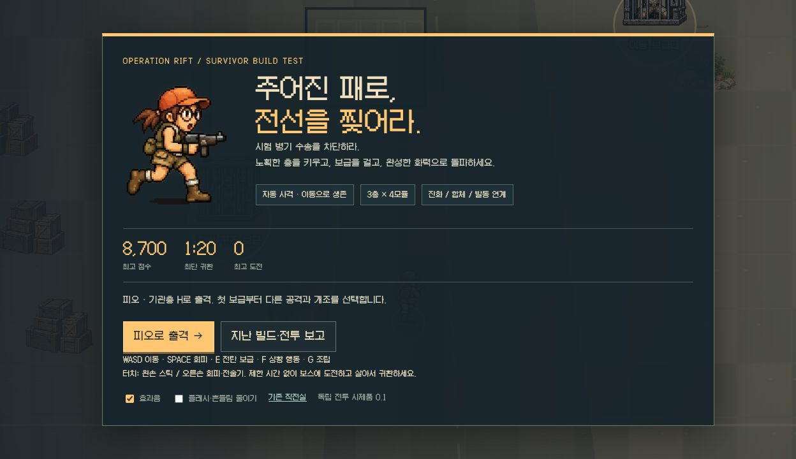

<h1 align="center">★ 서바이버 작전실</h1>
<p align="center"><strong>RIFT · 빌드 서바이버 실험</strong><br>노획한 패로 화력을 완성하고, 거대 병기를 돌파하라.<br>피오 독립 전투 시제품과 기존 BREAKWATER 공개본을 함께 보관합니다.</p>
<p align="center">
<a href="https://github.com/yu-reka/woodland-survivors/actions/workflows/pages.yml"></a>


</p>
<p align="center"><a href="docs/REBOOT-DESIGN.md"><strong>새 게임 설계</strong></a> · <a href="docs/REBOOT-PROTOTYPE.md">실제 구현·검증 범위</a> · <a href="https://yu-reka.github.io/woodland-survivors/">▶ 기존 공개본 0.15.1</a></p>



### 새 구현 · RIFT 빌드 서바이버 시제품

**메가봉크·Pokémon Survivor Burst의 빌드 성장과 선택을 참고하고, 메탈슬러그의 대원·적진 침투·거대 병기 파괴를 표현으로 삼습니다.** 피오·H/R/F·공격 3칸·모듈 4칸을 독립 전투 모델로 구현했습니다. 새 패 획득 → 투자 → 안전 보급/위험 습격 → 진화·합체·발동 연계 → 보스 → 귀환/잔류를 실험합니다.

`npm run dev` 후 **http://127.0.0.1:5200/reboot.html**에서 실행합니다. [방향 재점검·실제 구현·검증 한계](docs/REBOOT-PROTOTYPE.md) · [전체 게임 설계](docs/REBOOT-DESIGN.md) · [공식 자료 조사](docs/REBOOT-REFERENCE-ANALYSIS.md)

기존 두 총·3단 강화·고정 합체 모델을 가져오지 않았습니다. 첫 두 보급의 새 총, L4 분화, 조율권의 기회비용과 도박 보급으로 다른 투자 경로를 만듭니다. 시제품은 독립 기록을 쓰며 기존 크레딧·연구·저장을 바꾸지 않습니다. **마르코·세 구역·새 연구 경제는 확장 범위이며 아직 새 게임에 구현하지 않았습니다.**

**실제 인앱 브라우저에서 두 빌드로 보스 격파와 생존 귀환을 확인했습니다.** 사중 기관포는1:20·171처치·6,910점, 전도 H+R은2:13·364처치·8,700점입니다. 다중 표적 배분·적중 지점 합체 격발·전장 지도·같은 품질의 보급 재추첨을 보강했습니다. [실제 완주·모바일·검사 기록](docs/VALIDATION-REBOOT-V002.md). 규칙281개와 모델12판은 통과했고, 사람의 자유 선택과 재출격 재미는 별도 검증 대상입니다.

세부 계약: [성장·후보·습격·정산·저장](docs/REBOOT-RULES.md) · [전투·맵·보스 수치](docs/REBOOT-COMBAT.md) · [화면 흐름·수용 기준](docs/REBOOT-UX-QA.md). **아래는 현재 공개 배포본 0.15.1의 설명입니다.** 기본 GitHub Pages 주소는 새 시제품으로 교체하지 않았습니다.

### 준비 → 전투 → 정산 → 연구 → 재출격

**무엇을 위해 싸우나요?** 포로와 시험 병기를 탈환하고 지휘전차를 파괴합니다. 구출·거점·처치·보스 부위 파괴가 보급 크레딧과 기록으로 돌아옵니다. 전투를 중단하거나 쓰러져도 확보한 성과를 정산합니다.

| 기지에서 | 전장에서 | 귀환한 뒤 |
| :-- | :-- | :-- |
| 마르코 / 피오와 교범 선택 | 포로 경비 제압 → 총기 보급 | 수당·첫 보고·첫 완주 정산 |
| 상한 있는 기초 훈련 | XP로 무기 3단계 → 핵심으로 진화 | 조건 달성한 개조 연구 |
| 성과로 새 개조 해금 | H + R 최종 합체 / 선택 Slug 노획 | 연구 개조를 새 판에서 선택 |
| 다음 목표·최고 기록 확인 | 준비되면 직접 지휘전차에 도전 | 다른 대원·교범·과밀 도전 |

**보스를 잡아도 자동으로 다음 맵에 가지 않습니다.** 전술 보급을 받고 **다음 미션 진입 / 현재 맵 잔류**를 직접 고릅니다. 잔류하면 XP와 추가 점수를 계속 얻고 20초마다 증원이 강해집니다. 출구에서 언제든 진입을 다시 결정할 수 있습니다. 최종 보스 뒤에도 잔류하거나 살아서 귀환해 완주 정산합니다. 무장·XP·전술 지원은 끝까지 유지합니다. 시간이나 처치 수로 관문을 잠그지 않으며 각 전선 보스에게 바로 도전할 수도 있습니다.

탑승 중에는 **대원 HP와 Slug 차체 내구를 분리**합니다. 피격은 차체가 받고, 내구 0이면 HP 손실 없이 긴급 이탈합니다.

시간이 지나면 자동 실패하는 규칙은 없습니다. 진화 핵심은 수용소·수송대·후방 포로에서 얻습니다. 빈 지원 슬롯의 보급은 두 종류 총을 함께 제시하므로 합체 재료를 직접 선택할 수 있습니다.

### 세 전선의 한 판

| 전선 | 전투와 판단 | 다음 전투의 변화 |
| :-- | :-- | :-- |
| 해안 침투 | 구출·두 차례 호위대 → 장갑 수송차 | 관통 탄두 / 합체 조립선 / 기갑 지원 선택 |
| 철도 보급선 | 선택한 빌드로 보급선·포격대 돌파 | 35처치 연계 포격 / 정비 / 연구 개조 수령 |
| 항구 총공세 | 완성 무기로 고밀도 추격대 섬멸 | 관제소에서 보스 포격 교란 또는 시험 탄약 선택 → 지휘전차 |

포격 진지는 철도와 항구 모두 선택 목표입니다. 더 강한 화력과 안전한 보스 공략 중 하나를 고를 수 있습니다. Slug 지원은 다음 차고 한 번을 확보하고, 내구 160·짧은 주포 재사용을 제공합니다.

### 두 대원, 다른 성장

| | 마르코 | 피오 |
| :-- | :-- | :-- |
| 시작 무장 | 권총 P | 기관총 H |
| 고유 성장 | 같은 표적 연속 적중 → 집중 3단계 | 사격·처치·보급 → 강화 탄창 충전 |
| 전술기 E | 관통 집중 사격 | 두 무기 강화 사격 |
| 주력 완성 예 | P 진화 / P+S 레일 브리처 | H+R 미사일 / F+R 네이팜으로 전환 |
| 재도전 해금 | P 진화로 완주 → 산개 교범 | 강화 중 누적 300처치 → 신속 교범 |

P·H·R·S·F 모두 진화할 수 있습니다. 기본 총 3단계 두 개와 핵심으로 **H+R 미사일, P+S 관통 파쇄, F+R 소이 병기**를 조립합니다. 가득 찬 무장은 새 총을 고른 뒤 교체 슬롯을 선택하거나 취소할 수 있습니다. 연구는 P 관통 분열·H 도탄·R 점화 탄두·P 약점 파열·H 축전 탄창·S 플레셰트·F 촉매 연료·R 전도 탄두 후보를 영구 해금합니다. 새로 연구한 개조는 해당 총을 1단계 이상 강화하면 첫 적합한 성장 후보에 등장합니다. 매판 총기와 XP는 다시 성장시키며, 완성 무기를 기지에서 구매하지 않습니다.

중간 보스 격파·합체 실적으로 새로운 연구를 열고, 세 전선 돌파·완성 화력 900처치·합체 완주·P+S/F+R 실증의 지령으로 최초 보상을 받습니다. 800처치 이후에도 구간별 수당과 점수가 증가합니다. 기지에서 최근 보고서와 병영의 남은 지령을 볼 수 있습니다.

전장은 보병·방패병·박격포병·증원 장교로 구성했습니다. 장갑 수송차는 돌진 뒤 **후면 엔진**, 철도 포격대는 **좌우 포대와 안전 통로**, 지휘전차는 **부위 파괴 뒤 노출 코어**가 공략 대상입니다. 연구를 섞으면 화상 대상에 산탄·폭발이 강해지고, 로켓 표식에 관통탄이 강해집니다. 진화·합체에는 주변 폭발, 관통·다탄두·유도탄, 적 경직과 짧은 타격 정지를 적용했습니다.

### 조작

| 행동 | 키보드 | 모바일 |
| :-- | :-- | :-- |
| 이동 | WASD · 방향키 | 왼쪽 스틱 |
| 회피 | Space | 오른쪽 작은 버튼 |
| 대원 전술기 / Slug 주포 | E | 오른쪽 큰 버튼 |
| 탑승·하차·보스 진입 | F | 상황 버튼 |
| 목표 선택 | M | 미니맵 아래 버튼 |
| 성장 선택 | 1 · 2 · 3 / 클릭 | 카드 터치 |
| 일시정지 | Esc | 상단 Ⅱ |

공격은 자동입니다. 성장 선택·지도·일시정지는 전투를 멈춥니다. 5초마다 진행을 저장하고 선택·일시정지에서도 저장합니다. 기지에 저장된 작전을 이어가거나 확보 성과를 정산할 수 있습니다. 저장 공간 오류가 나면 구매·정산을 확정하지 않고 재시도 화면을 표시합니다. 브라우저·사이트별 로컬 저장이며 기기 간 동기화는 없습니다.

### 현재 범위와 확인할 것

0.15는 **해안·철도·항구의 세 미션을 선택해 이어가는 개발 버전**입니다. 클리어 뒤 잔류에서 더 성장하고 점수를 벌거나, 무장과 내구를 유지하고 다음 맵으로 이동합니다. 최고 시간과 최고 점수를 각각 기록합니다. [진입·잔류 기획과 규칙](docs/MISSION-LOOP-V015.md)을 기준으로 구현했습니다.

초기 계정 자동 입력 8판, 합체 경로 12판, 맵별 90초 이상 잔류 8판을 검증했습니다. 이는 진행·성장·기록의 검증이며 사람의 재미를 증명하지 않습니다. 390·320px 문서 프레임에서 진입/잔류 UI와 출구 재선택을 확인했습니다. 실기기 두 손 조작·장기 체감 난도는 추가 플레이 테스트 대상입니다. 기지 재화·연구는 유지하며 0.14 진행 중 판은 확보 성과를 정산한 뒤 새 규칙으로 출격합니다.

### 로컬 실행

Node.js 20 이상. 외부 런타임 패키지 없이 실행합니다.

```sh
git clone https://github.com/yu-reka/woodland-survivors.git
cd woodland-survivors
npm run dev
```

**http://127.0.0.1:5200/**

| 명령 | 용도 |
| :-- | :-- |
| `npm test` | 기존 게임·작전 + 새 독립 시제품 281개 검사 |
| `npm run test:reboot` | 새 전투·후보·조립·도박·저장 39개 검사 |
| `node scripts/reboot-pilot.mjs --all` | 새 전투의 세 투자 경로 × 4시드 정상 입력 파일럿 |
| `npm run test:mission` | 작전·경제·저장·진화 검사 76개 |
| `node scripts/mission-pilot.mjs --summary` | 초기 계정 8회 전체 보급 경로 주행 |
| `node scripts/mission-pilot.mjs --holdout --hold-seconds=90 --max-seconds=900 --summary` | 각 맵 장기 잔류 → 출구 복귀 → 귀환 8판 |
| `node scripts/mission-pilot.mjs --builds --summary` | 3합체 × 2대원 × 2시드 12회 주행 |
| `node scripts/mission-pilot.mjs --journey` | 실제 정산·구매를 연결하는 연구 여정 5판 |
| `npm run build` | 정적 배포 파일 생성 |
| `npm run test:pages` | 저장소 하위 경로·자산·모듈 버전 검사 |
| `npm run preview` | `http://127.0.0.1:5201/woodland-survivors/` |

`src/reboot/`는 새 시제품의 모델·화면·렌더·저장을 소유하고, `src/mission/`는 기존 공개 작전을 소유합니다. 빌드는 `reboot.html`도 포함하며 Pages 하위 경로에서 모듈·폰트 의존성을 검사합니다. 새 격납고 배경과 환경 소품, 금속 상자 UI는 기존 캐릭터 원화와 연결했습니다. 기존 원정의 전투 모델을 가져오지 않고 오디오·터치 입력만 재사용합니다. `main` 푸시 시 [GitHub Actions](.github/workflows/pages.yml)가 검사 → 빌드 → Pages 검사 → 배포를 실행합니다. `dist/`는 커밋하지 않습니다. 포크 배포는 **Settings → Pages → Source → GitHub Actions**입니다.

### 이전 실험

- [다람쥐 2분 전투](https://yu-reka.github.io/woodland-survivors/prototype.html) · [0.11 기록](docs/VALIDATION-V011.md)
- [기존 숲 원정](https://yu-reka.github.io/woodland-survivors/woodland.html) · [원정 기획](docs/GAME-DESIGN.md)

별도 주소에서 기존 원화·게임을 보존했습니다. 저장 키도 분리했습니다.

메탈슬러그 캐릭터·설정에서 착안한 비공식 팬 시제품입니다. 게임에서 추출한 자산·코드는 사용하지 않았습니다. [차체·포탑 분리 아트와 프롬프트](docs/MISSION-ART-V015.md) · [새 격납고·환경 아트와 프롬프트](docs/MISSION-ART-V014.md) · [기존 아트 기록](docs/ART-PROVENANCE.md). 코드·아트 재사용 라이선스는 아직 정하지 않았습니다. Galmuri는 동봉된 [SIL OFL 1.1](public/fonts/woodland/LICENSE.txt)을 따릅니다.
