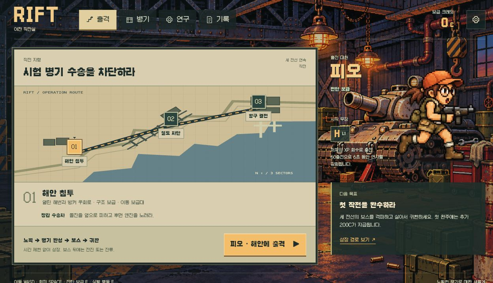
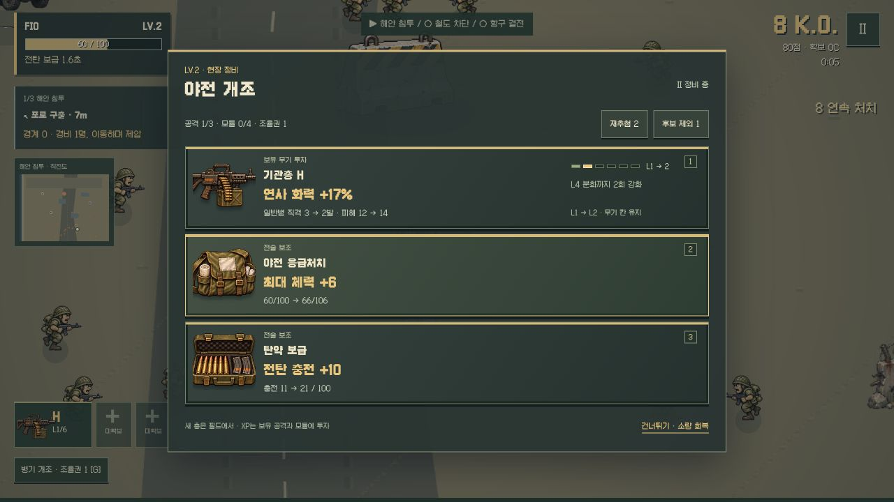
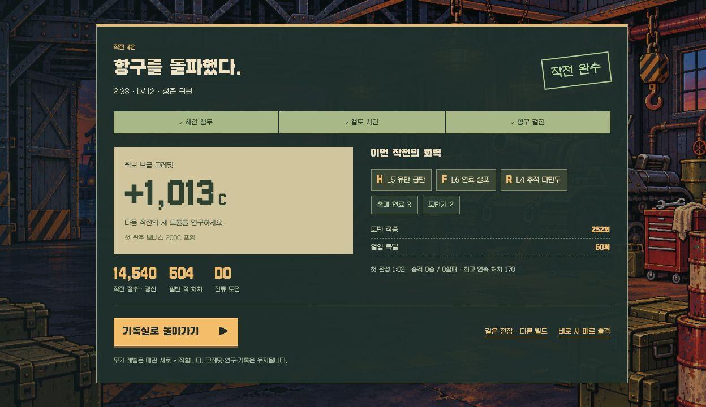

<h1 align="center">OPERATION RIFT</h1>
<p align="center"><strong>적의 병기로, 항구를 돌파하라.</strong><br>노획 · 성장 · 진화 · 거대 병기 · 귀환</p>
<p align="center">
<a href="https://seung-won-yu.github.io/woodland-survivors/"><strong>▶ 작전 시작</strong></a> ·
<a href="docs/RIFT-GAMEPLAY-V1.md">게임 실행 명세</a> ·
<a href="https://github.com/Seung-Won-Yu/woodland-survivors/actions/workflows/pages.yml">검사·배포</a>
</p>
<p align="center">


</p>



피오와 마르코 중 한 명을 골라 적진의 시험 병기 수송을 차단하는 자동 공격 서바이버입니다. 전장에서 주운 H/R/F와 모듈에 투자해 화력을 완성하고, 세 전선의 보스를 격파한 뒤 귀환합니다. 확보 크레딧으로 연구하면 다음 판에 새로운 모듈 후보가 생깁니다.

피오는 전탄 보급으로 여러 무장의 연사를 가속합니다. 마르코는 가까이서 직접 명중시켜 집중을 채우고, 이동 방향으로 관통 사격합니다. 레벨 6에서 보스용 집중 조준과 밀집 보병용 산개 관통 중 하나를 고릅니다.

해안에서는 같은 무기를 골라도 경비 편성에 따라 진입 방향이 달라집니다. 화염은 밀집 호위나 양갈래 호위, 로켓은 집결 포대나 분산 포대를 상대합니다. 배치는 출격 브리핑과 첫 무장 카드에서 확인할 수 있습니다.

철도에서는 시드에 따라 정비대와 중계기에 방패 검문 또는 박격포 경계가 배치됩니다. 선택 거점과 보스 직행은 전장의 목표판에서 각각 확인할 수 있습니다. 항구에서는 정면과 측면 해치의 첫 포격 방향이 다르고, 관제소 교란을 고르면 첫 가로 포격의 장갑탄을 끊습니다.

철도에 잔류해 고른 부품은 항구 보스전의 동선을 바꿉니다. **철갑 급탄**은 측면에서 포탑탄과 후속 탄막을 차단하고, **돌격 신관**은 재장전 중 코어 원으로 돌입하거나 원 안에서 좌우로 회피해 장갑을 엽니다. **회수 의무 장비**는 포격을 유도한 뒤 측면 화물을 회수해 체력과 전탄을 채웁니다.

기본 주소와 `reboot.html`은 **같은 RIFT**를 실행합니다. 구형 작전실·동물 원정·이전 전투 실험의 진입점은 공개 빌드에서 제외했습니다. 과거 원본과 설계 이력은 Git에 남깁니다.

| 전선 | 전장에서 하는 일 | 보스에서 다른 공략 |
| :-- | :-- | :-- |
| **해안 침투** | 포로 구출 후 화염 F로 보급차 돌파, 로켓 R로 박격포 진지 제압 | 돌진을 옆으로 피하고 후면 엔진 공격 |
| **철도 차단** | 중계기에서 냉각 밸브 차단 / 포대 신호 역송 / 보급 회수 | 화염은 재장전 때 측면에 붙고, 전도는 차선 밖에서 포대 연결 |
| **항구 결전** | 관제소에서 코어 냉각 차단 / 포탑 교신 탈취 / 교란 / 시험 탄약 | 화염은 포격 뒤 코어에 진입하고, 전도는 먼 사선에서 포탑 제압 |

보스는 시간·처치 수로 잠그지 않습니다. 격파 지점 옆에 XP가 떨어지고 게이트가 열립니다. 접근해 F를 누르면 **전진 / 잔류 / 중도귀환**을 고를 수 있습니다. 6초 뒤 첫 증원군이 오고, 잔류 공세는 10초마다 강해집니다. 무기·모듈·체력·XP는 다음 맵에도 이어집니다. 첫 증원 전에 도전을 호출하지 않고 전진하면 다음 전선에서 선발 지원을 받습니다. 잔류하면 바닥 XP와 희귀 부품을 노릴 수 있습니다. 최종 보스 뒤 살아서 귀환을 선택해야 완주입니다.

### 격납고에서 준비하고, 전장에서 결정한다

작전 지도에서 세 전선의 지형과 보스를 살펴보고 출격합니다. **병기**에서 H/R/F의 분화·진화·합체 조건을, **연구**에서 다음 판의 새 모듈을, **기록**에서 최근 작전의 빌드를 확인합니다. 성장 화면은 실제 병기 원화와 전투 효과·슬롯 비용을 보여 줍니다. 초반 단순 강화는 짧은 정비 목록으로, 새 무기 노획은 상세 선택으로 구분합니다. 로비의 현지 지형·실제 전장·작전도는 같은 지형과 출격 계획을 사용합니다. 새 출격은 항상 해안 LV.1에서 시작합니다.



### 같은 패도 다르게 완성한다

| 방향 | 투자 | 전투 변화 |
| :-- | :-- | :-- |
| 단일 진화 | 총 L6 + 대응 모듈2 + 조율권1 | 사중 기관포의 직선 관통 / 폭풍 발사대의 다탄두 폭격 / 인페르노의 화염 장판 또는 고열 분사 |
| 전도 합체 | H·R 각 L4 + 코일2 + 조율권1 | 첫 연쇄탄 장전 · 두 명 처치 시 한 번 더 도약 · 무기 한 칸 회수 |
| 열압 연계 | 서로 다른 연소·폭발 총 L4 + 촉매3 | 화염으로 점화하고 유탄·로켓으로 연쇄 기폭 |

공격3칸·모듈4칸. L4에서 총마다 두 발사 방식 중 하나를 고릅니다. 조율권은 진화·합체·모듈 조율·응급 정비가 공유합니다. 완성 직후에는 증원 무리가 투입되어 강해진 화력을 사용할 수 있습니다.

무기고에서는 현재 보급을 확정하거나, 상자를 걸고 수송대를 습격합니다. **보급차는 분화 개장**, **장갑 수송대는 미완성 경로 부품**을 노리는 계약입니다. 실패하면 걸었던 상자만 잃습니다. 품질 확률·위험·결과를 공개하고 재추첨2·후보 제외1로 무작위에 대응합니다.



### 귀환한 다음에는

확보 성과는 전사·중도귀환에도 크레딧으로 남습니다. 연구로 **응급 주사기 / 분열 수류탄 / 흡열 코일**을 보급 후보에 추가할 수 있습니다. 연구 모듈은 판 안에서 직접 골라 한 칸에 장착합니다. 분열 수류탄은 로켓·유탄·합체 연쇄탄의 폭발에 파쇄를 더합니다.

한 번 장착해 본 연구 모듈은 **철도 화차 정비대**에 예약할 수 있습니다. 예약 출격에 120C를 쓰고, 철도에서 경비를 제압한 뒤 예약품·무장 정비·응급 보급 중 하나를 고릅니다. 흡열 코일을 노릴 때는 해안 박격포 진지에서 축전 코일부터 준비할 수 있습니다.

후반 공세는 일반병의 물량을 늘리고 장교·포격병의 수와 빈도를 제한합니다. 강화한 무기로 대군을 쓸고, 특수 적의 예고를 읽는 리듬을 분리했습니다.

해안은 출격할 때마다 네 가지 배치 중 직전과 다른 동선을 엽니다. 전장 표식을 따라 포로의 경비를 제압한 뒤 감옥에 다가가면 첫 무장을 고릅니다. 화염 F는 보급차에 붙어 방패병과 밀집 보병을 태우고 촉매 연료를 노립니다. 로켓 R은 열린 사선에서 박격포부터 끊고 축전 코일을 노립니다. 표지가 남은 경비와 보급 회수 시점을 알려 주며, 첫 교전 중 얻은 개조는 잠시 대기합니다.

해안은 지휘부 소탕, 철도는 중계기 방어, 항구는 탈출 차량 저지입니다. 해안·철도 첫 도전은 목표를 완료하고 잔류 증원 8명을 제압하면 희귀 보급을 엽니다. 철갑 급탄, 돌격 신관, 회수 의무 장비 중 시드와 전선으로 정한 두 부품이 나오며, 지금 쓸 응급 보급도 고를 수 있습니다. 같은 전장 재도전은 후보를 유지합니다.

항구에서 철갑은 포격 예고 중 측면 사격을 맞히면 포탑탄과 그 주기의 후속 탄막을 끊습니다. 발밑 포격을 피한 뒤 측면 사격을 이어갈 수 있습니다. 돌격은 재장전 때 회피로 노출 코어를 직접 칩니다. 의무 장비는 투하 위치를 먼저 알려 줍니다. 포격 위치가 고정된 뒤 붉은 원 밖 화물을 경고 중 회수하면 전탄 +45를 얻습니다. 보스 격파 뒤에는 열린 게이트로 귀환하거나, 하역로 바깥으로 빠지는 통신 차량을 18초 안에 저지해 화물 또는 후송 보급을 고를 수 있습니다. D2부터는 더 어려운 목표로 기록에 도전합니다.

첫 완주 뒤 작전실에서 추가 지령을 고를 수 있습니다. **전파 절단**은 해안 통신소 해킹과 회수, **보급선 절단**은 무기고에서 상자를 걸고 경량 보급차를 추격하는 작전입니다. 출격 때 70C를 쓰고 목표를 달성한 뒤 최종 귀환하면 180C를 받습니다. 두 지령의 기록은 표준 작전과 분리됩니다.

### 조작과 실행

| 행동 | 키보드 / 모바일 |
| :-- | :-- |
| 이동 | WASD·방향키 / 왼손 스틱 |
| 회피 | SPACE / 회피 버튼 |
| 전탄 보급 | E / 전술기 버튼 |
| 보스·출구 | F / 상황 버튼 |
| 잔류 도전 | Q / 현장 목표의 호출 버튼 |
| 진화·합체·정비 | G / 조율권 버튼 |
| 성장 선택·일시정지 | 표시된 숫자키 / 카드 터치, ESC / Ⅱ |

```sh
npm run dev
npm test
npm run build
npm run test:pages
```

로컬 주소는 `http://127.0.0.1:5200/`입니다. 빌드는 GitHub Pages의 저장소 하위 경로에서도 동작합니다. `main`에 반영하면 검사 후 Pages로 배포합니다.

### 검증 범위

0.37은 철도·항구에 보급과 전술 목표로 갈라지는 길을 표시합니다. 철도 중계기와 경비를 엄폐물 밖으로 옮겼고, 브리핑과 현장에 같은 시드의 좌우 배치를 사용합니다. [전선 진입 검증](docs/RIFT-GAMEPLAY-V1.md#037-철도와-항구-진입로).

0.36은 인페르노의 분사·불씨와 전도 격발망의 도약·착탄을 구분합니다. 고정 입력 비교에서 합체 뒤 첫 15초의 도약이 14회에서 31회로 늘었습니다. [첫 공세 검증](docs/RIFT-GAMEPLAY-V1.md#036-완성-무장의-첫-공세).

0.35는 보급이나 개조 뒤 3초 동안 전투를 이어갑니다. 대기 개조는 화면 버튼이나 R로 먼저 열 수 있습니다. 시드 19의 화염과 21의 전도 판으로 선택부터 귀환까지 확인했습니다. [전투와 개조 검증](docs/RIFT-GAMEPLAY-V1.md#035-전투-사이의-개조).

0.34는 작전실을 먼저 열고 전투 원화를 뒤에서 준비합니다. 원화는 픽셀을 유지하면서 23% 가벼워졌습니다. 출격 준비 중 취소해도 이전 저장 판을 보존합니다. [로딩 검증](docs/RIFT-GAMEPLAY-V1.md#034-작전실과-전투-로딩).

0.33은 철도 잔류 부품에 따라 항구 첫 포격 공략이 갈립니다. 철갑은 시드별 포탑 사선을 잡고, 돌격은 포격 뒤 코어에 진입하고, 구급은 반대편 화물을 회수합니다. 시드 21·58의 화염과 전도 8판을 세로 인앱 화면에서 귀환까지 확인했습니다. [항구 공략 검증](docs/RIFT-GAMEPLAY-V1.md#033-항구-첫-포격과-잔류-부품).

0.32는 강화와 분화를 고를 때 이번 선택으로 열리는 조합을 표시합니다. 시드 19에서 화염의 열압과 인페르노, 전도 격발망을 모바일 인앱 화면에서 각각 직접 장착하고 귀환을 확인했습니다. [성장 선택 검증](docs/RIFT-GAMEPLAY-V1.md#032-강화에서-조립까지).

0.31은 390px와 360px 인앱 화면에서 조이스틱을 직접 움직여 포로를 구출하고 화염과 로켓을 각각 장착했습니다. 두 화면 모두 출격 버튼이 첫 화면에 들어오고, 장착 직후 선택한 무장의 다음 표적이 전장과 작전도에 표시됩니다. [해안 첫 출격 검증](docs/RIFT-GAMEPLAY-V1.md#031-포로-구출과-첫-무장).

0.49에서는 시드 17·22의 화염과 전도로 모바일 화면에서 여섯 판을 귀환했습니다. 철갑은 발사 후 회피해도 포탑탄을 끊고, 구급은 다음 투하 위치를 보고 포격을 유도할 수 있습니다. [항구 부품 비교](docs/RIFT-GAMEPLAY-V1.md#049-철갑-발사-판정과-구급-투하-예고).

0.29는 화염과 전도의 저체력·완성 빌드에서 같은 게이트를 전진과 잔류로 갈라, 인앱 브라우저에서 여덟 경로의 귀환을 확인했습니다. 저체력 즉시 전진은 다음 전선에서 체력 60%를 보장하고, 잔류는 전투를 더 치르는 대신 보급과 크레딧을 줍니다. [저체력·완성 빌드 비교](docs/RIFT-GAMEPLAY-V1.md#029-저체력과-완성-빌드의-게이트-비교).

0.28은 시드 16의 화염 판으로 즉시 전진과 해안 잔류를 비교했습니다. 철도에서 선발 경보와 돌격 신관이 각각 발동했고 두 판 모두 항구에서 생존 귀환했습니다. [전진·잔류 비교](docs/RIFT-GAMEPLAY-V1.md#028-즉시-전진과-잔류-보급-검증).

0.27은 인앱 브라우저에서 시드 16을 화염과 전도로 각각 완주했습니다. 두 판 모두 철도와 항구에서 선택한 현장 공략을 발동하고 최종 게이트로 귀환했습니다. [철도·항구 공략 검증](docs/RIFT-GAMEPLAY-V1.md#027-철도와-항구의-보스-공략-검증).

0.26은 시드 16의 해안 첫 90초를 두 무장으로 비교했습니다. 화염은 보급차의 밀집 보병을 돌파해 촉매를 얻었고, 전도는 반대쪽 진지의 박격포를 먼저 끊고 코일을 얻었습니다. [해안 첫 무장 검증](docs/RIFT-GAMEPLAY-V1.md#026-해안-첫-무장-검증).

규칙·UI와 저장소 하위 경로 배포를 자동 검사합니다. 0.25는 시드 16에서 해안 90초와 두 빌드의 완성 후 15초를 정상 입력으로 비교했습니다. 시드 18에서 합체 직후 보스에 진입했을 때 시험 편대가 1회에서 3회로 늘고, 15초간 처치가 17명에서 34명으로 늘었습니다. 시드 16의 철도 인페르노는 같은 구간에 36명에서 64명으로 늘었습니다. 브라우저에서 입력을 재생해 같은 전투 장면을 확인했습니다.

0.24는 390px 모바일 브라우저에서 전도 격발망으로 2:13에 귀환하고, 분열 수류탄을 연구해 새 판에서 발동했습니다. [공개판 완주·연구·재출격](docs/VALIDATION-RIFT-V017.md)과 [전장·정비 흐름 검증](docs/VALIDATION-RIFT-V018.md)에 이전 검증도 기록했습니다.

매판 해안의 기관총 H LV.1로 시작합니다. 이전 판이 남아 있으면 새 출격과 함께 확보한 성과를 정산합니다. 기록·크레딧·연구·설정은 브라우저의 `operation-rift-profile-v2`에 저장합니다. 구형 저장·크레딧을 삭제하거나 합산하지 않습니다. 활성 판의 ID·정산 중복·동시 탭 충돌을 검사합니다.

현재 대원은 피오, 무기는 H/R/F입니다. 마르코·P/S·Slug는 후속 확장입니다. 세 맵과 현재 성장·보상 순환을 먼저 검증합니다. [기획·수치·화면·저장 계약](docs/RIFT-GAMEPLAY-V1.md).

<p align="center">GitHub · <a href="https://github.com/Seung-Won-Yu">유승원 · Seung-Won-Yu</a></p>
