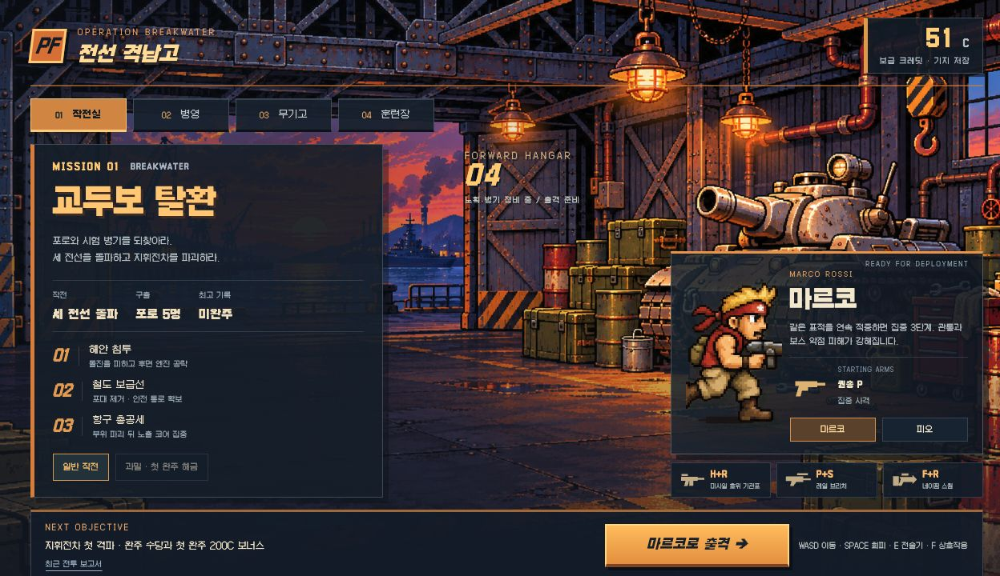

<h1 align="center">★ 서바이버 작전실</h1>
<p align="center"><strong>OPERATION BREAKWATER · 교두보 탈환</strong><br>마르코의 집중 사격, 피오의 강화 탄창.<br>전장에서 무기를 완성하고, 확보한 성과로 다음 출격을 준비하는 팬 시제품.</p>
<p align="center">
<a href="https://github.com/yu-reka/woodland-survivors/actions/workflows/pages.yml"></a>


</p>
<p align="center"><a href="https://yu-reka.github.io/woodland-survivors/"><strong>▶ 작전실에서 출격</strong></a> · <a href="docs/METAL-SLUG-SURVIVORS-CONCEPT.md">게임 기획</a> · <a href="docs/META-PROGRESSION-ECONOMY.md">기지와 경제</a> · <a href="docs/VALIDATION-V014.md">구현·검증 기록</a></p>



### 준비 → 전투 → 정산 → 연구 → 재출격

**무엇을 위해 싸우나요?** 포로와 시험 병기를 탈환하고 지휘전차를 파괴합니다. 구출·거점·처치·보스 부위 파괴가 보급 크레딧과 기록으로 돌아옵니다. 전투를 중단하거나 쓰러져도 확보한 성과를 정산합니다.

| 기지에서 | 전장에서 | 귀환한 뒤 |
| :-- | :-- | :-- |
| 마르코 / 피오와 교범 선택 | 포로 경비 제압 → 총기 보급 | 수당·첫 보고·첫 완주 정산 |
| 상한 있는 기초 훈련 | XP로 무기 3단계 → 핵심으로 진화 | 조건 달성한 개조 연구 |
| 성과로 새 개조 해금 | H + R 최종 합체 / 선택 Slug 노획 | 연구 개조를 새 판에서 선택 |
| 다음 목표·최고 기록 확인 | 준비되면 직접 지휘전차에 도전 | 다른 대원·교범·과밀 도전 |

해안의 장갑 수송차와 철도의 포격대를 격파하면 전술 보급을 고르고 다음 전선으로 넘어갑니다. 무장·XP·전술 지원은 끝까지 유지합니다. 시간이나 처치 수로 관문을 잠그지 않으며 각 전선 보스에게 바로 도전할 수도 있습니다.

시간이 지나면 자동 실패하는 규칙은 없습니다. 진화 핵심은 수용소·수송대·후방 포로에서 얻습니다. 빈 지원 슬롯의 보급은 두 종류 총을 함께 제시하므로 합체 재료를 직접 선택할 수 있습니다.

### 세 전선의 한 판

| 전선 | 전투와 판단 | 다음 전투의 변화 |
| :-- | :-- | :-- |
| 해안 침투 | 구출·두 차례 호위대 → 장갑 수송차 | 관통 탄두 / 합체 조립선 / 기갑 지원 선택 |
| 철도 보급선 | 선택한 빌드로 보급선·포격대 돌파 | 35처치 연계 포격 / 정비 / 연구 개조 수령 |
| 항구 총공세 | 완성 무기로 고밀도 추격대 섬멸 | 관제소에서 보스 포격 교란 또는 시험 탄약 선택 → 지휘전차 |

포격 진지는 철도와 항구 모두 선택 목표입니다. 더 강한 화력과 안전한 보스 공략 중 하나를 고를 수 있습니다. Slug 지원은 다음 차고 한 번을 확보하고, 내구 160·짧은 주포 재사용을 제공합니다.

### 두 대원, 다른 성장

| | 마르코 | 피오 |
| :-- | :-- | :-- |
| 시작 무장 | 권총 P | 기관총 H |
| 고유 성장 | 같은 표적 연속 적중 → 집중 3단계 | 사격·처치·보급 → 강화 탄창 충전 |
| 전술기 E | 관통 집중 사격 | 두 무기 강화 사격 |
| 주력 완성 예 | P 진화 / P+S 레일 브리처 | H+R 미사일 / F+R 네이팜으로 전환 |
| 재도전 해금 | P 진화로 완주 → 산개 교범 | 강화 중 누적 300처치 → 신속 교범 |

P·H·R·S·F 모두 진화할 수 있습니다. 기본 총 3단계 두 개와 핵심으로 **H+R 미사일, P+S 관통 파쇄, F+R 소이 병기**를 조립합니다. 가득 찬 무장은 새 총을 고른 뒤 교체 슬롯을 선택하거나 취소할 수 있습니다. 연구는 P 관통 분열·H 도탄·R 점화 탄두·P 약점 파열·H 축전 탄창·S 플레셰트·F 촉매 연료·R 전도 탄두 후보를 영구 해금합니다. 새로 연구한 개조는 해당 총을 1단계 이상 강화하면 첫 적합한 성장 후보에 등장합니다. 매판 총기와 XP는 다시 성장시키며, 완성 무기를 기지에서 구매하지 않습니다.

중간 보스 격파·합체 실적으로 새로운 연구를 열고, 세 전선 돌파·완성 화력 900처치·합체 완주·P+S/F+R 실증의 지령으로 최초 보상을 받습니다. 800처치 이후에도 구간별 수당과 점수가 증가합니다. 기지에서 최근 보고서와 병영의 남은 지령을 볼 수 있습니다.

전장은 보병·방패병·박격포병·증원 장교로 구성했습니다. 장갑 수송차는 돌진 뒤 **후면 엔진**, 철도 포격대는 **좌우 포대와 안전 통로**, 지휘전차는 **부위 파괴 뒤 노출 코어**가 공략 대상입니다. 연구를 섞으면 화상 대상에 산탄·폭발이 강해지고, 로켓 표식에 관통탄이 강해집니다. 진화·합체에는 주변 폭발, 관통·다탄두·유도탄, 적 경직과 짧은 타격 정지를 적용했습니다.

### 조작

| 행동 | 키보드 | 모바일 |
| :-- | :-- | :-- |
| 이동 | WASD · 방향키 | 왼쪽 스틱 |
| 회피 | Space | 오른쪽 작은 버튼 |
| 대원 전술기 / Slug 주포 | E | 오른쪽 큰 버튼 |
| 탑승·하차·보스 진입 | F | 상황 버튼 |
| 목표 선택 | M | 미니맵 아래 버튼 |
| 성장 선택 | 1 · 2 · 3 / 클릭 | 카드 터치 |
| 일시정지 | Esc | 상단 Ⅱ |

공격은 자동입니다. 성장 선택·지도·일시정지는 전투를 멈춥니다. 5초마다 진행을 저장하고 선택·일시정지에서도 저장합니다. 기지에 저장된 작전을 이어가거나 확보 성과를 정산할 수 있습니다. 저장 공간 오류가 나면 구매·정산을 확정하지 않고 재시도 화면을 표시합니다. 브라우저·사이트별 로컬 저장이며 기기 간 동기화는 없습니다.

### 현재 범위와 확인할 것

0.14는 **두 대원과 하나의 작전 안에 세 전선을 구현한 개발 버전**입니다. 다음 별도 작전·에리·타마는 아직 구현하지 않았습니다. 초기 계정으로 구출·보급을 챙기는 이상적인 자동 주행 8회는 전투 시간 약 **3분 41초~5분 1초**에 완주했습니다. 선택 고민과 이동 오차가 있는 실제 플레이의 목표는 4~6분이며, 모든 플레이어에게 이 길이를 보장하지 않습니다. 세 합체를 목표로 한 12회도 모두 해당 병기를 조립해 완주했습니다. 실제 정산·연구 구매를 연결한 5판으로 연구 8종과 교차 효과를 확인했습니다.

이는 처리량·규칙의 검증이며 사람의 재미를 증명하지 않습니다. 390px·320px 화면, 실제 중간 보스 격파와 전선 전환·합체·연구 후 재출격은 확인했습니다. 실기기 두 손 동시 조작과 저사양 장시간 성능은 추가 확인 대상입니다. 기존 기지 재화·연구는 유지하며 이전 규칙의 진행 중 판은 확보 성과를 정산한 뒤 새 규칙으로 출격합니다.

### 로컬 실행

Node.js 20 이상. 외부 런타임 패키지 없이 실행합니다.

```sh
git clone https://github.com/yu-reka/woodland-survivors.git
cd woodland-survivors
npm run dev
```

**http://127.0.0.1:5200/**

| 명령 | 용도 |
| :-- | :-- |
| `npm test` | 기존 게임 + 작전 규칙 224개 검사 |
| `npm run test:mission` | 작전·경제·저장·진화 검사 58개 |
| `node scripts/mission-pilot.mjs --summary` | 초기 계정 8회 전체 보급 경로 주행 |
| `node scripts/mission-pilot.mjs --builds --summary` | 3합체 × 2대원 × 2시드 12회 주행 |
| `node scripts/mission-pilot.mjs --journey` | 실제 정산·구매를 연결하는 연구 여정 5판 |
| `npm run build` | 정적 배포 파일 생성 |
| `npm run test:pages` | 저장소 하위 경로·자산·모듈 버전 검사 |
| `npm run preview` | `http://127.0.0.1:5201/woodland-survivors/` |

`src/mission/`가 모델·화면·렌더·저장을 소유합니다. 새 격납고 배경과 환경 소품, 금속 상자 UI는 기존 캐릭터 원화와 연결했습니다. 기존 원정의 전투 모델을 가져오지 않고 오디오·터치 입력만 재사용합니다. `main` 푸시 시 [GitHub Actions](.github/workflows/pages.yml)가 검사 → 빌드 → Pages 검사 → 배포를 실행합니다. `dist/`는 커밋하지 않습니다. 포크 배포는 **Settings → Pages → Source → GitHub Actions**입니다.

### 이전 실험

- [다람쥐 2분 전투](https://yu-reka.github.io/woodland-survivors/prototype.html) · [0.11 기록](docs/VALIDATION-V011.md)
- [기존 숲 원정](https://yu-reka.github.io/woodland-survivors/woodland.html) · [원정 기획](docs/GAME-DESIGN.md)

별도 주소에서 기존 원화·게임을 보존했습니다. 저장 키도 분리했습니다.

메탈슬러그 캐릭터·설정에서 착안한 비공식 팬 시제품입니다. 게임에서 추출한 자산·코드는 사용하지 않았습니다. [새 격납고·환경 아트와 프롬프트](docs/MISSION-ART-V014.md) · [기존 아트 기록](docs/ART-PROVENANCE.md). 코드·아트 재사용 라이선스는 아직 정하지 않았습니다. Galmuri는 동봉된 [SIL OFL 1.1](public/fonts/woodland/LICENSE.txt)을 따릅니다.
