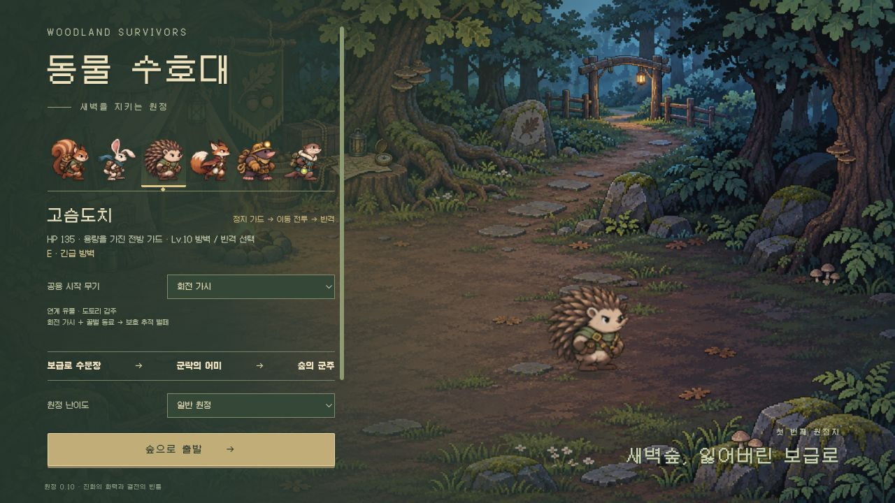

<h1 align="center">🌲 동물 수호대</h1>
<p align="center"><strong>Woodland Survivors · 새벽숲 원정</strong><br>작은 동물 수호자의 성장을 한 판의 결전까지 이어가는 2D 서바이버</p>
<p align="center">
<a href="https://github.com/yu-reka/woodland-survivors/actions/workflows/pages.yml"></a>


</p>
<p align="center"><a href="https://yu-reka.github.io/woodland-survivors/"><strong>▶ 브라우저에서 플레이</strong></a> · <a href="docs/GAME-DESIGN.md">게임 기획</a> · <a href="docs/PRESENTATION-V09.md">화면·연출 기준</a> · <a href="#로컬-실행">로컬 실행</a></p>

> **0.10 전투·모바일 개선 · 2026-11-05**
> 보급로 → 군락 심부 → 수호목 결전. 정찰 타이머와 사냥 할당량을 대신해 **세 보스의 격파**가 한 판의 목표가 됩니다. 자료 분석, 성장 규칙, 화면 표현을 먼저 정리하고 그 계약에 맞춰 구현했습니다. 배포·검증 범위는 [0.10 검증 기록](docs/VALIDATION-V010.md)에 기록합니다.



이번 버전은 보스의 공격 후 빈틈(+45% 무기 피해), 집중 조준, 수호형 벌떼의 표적 분산을 연결했습니다. 공방 준비 알림·변신 완성 표시·처치음과 모바일 누름 즉시 반응도 다듬었습니다. [변경 계약](docs/COMBAT-V010.md) · [실패를 포함한 검증 결과](docs/VALIDATION-V010.md)

### 한 판의 흐름

| 보급로 | 군락 심부 | 수호목 공터 |
| :-- | :-- | :-- |
| 무기 보급을 찾아 조합 시작 | 많은 적을 쓸어 담으며 빌드 완성 | 시야가 열린 별도 결전장 |
| 수문장: 부채 사격과 직선 돌진 | 군락의 어미: 뿌리 예고·탄막·증원 | 군주 모르가: 돌진·방사탄·치유 꽃 |
| 첫 인장으로 진화 준비 | 합체 또는 두 진화 무기를 유지 | 군주를 쓰러뜨리면 완주·기록 확정 |

공격은 자동입니다. 적을 모아 처치하고 청록빛 경험치를 회수하세요. 보스 표식은 처음부터 열려 있습니다. 권장 레벨은 안내이며, 원하는 때 직접 도전합니다. 오래 머물면 공세가 강해지지만 타이머가 플레이를 강제로 끝내지는 않습니다.

보스 격파 후 인장과 기록을 확보하고, 보상 패널에서 정비합니다. 전장에 돌아와 **열린 출구에서 F**를 누르면 남은 경험치를 일반 성장 선택으로 정산한 뒤 다음 구역에 진입합니다. 위험 둥지는 선택 도전입니다.

### 무기를 얻고, 키우고, 합치기

| 선택 | 역할 |
| :-- | :-- |
| 구역마다 두 무기 보급 | 새 무기 확보. 첫 보급은 시작 무기의 합체 파트너와 다른 후보를 제시 |
| 경험치 레벨업 | 보유 무기 강화 또는 보조 성장. 무기·보조 각각 4칸 |
| 일반 진화 | 무기 8단계 + 맞는 촉매 + 보스 인장 1개. 촉매는 유지 |
| 최종 합체 | 두 무기 모두 8단계 + 한쪽 진화. 두 슬롯을 하나로 합치고 진화 핵심을 선택 |
| 공방 | 일시정지 메뉴에서 언제든 조건과 재료 확인. 준비된 조합을 유지해도 됨 |

- **도토리 + 반달 → 왕복 산탄**: 도토리 핵심은 넓은 폭발 산개, 반달 핵심은 좁은 귀환 집중.
- **가시 + 꿀벌 → 보호 벌떼**: 가시 핵심은 가까운 수호 궤도, 꿀벌 핵심은 먼 출격과 귀환.
- 두 진화 무기를 유지하는 경로도 최종 군주를 잡을 수 있도록 비교합니다. 합체가 승리 필수 조건은 아닙니다.
- 무기를 모두 키운 뒤에도 레벨업은 회복·8초 임시 화력·추가 기록 점수 중 명시적으로 선택합니다.

### 다르게 성장하는 두 수호자

| 대원 | 전투와 자동 성장 | Lv.10 선택 → Lv.18 완성 |
| :-- | :-- | :-- |
| **다람쥐** | 공격 수 +1. Lv.6·12·18 관통 증가. 실제 발사와 다중 적중으로 E 충전 | 넓게 퍼지는 **산개 포격** / 보스 반복 적중의 **집중 포격** |
| **고슴도치** | HP 135·방어 2. 멈추면 용량이 있는 전방 가드. 이동 후 짧게 유지하며 차단·근접 무기 처치로 E 충전 | 큰 용량과 빠른 재정비의 **방벽** / 소진 뒤 넓게 되받는 **반격** |

토끼·여우·두더지·수달도 기존 고유 특성으로 출전할 수 있습니다. 모든 대원이 여덟 시작 무기를 공유하며, 이번 성장 개편의 집중 대상은 다람쥐·고슴도치입니다.

### 탐색과 유물

회복 샘은 체력 +40을 한 번 제공합니다. 위험 둥지는 지휘관·강화 상자와 유물을, 바람숲 제단은 원 안에서 버티는 20초 도전과 유물을 제공합니다. 보급은 보류했다가 다시 열 수 있으며 구역을 떠나면 남긴 보급은 사라집니다.

여섯 유물은 이동·정지·방어·무기 적중 조건을 바꿉니다. 후보 두 개 중 하나를 고르고 두 칸에 장착합니다. 가득 찼다면 교체 대상을 직접 고르거나 남겨둘 수 있습니다. 무기·유물 연계는 이번 판에서 사용하며 다음 원정은 같은 기본 능력으로 시작합니다.

### 다시 도전할 이유

보스마다 돌파 기록을 먼저 저장하고 최종 군주 격파를 완주로 구분합니다. **규칙 버전·대원·스타일·난이도별 최고 기록**은 최근 원정 목록이 밀려도 유지합니다. 첫 완주로 더 많은 적이 나오는 과밀 도전이 열립니다. 같은 시드 재도전으로 선택을 비교하거나 새 시드와 다른 합체 핵심을 시험할 수 있습니다. 기록은 이 브라우저에 저장됩니다.

### 조작

| 행동 | 키보드 | 모바일 |
| :-- | :-- | :-- |
| 이동 / 공격 | WASD·방향키 / 자동 | 왼쪽 스틱 / 자동 |
| 회피 / 고유기 | Space / E | 구르기 / 고유기 버튼 |
| 보급·보스·출구 | F | 상호작용 버튼 |
| 성장 선택 | 1–3·클릭 | 카드 터치 |
| 일시정지·공방 | Esc | Ⅱ 버튼 |

### 로컬 실행

Node.js 20 이상. 외부 패키지 설치 없이 실행합니다.

```sh
git clone https://github.com/yu-reka/woodland-survivors.git
cd woodland-survivors
npm run dev
```

개발 서버는 **http://127.0.0.1:5200/** 입니다.

| 명령 | 용도 |
| :-- | :-- |
| `npm test` | 전투·성장·3보스 진행·기록·저장 규칙 검사 |
| `node scripts/journey-pilot.mjs --hero bram --no-union` | 장비·HP 주입 없이 입력 정책으로 원정 주행 |
| `npm run build` | `dist/`에 정적 게임 생성 |
| `npm run test:pages` | 빌드 후 저장소 하위 경로·자산 검사 |
| `npm run preview` | 빌드를 `http://127.0.0.1:5201/woodland-survivors/`에서 확인 |

[성장 검수실](docs/progression-lab.html)은 고정 장비·무적 조건을 명시한 연출 검수 도구입니다. 일반 원정 플레이 결과와 구분하며 기록을 저장하지 않습니다.

### 배포와 검증

`main` 푸시 시 [GitHub Actions](.github/workflows/pages.yml)가 검사 → 빌드 → Pages 경로 검사 → 배포를 실행합니다. PR에서는 검사와 빌드만 실행합니다. `dist/`는 커밋하지 않습니다. 포크에서는 **Settings → Pages → Source → GitHub Actions**를 선택하세요.

모델 주행은 정해진 조작 정책의 재현 결과입니다. 사람이 느끼는 타격감과 재미, 모든 시작 무기·시드의 균형을 증명하지 않습니다. [검증 기록](docs/VALIDATION-V010.md)에 실제 검사와 남은 범위를 구분합니다. 진행 중 원정의 저장·복구 UI, 영구 능력치 상점, 무한 모드는 이번 버전에 포함하지 않습니다.

### 설계와 소스

| 자료 | 내용 |
| :-- | :-- |
| [자료 분석](docs/REFERENCE-ANALYSIS-V09.md) | 제공된 MegaBonk PDF·Pokémon Survivor Burst 캡처의 사실과 적용 결정 |
| [게임 기획](docs/GAME-DESIGN.md) | 목표·진행·성장·보상·반복 동기 |
| [캐릭터 설계](docs/CHARACTER-DESIGN.md) | 성장 분기·충전·합체 수량 상한 |
| [표현 설계](docs/PRESENTATION-V09.md) | 화면 우선순위·구역·예고·합체 탄도 |
| `src/core/` | 전투·성장·진행·저장 모델 |
| `src/game/` | 탐색·UI·지형·렌더·합성 사운드 |
| `src/art/`, `public/art/v2/` | 기존 원화 기반 아틀라스·프레임·PNG |

외부 게임의 자산·코드를 사용하지 않습니다. [아트 제작 기록](docs/ART-PROVENANCE.md) · [폰트 라이선스](public/fonts/woodland/LICENSE.txt) · [0.8 실험 보관](docs/PROTOTYPE-V08.md)

코드와 게임 아트의 재사용 라이선스는 아직 정하지 않았습니다. Galmuri 폰트는 동봉된 SIL Open Font License 1.1을 따릅니다.
