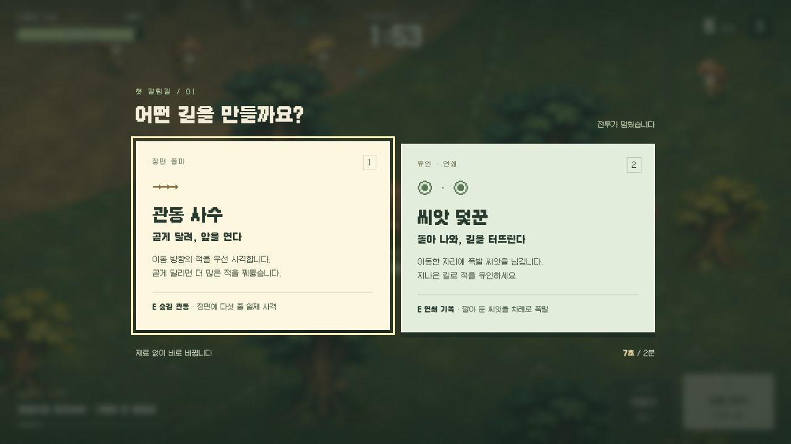
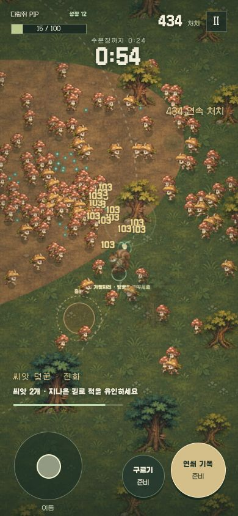

<h1 align="center">🌲 동물 수호대</h1>
<p align="center"><strong>Woodland Survivors · 두 갈래 숲길</strong><br>작은 다람쥐, 두 가지 성장. 2분 안에 숲을 돌파하는 전투 시제품.</p>
<p align="center">
<a href="https://github.com/yu-reka/woodland-survivors/actions/workflows/pages.yml"></a>


</p>
<p align="center"><a href="https://yu-reka.github.io/woodland-survivors/prototype.html"><strong>▶ 다람쥐 2분 전투 플레이</strong></a> · <a href="docs/SPRINT-PROTOTYPE.md">시제품 설계</a> · <a href="docs/VALIDATION-V011.md">검증과 남은 과제</a> · <a href="https://yu-reka.github.io/woodland-survivors/">기존 긴 원정</a></p>

> **0.11 · 전투를 먼저 검증합니다**
> 기존 다람쥐·몬스터·숲 원화를 유지하고, 두 성장 경로가 움직임을 바꾸는 짧은 전투를 별도로 만들었습니다. 장비 공방과 여러 구역을 돌기 전에 **적을 모으고, 성장하고, 쓸어 담는 경험**부터 다듬는 시제품입니다.



### 같은 다람쥐, 다른 숲길

| | 관통 사수 ↗ | 씨앗 덫꾼 ◉ |
| :-- | :-- | :-- |
| 움직임 | 곧게 달려 관통을 충전하고 정면을 뚫기 | 이동하며 씨앗을 남기고 돌아 나와 적 유인 |
| E 고유기 | 다섯 줄 관통 일제 사격 | 남긴 씨앗을 차례로 기폭 |
| 대군 진화 | 세 줄 사격 + 다중 관통 파열 | 씨앗 15개 + 넓은 연쇄 폭발 |
| 보스 진화 | 좁은 집중탄 + 보스 사격 피해 증가 | 보스에게 적중한 씨앗 재폭발 |

공격은 자동입니다. 경험치를 회수하면 메뉴 없이 공격과 체력이 성장합니다. 구르기는 두 경로 모두 짧은 무적을 제공합니다. 고유기는 각 경로의 공격 방식을 직접 쓰는 버튼입니다.

### 2분의 흐름

| 전투 시간 | 일어나는 일 |
| :-- | :-- |
| 0–7초 | 기본 도토리 사격과 첫 무리 |
| 7초 | 관통 / 씨앗 성장 선택. 즉시 새 공격 사용 |
| 50초 | 대군 / 보스 진화 선택. 회복 + 주변 적을 터뜨리는 충격파 |
| 50–90초 | 많은 적과 예고 증원. 진화 무기로 무리 돌파 |
| 90초 | 큰뿔 수문장 등장. 돌진 예고를 피하고 회복 빈틈에 공격 |
| 120초 이내 | 보스 격파 즉시 완주. HP 소진·시간 종료는 실패 |

선택과 일시정지는 전투 시간을 멈춥니다. 결과에서 **같은 숲의 반대 성장 경로**로 바로 재도전할 수 있습니다. 경로·진화별 최고 처치와 돌파 기록은 이 브라우저에 저장하며, 다음 판 능력치는 동일하게 시작합니다.

<details>
<summary>모바일 대군 전투 화면 보기</summary>
<br>

</details>

### 조작

| 행동 | 키보드 | 모바일 |
| :-- | :-- | :-- |
| 이동 | WASD · 방향키 | 왼쪽 스틱 |
| 구르기 | Space | 오른쪽 작은 버튼 |
| 경로 고유기 | E | 오른쪽 큰 버튼 |
| 성장 선택 | 1 · 2 · 클릭 | 카드 터치 |
| 일시정지 | Esc | 상단 Ⅱ |

시작·일시정지 화면에서 효과음과 흔들림·플래시 줄이기를 설정합니다. 모바일 크기·단일 포인터 입력과 터치 소유권은 검사했으며, 실제 휴대전화의 두 손 동시 조작은 추가 플레이 검증 대상으로 남아 있습니다.

### 기존 긴 원정

[새벽숲 원정](https://yu-reka.github.io/woodland-survivors/)도 계속 실행할 수 있습니다. 여러 대원·여덟 시작 무기·유물·진화와 합체·세 보스로 이어지는 기존 실험입니다. 새 시제품의 두 경로는 기존 원정에 아직 통합하지 않았습니다.

- [원정 기획](docs/GAME-DESIGN.md) · [캐릭터 성장](docs/CHARACTER-DESIGN.md)
- [제공 자료 분석](docs/REFERENCE-ANALYSIS-V09.md) · [0.10 검증](docs/VALIDATION-V010.md)

### 로컬 실행

Node.js 20 이상. 외부 패키지 설치 없이 실행합니다.

```sh
git clone https://github.com/yu-reka/woodland-survivors.git
cd woodland-survivors
npm run dev
```

**http://127.0.0.1:5200/prototype.html** 에서 시제품을 실행합니다.

| 명령 | 용도 |
| :-- | :-- |
| `npm test` | 기존 원정 + 시제품 + 입력 규칙 검사 |
| `npm run test:sprint` | 시제품의 선택·충돌·종료·진화 검사 |
| `node scripts/sprint-pilot.mjs --summary` | 능력치 주입 없이 두 경로 × 두 진화 입력 주행 |
| `npm run build` | `dist/`에 정적 빌드 |
| `npm run test:pages` | 저장소 하위 경로·자산·모듈 캐시 버전 검사 |
| `npm run preview` | `http://127.0.0.1:5201/woodland-survivors/prototype.html` |

### 소스와 검증

`src/sprint/`는 시제품 모델·원화 렌더·UI·스타일입니다. 기존 `src/core/` 원정 모델을 가져오지 않습니다. `src/art/`의 원화와 걷기·공격 모션, `src/game/`의 오디오·터치 입력을 재사용합니다.

`main` 푸시 시 [GitHub Actions](.github/workflows/pages.yml)가 검사 → 빌드 → Pages 검사 → 배포를 실행합니다. `dist/`는 커밋하지 않습니다. 포크는 **Settings → Pages → Source → GitHub Actions**를 사용하세요.

모델 주행은 규칙과 처리량의 검증입니다. 사람의 재미나 모바일 체감, 네 진화의 동등한 난이도를 증명하지 않습니다. 실제 플레이에서 발견한 문제와 수정·미검증 범위는 [0.11 검증 기록](docs/VALIDATION-V011.md)에 구분했습니다.

외부 게임의 자산·코드를 사용하지 않습니다. [아트 제작 기록](docs/ART-PROVENANCE.md) · [폰트 라이선스](public/fonts/woodland/LICENSE.txt). 코드·게임 아트의 재사용 라이선스는 아직 정하지 않았습니다. Galmuri는 동봉된 SIL OFL 1.1을 따릅니다.
