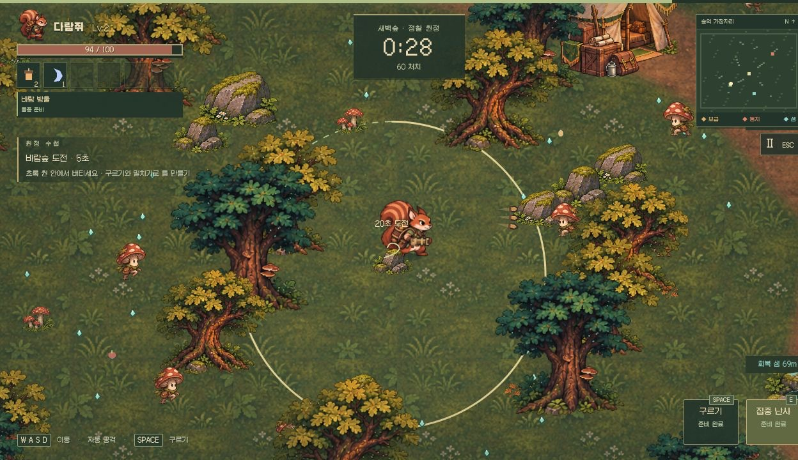
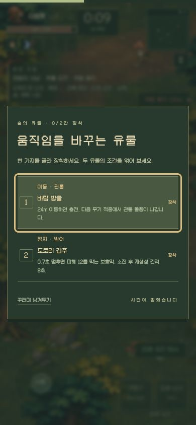
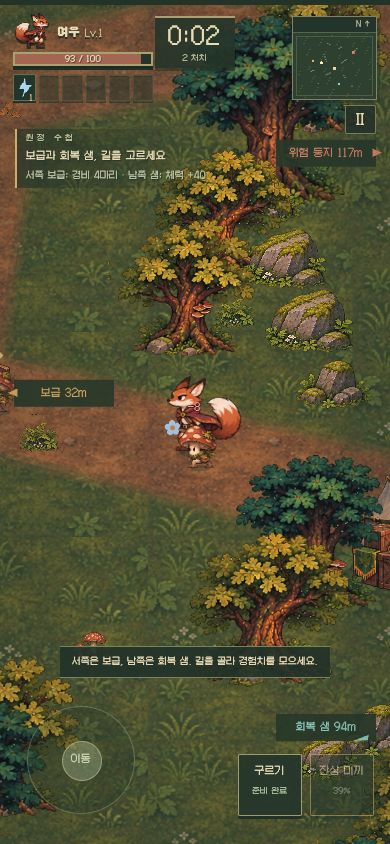

<h1 align="center">🌲 동물 수호대</h1>
<p align="center"><strong>Woodland Survivors · 새벽숲 정찰 원정</strong><br>작은 동물 모험가와 함께 숲을 탐색하는 2D 서바이버 게임</p>
<p align="center">
  <a href="https://github.com/yu-reka/woodland-survivors/actions/workflows/pages.yml"></a>
  
  
  
</p>
<p align="center"><a href="https://yu-reka.github.io/woodland-survivors/"><strong>▶ 브라우저에서 플레이</strong></a> · <a href="https://yu-reka.github.io/woodland-survivors/docs/motion-lab.html">모션 미리보기</a> · <a href="#로컬에서-실행">로컬 실행</a></p>



## 숲을 둘러보고, 싸우고, 돌아오기

공격은 자동으로 이루어집니다. 대원을 움직여 적을 피하고, 청록빛 경험치를 회수하며 무기를 조합하세요. **3분을 생존한 뒤 야영지로 돌아오는 것**이 이번 정찰의 목표입니다.

| 여섯 대원 | 여덟 공용 무기 | 여섯 행동 유물 |
| :-- | :-- | :-- |
| 대원마다 다른 특성과 고유기 | 최대 6무기 + 6보조, 8진화·2합체 | 두 칸에 담아 이동·방어·회복을 엮는 조합 |

둥지를 건너뛰어도 일반 전투로 성장해 귀환할 수 있습니다. 둥지는 빠른 강화와 진화를 노리는 선택지입니다.

### 원정 수첩

| 장소 | 무엇을 얻나요? |
| :-- | :-- |
| **서쪽 보급터** | 경비 처치 후 장비 하나, 시작 무기 +1, 진화 촉매. 옆 유물 꾸러미는 F로 따로 확인 |
| **바람숲 제단** | 직접 시작하는 20초 도전. 완료하면 유물 꾸러미와 주변에 쌓인 경험치 회수 |
| **동북쪽 위험 둥지** | 지휘관 처치 후 시작 무기 +2, 조건부 진화·합체 상자와 추가 유물 꾸러미 |
| **남쪽 반딧불 샘** | 체력 +40, 한 번 사용. 건강할 때는 남겨둘 수 있습니다. |
| **중앙 야영지** | 3분 이후 상호작용하면 정찰 완료. 2분 30초부터 귀환로를 안내합니다. |

### 작은 유물이 다음 움직임을 바꿉니다

유물 꾸러미에서는 **후보 두 개 중 하나**를 고릅니다. 장착은 두 칸. 가득 찼다면 바꿀 유물을 직접 선택하거나 꾸러미를 남겨둘 수 있습니다.

| 유물 | 발동 조건과 역할 |
| :-- | :-- |
| 바람 방울 | 24m 이동 → 다음 무기 적중에서 관통 돌풍 |
| 매듭 실타래 | 살아남은 적에 표식 → 12m 이동해 추가 피해 |
| 도토리 갑주 | 0.7초 정지 → 피해 12를 흡수하는 보호막 |
| 가시 매듭 | 무기로 밀친 적을 다시 적중 → 주변 가시 파열 |
| 생명씨 주머니 | 무기로 12마리 처치 → 회복 씨앗을 직접 회수 |
| 물결 조개 | 실제 일반 회복 15 누적 → 적을 밀치는 파동 |

새 원정마다 제단 위치와 유물 후보가 달라집니다. 결과에서는 유물의 발동·피해·회복·방어 기여를 확인하고 **같은 숲 재도전 / 새로운 숲**을 고릅니다. 발견 유물과 최근 12회 기록은 이 브라우저에 저장하며, 다음 원정의 기본 능력치는 동일합니다.

<p align="center"></p>

### 함께 떠나는 수호대

모든 대원이 여덟 시작 무기를 공유합니다. 무기를 바꾸어도 대원 특성과 고유기는 유지됩니다.

| 대원 | 특성 | 고유기 · E |
| :-- | :-- | :-- |
| 다람쥐 | 공격 수 +1 | 집중 난사 |
| 토끼 | 이동 중 재사용 시간 최대 −15% | 회피 질주 |
| 고슴도치 | 받는 피해 −2 | 긴급 방벽 |
| 여우 | 정예·보스 피해 +20% | 잔상 미끼 |
| 두더지 | 정지 중 공격 범위 +25% | 땅굴 탈출 |
| 수달 | 효과 지속시간 +25% | 물결 회수 |

## 조작

| 행동 | 키보드 | 모바일 |
| :-- | :-- | :-- |
| 이동 | WASD / 방향키 | 왼쪽 스틱 |
| 공격 | 자동 | 자동 |
| 회피 | Space | 구르기 버튼 |
| 고유기 | E | 고유기 버튼 |
| 장소 상호작용 | F | 화면 중앙 버튼 |
| 성장 선택 | 1–3 / 클릭 | 선택지 터치 |
| 유물 선택·교체 | 1–2 / 클릭 | 선택지 터치 |
| 일시정지 | Esc | Ⅱ 버튼 |

<p align="center"></p>

## 로컬에서 실행

Node.js 20 이상. 외부 패키지 설치 없이 실행합니다.

```sh
git clone https://github.com/yu-reka/woodland-survivors.git
cd woodland-survivors
npm run dev
```

개발 서버: **http://127.0.0.1:5200/**

| 명령어 | 용도 |
| :-- | :-- |
| `npm test` | 전투·성장·귀환 규칙 검사 |
| `node scripts/pilot.mjs` | 여섯 대원의 고정 간격 모델 주행 |
| `npm run build` | `dist/`에 정적 게임 생성 |
| `npm run test:pages` | 빌드 후 Pages 하위 경로·자산·모션 랩 검사 |
| `npm run preview` | 빌드를 `http://127.0.0.1:5201/woodland-survivors/`에서 확인 |

`npm run test:pages`와 `npm run preview`를 실행하기 전에는 먼저 `npm run build`를 실행하세요.

## GitHub Pages 배포

`main`에 푸시하면 [자동 배포](.github/workflows/pages.yml)가 게임 검사 → 정적 빌드 → Pages 경로 검사 → 배포 순서로 실행됩니다. PR에서는 검사와 빌드만 실행합니다. GitHub Actions는 Node.js 24를 사용하며, 배포 결과인 `dist/`는 커밋하지 않습니다.

이미지·폰트·모듈은 프로젝트 경로 기준으로 불러옵니다. `/woodland-survivors/` 같은 저장소 하위 경로에서도 동일한 빌드가 동작합니다. 다른 저장소로 포크해 배포할 경우 **Settings → Pages → Source → GitHub Actions**를 선택하세요.

## 개발 현황

현재는 **0.5 개발판 · 첫 3분 정찰**입니다. 행동 유물, 선택형 필드 도전, 시드 변주와 원정 수첩을 연결했습니다. 30분 전체 원정, 영구 능력치 성장·해금 UI, 진행 중 원정의 저장·복구 UI는 아직 연결하지 않았습니다. 대원·시작 무기·음소거 설정과 수첩은 브라우저에 저장합니다.

<details>
<summary><strong>0.4 전투와 밸런스에서 다듬은 점</strong></summary>

- 경험치 회수 범위를 넓히고 중반 성장 비용을 완만하게 조정했습니다.
- 포자 사수와 오래 남는 탄막, 모바일에서 가까이 생기는 좌우 포위를 완화했습니다.
- 귀환 직전에는 새 적과 마지막 몰이 무리가 줄어 돌아갈 틈이 생깁니다.
- 투사체의 밀침 방향, 이동 입력을 유지하는 짧은 타격 반응, 무기별 발사·적중음과 처치음을 다듬었습니다.
- 원화 기반 방향별 보행·공격·피격 프레임, 발 피벗과 이동·조준 방향 분리를 사용합니다.

</details>

검증 기준과 36회 모델 주행 요약은 [검증 기록](docs/VALIDATION.md), 보상과 발동 규칙의 의도는 [0.5 게임성 설계](docs/GAMEPLAY-V05.md)에 있습니다. 모델 주행은 정해진 입력 정책의 결과이며 사람이 느끼는 재미나 모든 시드의 균형을 증명하지 않습니다.

## 소스와 아트

| 위치 | 내용 |
| :-- | :-- |
| `src/core/` | 전투, 성장, 무기, 저장 데이터 모델 |
| `src/game/` | 탐색, 지형, 렌더링, 모션, 합성 사운드 |
| `src/art/` | 일러스트 아틀라스와 프레임 정렬 |
| `public/art/v2/` | 현재 게임에서 사용하는 PNG와 생성 기록 |
| `docs/` | 스크린샷, 모션 랩, 제작·검증 기록 |
| `scripts/` | 개발 서버, 빌드, 정적 미리보기, 검사 |

[아트 제작 기록](docs/ART-PROVENANCE.md) · [원화 프롬프트](docs/REFERENCE-ART-PROMPTS.md) · [폰트 라이선스](public/fonts/woodland/LICENSE.txt)

일러스트는 원화를 참조해 제작한 이미지이며 사운드는 Web Audio로 합성합니다. [메가봉크 개발사 설명](https://store.steampowered.com/app/3405340/Megabonk/)과 [PokéSurvivor 제작자 가이드](https://pokesurvivor.com/en/guide/)의 전리품·빌드 선택·공격 예고를 참고했습니다. 외부 게임의 자산이나 코드는 사용하지 않았습니다.

프로젝트 코드와 게임 아트의 재사용 라이선스는 아직 정하지 않았습니다. Galmuri 폰트에는 동봉된 SIL Open Font License 1.1이 적용됩니다.
