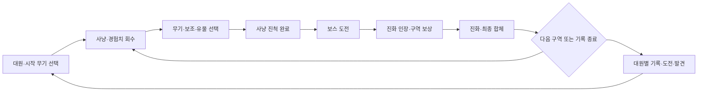

# 동물 수호대 · 게임 기획 기준

버전: 설계 0.8 · 2026-11-04 · 상태: 구현 기준 / 밸런스 수치는 비교 실험값

이 문서는 앞으로의 개발 판단 기준이다. [시스템 분석](SYSTEM-REVERSE-ENGINEERING.md)의 확인 사실과 우리 설계를 구분한다. 현재 로컬 0.7 시제품이 이 규칙을 모두 구현한 것은 아니다. 0.7의 고정 3·5·7분 보상, 1→8 무료 진화, 90초 단위 계속하기는 실험이며, 아래 목표와 충돌하면 교체한다.

## 1. 어떤 게임인가

**작은 동물 수호대로 숲을 돌며, 대원에게 맞는 행동으로 성장하고, 무기를 진화·합체해 몰려오는 군락을 쓸어내는 원정 서바이버.**

플레이어가 한 판 동안 답할 질문은 세 가지다.

1. 이 대원은 무엇을 하면 강해지는가?
2. 이번 판에는 어떤 최종 무기와 유물 조합을 완성할 것인가?
3. 지금 보스를 잡아 다음 구역으로 갈 것인가, 더 얻는 대신 높아진 위협을 감당할 것인가?

| 약속 | 구현에서 보여 줄 것 | 실패로 보는 상태 |
| --- | --- | --- |
| 처치가 시원함 | 군집이 끊겨 나가는 공격, 짧고 분명한 적중·사망·회수 반응 | 적 HP만 불어나 오래 두드림, 큰 섬광이 적을 가림 |
| 성장이 다른 플레이를 만듦 | 대원별 성장 행동, 무기 형태 변화, 배타적 분기 | 대원 이름만 달라지고 같은 무기 여섯 개로 수렴 |
| 완성할 빌드가 보임 | 재료·현재 단계·부족한 조건·합체 결과 | 조건이 숨겨짐, 진화하면 합체가 막힘, 합체하면 약해짐 |
| 다음 판의 목표가 남음 | 대원별 최고 구역·첫 돌파 시간·숙련 도전·다른 분기 | 승리/패배 숫자만 남고 다음에 바꿀 이유가 없음 |

정체성은 원화풍 숲, 행동에 반응하는 유물, 대원별 성장, 판 안의 장비 완성에 둔다. 메가봉크의 숫자와 Burst의 Pokémon·수집 규모를 그대로 이식하지 않는다.

## 2. 목표와 한 판의 흐름

### 핵심 원정

**사냥 진척을 채워 보스에 도전 → 보스 보상으로 빌드 완성 → 다음 구역.** 첫 원정의 큰 목표는 세 구역의 주인을 쓰러뜨려 숲을 돌파하는 것이다. 이후에는 같은 빌드로 강화 구역을 계속하거나 기록을 남기고 마칠 수 있다.

### 시간의 의미

- 시계는 기록과 위협을 알린다. 시간이 됐다고 자동 승리·강제 종료하지 않는다.
- 보스 도전 자격은 실제 사냥 진척으로 얻는다. 준비되면 표식에서 도전한다.
- 미루는 동안 위협 단계가 오르므로 무료로 안전한 성장만 계속할 수는 없다.
- 다음 구역은 새로운 적 구성·공세 규칙·보스 검증으로 구분한다. 같은 지형을 쓰는 시제품을 새 지역이 완성된 것처럼 표시하지 않는다.

보스 자격을 얻은 뒤의 경제 규칙도 고정한다. 해당 구역에서 추가로 얻는 XP는 **자격 획득 순간 기준 다음 두 레벨에 필요한 XP**까지만 전투 성장에 반영한다. 남은 예산을 HUD에 표시하고, 소진 후에는 ‘추가 성장 한계 · 보스 도전 가능’으로 알린다. 위협은 계속 45초마다 한 단계 오른다(초기 실험 간격). HP/특수 적 압력이 증가하지만 경고 동시 수 제한은 유지한다. 보스를 잡아 다음 구역으로 가면 새 성장 예산이 열린다. 따라서 시간 강제 종료 없이 계속 성장할 수 있으나 같은 쉬운 구역에서 모든 장비를 완성하는 것이 정답이 되지는 않는다.

예산은 `현재 레벨의 남은 XP + 다음 레벨 XP`로 계산한다. 자격 획득 뒤 새로 생성된 XP에만 적용하며, 이미 바닥에 쌓여 있던 정당한 전리품은 깎지 않는다. XP에는 구역/생성 시점을 태그하고, 보너스 적용 후 실제 획득량으로 추가 예산을 차감해 배율로 우회하지 못하게 한다.

즉시 도전/60초 지연/120초 지연을 비교해 추가 XP가 두 레벨을 넘지 않는지, 생존 위험과 첫 돌파 시간이 실제로 달라지는지 검사한다. 돌파 기록은 구역을 우선하며 구역 초과 사냥을 별도의 보스 기록 이득으로 더하지 않는다.

### 첫 원정의 경험 목표 · 밸런스 가설

| 구간 | 플레이어가 느낄 변화 | 예상 시점 목표 |
| --- | --- | --- |
| 첫 교전 | 움직이면 공격하고, 적이 쓰러지고, XP를 주움 | 첫 처치 약 2–5초 |
| 첫 선택 | 공격 강화와 다른 무기 확보의 차이를 이해 | 첫 레벨업 약 10–20초 |
| 대원 정체성 | 고유 행동의 성장 게이지가 실제로 오름 | 첫 숙련 보상 약 30–60초 |
| 첫 문턱 | 잡몹 학살과 보스 화력의 차이를 경험 | 첫 보스 약 2–3분 |
| 빌드 전환 | 투자한 무기의 진화, 연계 변화 | 약 3–5분 |
| 완성 | 두 공격을 최종 합체, 빈 슬롯과 새 공격 확인 | 약 5–8분 |
| 첫 숲 돌파 | 완성 빌드로 세 번째 보스 격파 | 약 8–12분 |

이 시점은 타이머 지급 조건이 아니다. 실제 성장·사냥 속도를 측정해 조정할 목표다.

## 3. 성장의 네 층

| 층 | 어떻게 얻는가 | 무엇이 변하는가 | 판이 끝나면 |
| --- | --- | --- | --- |
| 경험치 성장 | 실제 처치가 남긴 XP 회수 | 무기·보조 장비 선택 | 초기화 |
| 대원 숙련 | 대원 고유의 전투 행동 | 특성 단계·배타적 분기 | 초기화, 발견/도전은 기록 |
| 고유기 | 유효 전투 행동으로 제한된 충전 | 짧은 Burst·생존·반격 창 | 충전 초기화 |
| 영구 진행 | 대원별 명시적 도전과 발견 | 레시피 수첩·분기/외형 등 선택권 | 유지 |

고유기 충전은 처치 한 마리마다 무제한으로 더하지 않는다. **초당 충전 상한**을 두어 대공세가 고유기 상시 유지로 변하지 않게 한다. 첫 실험은 최대 7/초, 기본 충전 0.5/초다. 숙련과 고유기 충전을 같은 수치로 표시하지 않는다.

현재처럼 장비 선택이 끝났다고 경험치를 자동 공통 공격력으로 바꾸지 않는다. 장기 구역에서는 주력 무기에 투자할지 다른 약점을 보완할지 고르는 제한된 초과 성장 선택으로 넘긴다.

## 4. 대원: 같은 출발, 같은 최적해를 피한다

전체 규칙은 [대원별 설계표](CHARACTER-DESIGN.md)에 있다. 기존 여섯 대원의 사용 권한은 유지한다. 새 기획의 비교 검증은 먼저 다람쥐·고슴도치 두 역할에 집중한다.

| 대원 | 성장 원천 | 주요 판단 | 약점 |
| --- | --- | --- | --- |
| 다람쥐 · 포격 | 한 공격의 다수 적중 | 흩어진 적을 모아 관통할 각도 | 근접 포위·과투자한 산개 공격의 보스 화력 |
| 토끼 · 기동 | 전투 중 실제 이동 | 공격 궤적과 회수 동선을 겹치기 | 멈추는 구간·급한 방향 전환 |
| 고슴도치 · 반격 | 실제 방어와 가까운 위협 대응 점수 | 버틸 자리와 피할 공격 구분 | 장판 중첩·원거리 적·느린 회수 |
| 여우 · 사냥 | 표식 처치 | 군집 정리와 정예 추적 우선순위 | 넓은 포위·표식 밖 화력 |
| 두더지 · 지대 | 자기 지대 안의 처치 | 적을 지대로 끌어오고 다음 자리를 정하기 | 빠른 이동 보스·진지 이탈 |
| 수달 · 순환 | 실제 XP 회수 | 위험한 회수와 Burst 시점 | 회수 자원이 적은 단일 보스 |

추천 무기와 유물은 도움말이다. 대원 특성을 쓰려면 희귀 유물 하나가 반드시 나와야 하는 설계는 피한다. 기본 능력과 고유기만으로 성장 자원을 얻을 수 있어야 한다.

## 5. 장비 선택과 최종 완성

### 슬롯과 투자

첫 비교 실험은 **무기 4칸 / 보조 4칸 / 유물 2칸**이다. 현재 6칸과 같은 seed·정책을 비교하고 빌드 수렴이 줄어드는지 확인한 뒤 runtime 기본값으로 확정한다. 슬롯 감소 자체를 재미라고 간주하지 않는다.

- 무기: 공격의 형태. 총 피해뿐 아니라 발사 수·궤도·관통·추적·지대가 다르게 성장한다.
- 보조: 명시한 공통 축. 무기별 실제 적용 여부를 보여 준다.
- 유물: 움직임·방어·밀침·처치·회복의 조건을 바꾸는 두 선택. 현재 행동 유물 여섯 개를 기반으로 한다.
- 무기 4단계: 공격 방식 A/B 중 하나 선택. 둘 다 누적하지 않는다.
- 무기 8단계: 재료와 진화 인장이 있으면 진화 가능. 인장은 보관하고 조건을 채운 뒤 쓸 수 있다.

### 진화 인장

필수 보스는 진화 기회를 준다. 소유 무기 1단계를 즉시 8단계로 만들지는 않는다. 그동안 투자한 무기 단계가 의미를 가져야 한다. 둥지는 더 빠른 강화·다른 유물 선택을 주는 선택 경로이며 필수 진화의 유일한 출처가 아니다.

필수 보스 보상은 **인장 1개 + 보조 보상 하나**다. 보조 보상은 보유 무기 +1 / 보유 무기용 촉매 하나 / 회복 중 선택한다. 촉매가 보조 슬롯을 넘으면 명시적으로 교체하거나 다른 보상을 고른다. 성장 제안도 소유 무기의 부족한 촉매를 정기적으로 후보에 넣되 자동 지급하지 않는다. 진화는 `무기 8단계 + 대응 촉매 1단계 이상 + 인장 1개`를 요구하며, 인장만 소모하고 촉매는 남긴다.

### 최종 경로 매트릭스

| 재료군 | 최종 형태 | 역할 변화 | 감수할 약점 | 상태 |
| --- | --- | --- | --- | --- |
| 도토리 + 반달 | 왕복 산탄 | 전진 관통·폭발 후 귀환 타격 | 좁은 조준/보스 대응과 산개 선택의 거래 | 0.7 시제품 있음 |
| 회전 가시 + 꿀벌 | 보호 추적 벌떼 | 방어 궤도 + 출격·귀환 파동 | 장거리 이동 중 방어 공백 | 0.7 시제품 있음 |
| 번개 + 반딧불 병 | 뇌우 연못 · 가칭 | 빛 지대를 매개로 이어지는 낙뢰 | 움직이는 표적을 지대에 유지해야 함 | 기획, 미구현 |
| 덩굴 + 민들레 | 만개 장미원 · 가칭 | 끌어모은 무리를 겹친 파동으로 폭발 | 멀리 흩어진 적·짧은 사거리 | 기획, 미구현 |

두 재료가 실제로 소비되고 한 슬롯이 빈다. 진화한 재료도 자격을 잃지 않는다. 합체를 거절해 두 무기를 유지할 수 있다. 합체의 가치는 재료 대비 역할 이득·공간 확보·공격 변화로 설명하며, 무조건 모든 상황의 DPS를 두 배로 만드는 정답 버튼은 피한다.

첫 두 경로의 자격 계약:

| 경로 | 요구 단계 | 요구 진화 | 추가 인장 | 분기 계승 |
| --- | --- | --- | --- | --- |
| 왕복 산탄 | 도토리 8 + 반달 8 | 둘 중 최소 하나 진화 | 0 · 진화할 때 이미 1개 사용 | 진화한 재료 중 하나를 ‘계승 핵’으로 선택 |
| 보호 추적 벌떼 | 가시 8 + 꿀벌 8 | 둘 중 최소 하나 진화 | 0 · 진화할 때 이미 1개 사용 | 진화한 재료 중 하나를 ‘계승 핵’으로 선택 |

계승 핵의 4단계 분기는 최종 무기의 대응 분기로 남고, 다른 재료의 4단계 분기는 재료와 함께 소모된다. 두 재료가 모두 진화했다면 핵을 직접 고른다. 선택 전 소모·계승 결과를 표시한다. 초기 사상은 도토리 산개/반달 원호→산개 산탄, 도토리 집중/반달 귀환 집중→집중 산탄; 가시 방벽/꿀벌 방어 귀환→방어 군체, 가시 반격/꿀벌 추적→출격 군체다. 대원 숙련 분기는 장비가 아니므로 소모되지 않는다. 이 계약은 0.7의 서로 다른 `evolved` exact-match 레시피를 대체할 규칙이다.

모든 시작 무기는 동급 종착점을 가져야 한다. 경로를 추가하기 전에 기존 두 경로의 선택·완성·실사용을 먼저 통과시킨다.

## 6. 공세·적·보스의 역할

| 역할 | 플레이어에게 주는 과제 | 보상/전투 감각 |
| --- | --- | --- |
| 군락 · 다수의 약한 적 | 모으고 관통할 각도 만들기 | 한두 번의 완성 공격으로 무리가 끊김 |
| 전열 · 단단한 적 | 방향을 바꾸거나 집중 화력 사용 | 산개/집중 분기의 차이 |
| 특수 · 사격·장판 적 | 우선 처치와 위치 이동 | 순수 화력으로 무시하기 어려운 리듬 |
| 정예 | 작은 빌드 점검과 위험 보상 | 집중 공격의 가치·장비 재료 |
| 구역 보스 | 진척을 다음 단계로 전환 | 예고 회피 → 회복 틈에 Burst·반격 |

공세는 압박 → 밀집된 절정 → 회수할 여유의 리듬을 가진다. 초당 생성 수만 계속 올리지 않는다. 화면 안 적 수, 1초 군집 처치 수, 회수 속도, 특수 적 비중과 경고 가독성을 따로 측정한다.

큰 공세의 약한 적은 XP 예산을 낮춰 **많이 죽이는 쾌감과 레벨 폭주를 분리**한다. 시간 경과만으로 XP 보상을 다시 곱하지 않는다. 위험 지점은 보상에 맞는 비용을 선택 전에 보여 준다. 구역별 특별 계약은 한 가지 선택으로 제한해 모든 보상을 전부 챙기는 안전한 정답 경로를 줄인다.

보스의 체력·패턴·위협 증가는 구역과 위협 설정에 따른다. 플레이어가 진화했다고 적 HP를 즉시 맞춰 올려 성장의 보상을 지우지 않는다. 예고 방향·폭·거리는 실제 판정과 공유하고, 대량 이펙트 아래에서도 보스와 플레이어가 보여야 한다.

## 7. 영구 진행과 기록

- 기존 여섯 대원을 다시 잠그지 않는다. 새 도전 보상은 레시피 발견, 숙련 분기·외형 등 선택의 폭을 넓힌다.
- 판 안의 무기 단계·진화·합체·숙련·임시 보너스는 새 run에서 초기화한다.
- 돌파 기록은 보스 격파 시 저장한다. 다음 구역에서 실패해도 이미 돌파한 구역은 잃지 않는다.
- 최고 구역, 해당 대원의 첫 돌파 최단 시간, 완료한 빌드와 도전을 구분한다. 다른 대원·규칙 버전의 수치를 하나의 점수로 뭉개지 않는다.
- 현재는 브라우저 개인 기록을 대상으로 한다. 온라인 순위·클라우드 저장은 별도 과제다.

결과 화면은 ‘이번에 무엇을 완성했는가 / 무엇 때문에 멈췄는가 / 다음에는 무엇을 바꿀까’에 답한다. 숫자 세 개만 보여 주고 끝내지 않는다.

## 8. UI/UX 방향 · Impeccable 적용

그림은 숲과 캐릭터가 기억에 남게 하고, UI는 플레이 결정을 도와야 한다. 기존 원화·Galmuri·숲색/양피지/황동 팔레트를 유지한다. 제목·본문·조건·수치·부가 정보의 역할을 토큰으로 통일하며, 중요한 조건을 휴대폰에서 지나치게 작은 글씨로 밀어 넣지 않는다.

| 화면 | 먼저 보여 줄 정보 | 바로 할 수 있는 행동 |
| --- | --- | --- |
| 출전 | 대원 역할 → 성장 조건 → 약점·추천 시작 빌드 → 이번 목표 | 대원·시작 무기를 고르고 출전 |
| 전투 | 현재 구역/보스까지 진척 → HP·장비 → 대원 숙련 → 위협 | 이동·구르기·고유기·보스 도전 |
| 성장 | 무기 이름/단계 → 이번에 바뀌는 공격 → 최종 경로 기여 | 셋 중 선택·리롤 |
| 유물 | 역할 → 조건 → 효과 → 제약 → 현재 무기 연계 | 장착·비교·남겨 두기 |
| 진화·합체 | 부족한 조건 → 준비된 재료 → 소모와 결과 → 빈 슬롯 | 명시적으로 진화/합체하거나 보류 |
| 일시정지 | 현재 빌드·숙련·레시피를 접어 볼 수 있게 구성 | 항상 보이는 계속하기·기록 종료 |
| 돌파·결과 | 돌파·완성 빌드·대원별 최고 기록과 다음 목표 | 보상 선택·다음 구역·기록 종료·재도전 |

용어: **강화**=무기 단계, **진화**=무기 상위 형태, **연계**=무기+유물 조건, **연계 각성**=진화 무기로 강화된 연계, **최종 합체**=두 무기 결합, **숙련**=대원 고유 성장. ‘최종 보스’는 실제 원정의 끝에만 쓰고 첫 버섯왕과 혼용하지 않는다.

현재 화면의 확인된 수정 항목은 [UX 점검표](UX-DIRECTION-AUDIT.md)를 따른다. 검수실은 개발 검증 화면이며 실제 게임의 메뉴·온보딩으로 노출하지 않는다.

## 9. 검증 기준

### 기능 검증

재료·슬롯·보상 일회성·위험 조우 보존·저장 복원·보스 예고 판정을 검사한다. 전체 주행은 외부 시간/XP/능력치 보정 없이 수행한다. 고정 전투 실험은 별도로 표시한다.

### 빌드 검증

동일 대원과 seed에서 전문화/범용/탐욕/안전/목표 우선 정책을 비교한다. 최종 무기 세트의 겹침, 주력 무기 피해 비중, 선택한 분기, 첫 진화·합체 시각, 보스 시간, 최저 HP·위험 체류 시간을 남긴다. 최종 HP 하나로 난도나 재미를 결론 내리지 않는다.

두 합체는 고정 보스·군집·이동 표적·접근 방어를 나눠 비교한다. 어느 상황에 강한지 설명할 수 있어야 한다. 어느 쪽도 투자할 이유가 없거나, 모든 상황에서 같은 선택만 답이면 다시 조정한다.

### 사람이 확인할 질문

첫 화면에서 성장 조건과 이번 목표를 설명할 수 있는가? 첫 1분의 두 대원이 다르게 움직이는가? 성장 선택에서 무엇을 포기했는지 말할 수 있는가? 진화·합체 직후 공격 변화가 보이는가? 적을 쓸어 담은 뒤 더 위험한 구간을 기대하는가? 결과에서 다음 판의 다른 선택을 하나 고를 수 있는가?

이는 아직 달성률을 측정하지 않은 플레이 검증 기준이다. 자동 검사 통과를 사용자 재미·재방문 의도의 입증으로 취급하지 않는다.

## 10. 구현 순서와 중단 기준

| 순서 | 작업 | 코드 연결점 | 완료 조건 |
| --- | --- | --- | --- |
| P0-1 | 규칙 설정 분리 | `content.js`, `campaign.js`, `expedition.js` | 현재 실험값과 새 규칙을 분리, 단일 설정으로 주행 가능 |
| P0-2 | 다람쥐/고슴도치 고유 성장 | `game.js`의 hit/kill/hurt, 고유기 | 서로 다른 행동으로 숙련을 얻고 분기·초당 충전 상한 검증 |
| P0-3 | 슬롯·XP·선택 품질 비교 | `draftChoices`, XP, 슬롯 검사, pilot | 4칸/6칸 비교, 초반 필수 무기 접근·레벨 목표·세트 수렴 기록 |
| P0-4 | 무료 1→8 도약 교체 | chest/진화/보상 | 인장 보관·현재 투자 인정·둥지 없이 완성 가능 |
| P0-5 | 첫 구역과 보스 문턱 | director/목표/보스 | 사냥 진척으로 자격 확보, 시간 강제 종료 없음, 위협 미루기 비용 |
| P0-6 | 두 빌드의 끝까지 주행 | 두 Union·유물·보스 | 첫 보스→인장·진화→합체→강화된 같은 보스까지 연결 |
| P0-7 | 같은 말로 설명하는 UI | `main.js`, `reward-ui.js`, CSS | 출전→성장→돌파→기록의 목표·용어·행동 일치, desktop/mobile 확인 |
| P0-8 | 플레이 검증·조정 | pilot + 직접 플레이 + 기록 | 경로 막힘 없음과 선택 차이 관찰, 남은 문제를 적고 수정 |
| P1 | 나머지 대원·최종 경로·구역 | 위 규칙을 확장 | 앞선 기준을 통과한 후 확장 |

첫 검증 단위는 **두 대원·네 재료 무기·두 최종 합체·같은 숲 한 지형·한 보스 유형의 두 번 대결**이다. 첫 대결은 숙련 1·2와 재료 투자, 처치 후 연장은 인장·진화·합체·숙련 3을, 강화 재대결은 완성 빌드의 실사용을 검증한다. 연장에서는 다음 성장 예산을 정상적으로 열며 XP/무기 단계를 임의 지급하지 않는다. 기록 종료를 선택한 run은 숙련 3·합체 검증으로 세지 않는다.

이를 탄탄하게 만든 뒤 세 구역과 여섯 대원으로 넓힌다. 기존 콘텐츠는 보존하되 ‘있으니 검증됐다’고 세지 않는다. 이 단위에서 두 캐릭터가 같은 행동·같은 선택으로 수렴하면 새 콘텐츠를 늘리지 않고 성장 규칙을 먼저 고친다.
