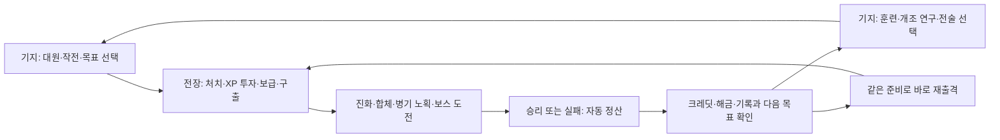

# 작전 → 정산 → 로비 → 재출격 · 경제와 장기 성장 설계

2026-11-05 · 설계 초안 0.1 · [작전형 서바이버 기획](METAL-SLUG-SURVIVORS-CONCEPT.md)의 장기 순환 상세

**상태:** 아래 기본 경제는 0.12에 구현됐다. 가격·최초 보너스는 0.13에서도 유지한다. 세 전선의 후반 처치·중간 보스·추가 거점 수당, 새 연구와 최초 지령은 [0.13 현행 계약과 검증](VALIDATION-V013.md)을 우선한다. 아래 [계산기](design/meta-economy.mjs)와 [예시](design/meta-economy-examples.json)는 이전 규칙 정산의 회귀 계약으로 보존한다.

## 1. 확정할 핵심 순환

**전장에서 빌드를 만든다 → 성공/실패 모두 성과를 정산한다 → 기지에서 다음 판의 선택과 작은 기초 보정을 얻는다 → 다른 대원·개조·목표로 다시 출격한다.**

로비에서 진화 무기를 사서 출발하는 구조가 아니다. 한 판을 강하게 만드는 주된 투자는 전장의 레벨업·개조·진화·합체다. 로비는 기본 생존을 조금 돕고, 다음에 시도할 것을 늘린다.



반복 정비는 익숙해진 뒤 약 20–40초를 관찰 목표로 둔다. 매번 모든 탭을 방문할 필요는 없다. 원하면 정산 후 바로 재출격한다.

## 2. 벤치마크에서 확인한 것과 우리의 선택

| 자료 | 확인한 사실 | 채택할 관계 | 그대로 복원하지 않는 것 |
|---|---|---|---|
| Vampire Survivors 공식 소개 | 판마다 Gold를 모아 다음 플레이용 강화를 구매. PowerUp 무료 환불을 권장 | 실패 뒤에도 준비가 진척되고 잘못 산 훈련은 되돌릴 수 있음 | 현행 전체 가격·상한이나 후반 무제한 성장 |
| MegaBonk 개발자 공지·업적 | Silver 획득과 슬롯 해금이 메타 성장으로 구분됨. 퀘스트로 새 사용 권한을 여는 구조 | 플레이 조건 해금과 소비 재화를 구분. 돈은 선택권에도 사용 | 모든 품목의 ‘조건 충족→추가 구매’ 규칙을 하나로 단정하거나 가격 복제 |
| Pokémon Survivor Burst 개발자 자료 | 특정 대원으로 도전해 다른 대원을 해금. 과거 로그에 영구 보너스 상점·Candy·훈련·장비·메달, 공식 소개에 기록 목표 | 대원별 목표와 새 조합의 장기 동기 | 과거 로그의 통화/훈련 효과를 현행 10.5의 정확한 경제로 취급 |

원작에서 확인되는 것은 이런 장기 성장 경로의 **존재와 관계**다. 인기나 재접속률이 특정 경제 공식 때문이라는 인과는 확인하지 못했다. MegaBonk와 Burst의 현행 사망 정산률·화폐 환산·전체 가격표도 복원했다고 주장하지 않는다.

### 이번 설계의 선택

1. 로비에서 소비하는 돈은 **보급 크레딧(C)** 하나다.
2. **작전 점수**는 숙련 기록이다. 크레딧으로 환전하지 않는다.
3. **훈장**은 달성 기록이다. 소비하거나 차감하지 않는다.
4. 기초 훈련은 유한한 상한을 두고 무료 환불한다.
5. 새 대원/작전은 플레이 달성으로 열고, 개조 연구·추가 선택권·기초 훈련은 크레딧을 쓴다.
6. 주무기/지원무기 두 칸, 기본 회피, 기본 전술기, 기본 진화·H+R 합체는 시작부터 사용할 수 있다. 핵심 재미의 입장권을 돈으로 사게 하지 않는다.

## 3. 무엇이 남고 무엇이 초기화되나

| 항목 | 작전 중 역할 | 작전 종료 뒤 |
|---|---|---|
| 전투 XP·레벨 | 무기/보조 강화 선택 | 초기화 |
| 획득 총·개조·진화·합체 | 그 판의 빌드 | 초기화. 발견 기록만 유지 |
| 탄약·Slug 내구·회복품 | 그 판의 화력·생존 | 초기화 |
| 확보 크레딧 | 현재 작전의 정산 예정액 | 성공/실패/정상 포기 모두 확보분 지급 |
| 기초 훈련 | 작은 공통 능력 보정·추가 리롤 | 구매 상태 유지. 새 대원에도 적용 |
| 개조 연구 | 해당 무기의 새 전투 후보를 사용 가능하게 함 | 유지. 완성 무기 자체를 들고 출발하지는 않음 |
| 대원·전술 교범·작전 해금 | 출격 선택지 | 유지 |
| 도전 진척·훈장·발견 | 다음 해금과 수집 목표 | 유지. 성공 조건 도전은 완주 때만 인정 |
| 점수·처치·구출·시간 | 이번 작전 성과 | 개인 기록으로 유지 |

한 작전 안에서 구역을 이동할 때에는 레벨·무기·강화가 유지된다. 결과를 거쳐 다음 작전에 출격할 때 새 빌드를 만든다.

## 4. 한 판의 크레딧 정산

### 반복 보상 공식 — 일반 난도

```text
처치 수당 = floor(min(일반 처치 수, 800) / 5)
정예 수당 = 고유 호위대장 처치 수 × 25       (작전당 최대 2)
구출 수당 = 구출한 고유 포로 수 × 20         (최대 5)
거점 수당 = 완료한 고유 거점 수 × 50         (최대 2)
보스 진척 = 최초 파괴한 장갑/주요 부위 수 × 30 (최대 2)
완주 수당 = 작전 승리 시 300
반복 획득 = 위 수당의 합계
```

- 실패해도 이미 확보한 수당을 깎지 않는다. 보스를 거의 잡다 실패했다면 부위 파괴 보상이 남는다.
- 포기는 그때까지의 확보분을 지급한다. 무조건 잔액을 몰수하거나 재출격 비용을 요구하지 않는다.
- 생존 시간만으로 돈을 지급하지 않는다. 무입력 대기는 수입원이 아니다.
- 처치 크레딧의 800마리 반영 상한은 무한 파밍보다 임무 완수를 유리하게 하려는 경제용 값이다. **전투 XP·성장·처치 집계는 제한하지 않는다.** 상한 이후에도 적은 성장과 화력을 즐길 대상이다.
- 포로·거점·호위대장·보스 부위는 ID별 최초 성공만 지급한다. 소환된 같은 보스를 다시 잡거나 재생성한 부위를 파괴해 중복 수당을 얻지 않는다.
- 과밀 도전은 반복 보상에만 ×1.15 후 버림. 최초 보너스는 증폭하지 않는다. 일반 원정만으로도 모든 기본 구매가 가능하다.

### 한 번만 받는 보너스

| 보너스 | 조건 | 지급 | 중복 방지 단위 |
|---|---|---:|---|
| 첫 전투 보고 | 50처치 이상 또는 포로/거점/보스 부위 성과가 있는 첫 작전 정산 | 100C | 계정당 한 번 |
| 첫 작전 완주 | 해당 작전 최초 승리 | 200C | 작전당 한 번. 대원/난도를 바꿔 중복 지급하지 않음 |

첫 전투 보고는 미달이면 소진하지 않는다. 시작 직후 포기하는 반복에 보너스를 주지 않으면서 첫 유효한 실패 뒤 작은 구매가 가능하도록 한다.

### 계산 예시

여기서 K/E/P/O/B는 각각 일반 처치/고유 정예/포로/거점/보스 부위 수다. 처치 K에는 E와 지휘 보스를 중복 포함하지 않는다.

| 예시 | 시간 | K/E/P/O/B | 결과 | 반복 C | 처음 받는 보너스까지 포함하면 |
|---|---:|---|---|---:|---:|
| 초반 전투 뒤 사망 | 45초 | 60/0/0/0/0 | 실패 | 12 | 첫 보고 포함 112 |
| 초보의 유효한 첫 판 | 2분 | 200/0/2/0/0 | 실패 | 80 | 첫 보고 포함 **180** |
| 우회 보급 후 사망 | 3분 30초 | 450/1/2/1/0 | 실패 | **205** | 첫 보고가 남았다면 305 |
| 보스 부위 둘 파괴 후 사망 | 6분 | 950/2/3/1/2 | 실패 | **380** | 첫 보고가 남았다면 480 |
| 빠른 작전 돌파 | 4분 | 600/2/1/0/2 | 승리 | **550** | 새 계정·첫 완주면 850 |
| 일반 완주 | 6분 | 1000/2/3/1/2 | 승리 | **680** | 첫 보고+첫 완주 모두 남았다면 980 |
| 구출·거점까지 완주 | 7분 | 1200/2/5/2/2 | 승리 | **770** | 모든 최초 보너스 포함 1070 |
| 같은 성과의 과밀 완주 | 7분 | 1200/2/5/2/2 | 승리 | **885** | 모든 최초 보너스 포함 1185 |

첫 보고를 이미 받았다면 첫 일반 완주는 680+200=880C다. 반복 완주에는 최초 보너스를 다시 붙이지 않는다.

## 5. 점수는 무엇을 위해 존재하나

크레딧은 실패해도 다음 시도를 준비하게 한다. 작전 점수는 잘 싸우고 임무를 해결한 정도를 기록한다. 둘을 같은 숫자로 만들면 최고 점수만 노리는 행동이 유일한 돈벌이 경로가 되기 쉽다.

```text
S = min(K,800)×10 + E×250 + P×300 + O×800 + B×1500
    + (완주 시 10,000)
    + (완주 시 max(0,600-전투초)×20)
```

E/P/O/B는 크레딧과 같은 고유 개체 상한을 적용한다. 선택/일시정지 시간은 전투초에서 제외한다. 실패 점수는 표시하되 완료 등급을 부여하지 않는다.

| 완료 등급 | 점수 |
|---|---:|
| S | 30,000 이상 |
| A | 24,000 이상 |
| B | 18,000 이상 |
| C | 그 미만의 완주 |

예시의 빠른 완주는 27,000점(A), 6분 일반 완주는 28,000점(A), 전원 구출·두 거점의 7분 완주는 28,200점(A)다. 같은 전원 구출 성과를 5분에 이루면 30,600점(S)다. S는 단순히 오래 버티거나 완주만 하면 자동 지급하는 등급이 아니다.

점수·완주 시간·전원 구출은 별도 개인 최고 기록으로 저장한다. 빠른 클리어와 구조 도전을 하나의 최적 경로로 강요하지 않는다. 기록 비교 키는 규칙 버전/작전/난도/대원이다. 당시 기초 훈련과 전술 교범도 기록에 남긴다. 초기 범위는 개인 기록이며 온라인 경쟁 규칙을 구현한 것으로 취급하지 않는다.

## 6. 로비에서 크레딧으로 무엇을 사나

### 훈련장 — 공통·유한·100% 환불

| 훈련 | 단계별 가격 | 단계당 효과 | 최대 |
|---|---|---|---|
| 기초 체력 | 80 / 160 / 240C | 기본 최대 HP +5% | +15% |
| 사격 기초 | 120 / 200 / 320C | 기본 무기 피해 +3% | +9% |
| 회수 훈련 | 80 / 160C | XP 회수 반경 +10% | +20% |
| 작동 숙련 | 140 / 240 / 360C | 기본 무기 공격 간격 −2% | −6% |
| 전술 판단 | 160 / 280C | 판마다 리롤 +1회 | 기본 1회 + 추가 2회 = 3회 |

모든 비율은 기본값에 가산한다. 체력 기본 100은 최대 115가 된다. 작동 숙련은 캐릭터 전술기·Slug 주포 충전에는 적용하지 않는다. 리롤 사용에 크레딧을 다시 지불하지 않고, 새 판마다 구매한 횟수가 충전된다. 남긴 리롤을 다음 판에 저축하지 않는다.

기본 리롤 1회는 훈련 없이 모두에게 제공한다. 160C 추가 리롤은 초반의 필수 생존권이 아니라 ‘확정 체력·회수 보정 두 개’와 경쟁하는 빌드 선택권이다. 첫 수입을 어디에 써야 정답인지 미리 정하지 않는다. 첫 네 판 예시의 리롤 구매는 가능한 경로 하나다.

총 구매액은 **2,540C**다. 피해와 공격 간격만의 직접 화력 보정은 최대 `1.09 / 0.94 ≈ 1.16배`다. 추가 리롤의 간접 효율이나 발동 시너지를 포함한 실제 전투력 배율은 별도 검증 대상이다.

전체 훈련 환불은 로비에서 무료로 가능하다. 실제 지불한 금액을 돌려주며, 가격표가 바뀌어도 더 높은 현 가격으로 환불해 차익이 생기지 않는다. 대원 교체 때 다시 구매하지 않는다.

### 무기고 — 새 개조 후보 연구

| 연구 제안 | 플레이로 확인할 조건 | 연구 비용 | 다음 판에 달라지는 것 |
|---|---|---:|---|
| P 관통 분열 | P 전용 강화 3회 완료 경험 | 200C | P 탄 적중 뒤 작은 분열탄을 만드는 개조 후보 |
| H 도탄 | H로 누적 일반 적 200처치 | 240C | H 탄이 다른 적으로 튕기는 개조 후보 |
| R 점화 탄두 | R로 누적 일반 적 100처치 | 280C | 로켓 폭발 자리에 짧은 화염 지대를 남기는 후보 |

세 연구 총액은 **720C**다. 조건 달성은 연구 가능 상태를 열고, 구매는 영구 사용 권한을 연다. 캐릭터 해금과 같은 무료 달성 보상에는 추가 영입비를 붙이지 않는다.

연구한 개조를 로비에서 완성 무기로 장착하지 않는다. 해당 총을 얻고 판 안의 강화 선택에 투자해야 한다. 무기 카테고리를 먼저 정한 뒤 해당 무기의 해금 후보에서 개조를 제안해, 연구 때문에 다른 총을 얻을 확률 자체가 희석되는 문제를 줄인다.

처음 연구한 개조는 다음 적합한 판에서 **해당 총의 첫 전용 개조 후보에 한 번 등장**하도록 한다. 선행 총/강화 조건이 맞을 때만 적용하며, 선택은 자유다. 다른 총으로 플레이했다면 이 첫 체험 기회를 소모하지 않는다. 즉시 미리보기와 추천 대원을 제공해 구매 효과를 이해하게 한다.

연구는 해금 콘텐츠이므로 환불하지 않는다. 비용·조건·효과·판 안에서 다시 선택해야 한다는 점을 구매 전에 보여 준다. 출전비, 판마다 사는 필수 탄약/회복품, 진화 무기 구매는 기본 경제에 없다.

### 후반 사용처

정식 확장안은 작전별로 연구를 단계 개방한다. 세 작전·추가 개조는 아직 구현하지 않은 콘텐츠 계획이며 초기 시제품의 상점에 가짜 구매 항목으로 표시하지 않는다.

| 단계 | 연구 계획과 가격 | 새 플레이 조건 | 단계 연구액 |
|---|---|---|---:|
| 작전 1 | P 분열200 / H 도탄240 / R 점화280 | 해당 총 숙련/사용 조건 | 720C |
| 작전 2 | P 귀환탄400 / H 소이탄500 / R 반사탄600 | 작전1 완주로 연구 목록 공개, 작전2에서 해당 총로 호위대장 처치 | 1,500C |
| 작전 3 | P 약점 잔향600 / H 제압사격700 / R 집속패턴800 | 작전2 완주로 공개, 해당 총의 진화 완주 기록 | 2,100C |

각 항목은 피해 수치 단계가 아닌 공격 방식의 새 후보다. 세 단계 연구 총액 **4,320C**, 기초 훈련까지 합한 예산은 **6,860C**다. 연구가 열려도 기존 총의 기본 진화와 초기 합체를 잠그지 않는다.

작전별 기념 외형은 500/800/1,200C의 선택 구매안으로 총 2,500C를 둔다. 외형은 전투력과 무관하다. 이 가격 계획은 실제 변주/외형 콘텐츠가 있을 때의 사용처이며, 가격만 늘려 같은 총을 반복 구매시키는 계획이 아니다.

전부 구매한 뒤에도 크레딧은 계속 적립한다. 남는 돈을 쓰게 하려고 무한 공격력·출전 소모비를 도입하지 않는다. 장기 목적은 미완 대원 도전·구조 완주·고득점·다른 조합으로 옮긴다. 첫 작전만 있는 시제품에서 초기 연구가 끝난 것은 그 검증 범위의 끝으로 명시한다.

## 7. 돈과 별개로 무엇이 열리나

### 대원·작전

| 목표 | 제안 조건 | 보상 | 크레딧 추가 구매 |
|---|---|---|---|
| 교두보 돌파 | 첫 작전 승리 | 다음 작전/과밀 도전의 사용 권한 | 없음 |
| 에리 영입 | R 또는 수류탄으로 호위대장 누적 3회 처치 | 에리 사용 권한 | 없음 |
| 타마 영입 | Slug 노획 누적 2회 + 작전 1회 완주 | 타마 사용 권한 | 없음 |
| 구조 훈장 | 한 작전의 포로 5명 전원 구출 후 완주 | 구조 기록·대원별 표식 | 없음 |
| 정밀 돌파 훈장 | 해당 작전 S등급 | 대원 명찰/기지 기념 표식 | 없음 |

마르코·피오는 기본 제공이다. 에리·타마의 조건은 두 대원으로도 수행할 수 있어 해금 순환이 막히지 않는다. 초기 구현에 실제로 없는 대원을 ‘해금 가능’인 것처럼 표시하지 않는다. 현재 첫 제작 단위는 마르코·피오이며 추가 대원 목표는 확장 명세다.

### 대원 숙련은 세 개의 도전으로 표현

별도 대원 경험치 통화를 추가하지 않는다. `완주 / 고유 운용 / 도전 완주`의 세 훈장으로 진척을 보여 준다. 숙련 훈장은 돈처럼 쓰지 않는다.

- 마르코 고유 운용: P 진화로 지휘전차 격파 → **집중/산개 전술기 교범** 선택 해금.
- 피오 고유 운용: 보급 강화 사격 중 두 총으로 합계 300처치 누적 → **비축/신속 재보급 교범** 선택 해금.
- 교범은 로비에서 하나를 선택한다. 집중은 좁고 강한 일제, 산개는 넓고 낮은 집중 피해처럼 장단점을 함께 갖는다. 같은 효과의 상위 등급을 무한히 쌓지 않는다.

발견 도감은 본 무기·개조·진화·합체와 알려진 조건을 남긴다. 완성하지 못한 조합은 다음 목표로 고정할 수 있지만, 그 재료를 다음 판에 자동 지급하지 않는다.

## 8. 로비 UI와 각 화면의 책임

기지를 걸어 다니는 이동 메뉴부터 만들지 않는다. 대원과 전장이 보이는 한 화면에서 네 영역을 전환하고 출격 버튼은 유지한다.

| 영역 | 결정할 일 | 보여 줄 것 |
|---|---|---|
| 작전실 | 어디에, 어떤 난도로, 무엇을 노리고 갈까 | 해금 작전·완주/구출/최고 기록·고정 목표 하나 |
| 병영 | 누구로, 어떤 전술을 쓸까 | 캐릭터 특성·출전 총·교범 하나·미완 숙련 조건 |
| 무기고 | 어떤 새 공격 방식을 열까 | 연구 가능/조건 부족/연구 완료, 가격과 실제 탄도 미리보기 |
| 훈련장 | 무엇이 부족했고 어떻게 조금 보완할까 | 다섯 훈련의 현재/최대치·다음 가격·무료 환불 |

크레딧 잔액은 공통으로 한 곳에 표시한다. 상점마다 다른 돈을 만들지 않는다. 도감·기록은 작전실/병영의 보조 화면으로 둔다.

구매 가능 항목을 전부 빨간 점으로 강조하지 않는다. 플레이어가 고정한 다음 목표 하나와 최근 판의 유효한 추천 하나를 우선 보여 준다. 추천은 무시/교체할 수 있고 기본 출격은 언제든 가능하다.

### 정산 화면 — 여러 보상 모달로 쪼개지 않는다

1. **성과:** 성공/실패, 사용 대원, 시간, 처치, 완성 빌드, 구출, 보스 진척.
2. **획득:** 반복 수당과 최초 보너스, 총 크레딧, 지급 후 잔액.
3. **진척:** 이번 판 달성/진척한 목표. 완료 보상은 자동 지급하고 한 번 강조.
4. **다음 한 수:** `리롤 +1회 연구 가능`, `에리 영입까지 폭발 호위대장 1회`, `P 분열을 다음 판에 시험`처럼 구체적 행동 하나.

버튼은 `기지에서 정비`와 `같은 준비로 재출격`이다. 새 목표를 고르지 않아도 계속 플레이할 수 있다. 정산은 애니메이션이나 ‘보상 받기’ 버튼보다 먼저 저장한다.

### 첫 실패 화면 예시

```text
작전 미완료                     마르코 · 2:00
200 처치 · 포로 2명 구출

전투 수당             +40 C
구출 수당             +40 C
첫 전투 보고         +100 C
이번 획득             180 C       보유 180 C

다음 한 수: 전술 판단 I — 160 C
다음 판 레벨업 리롤이 1회 → 2회로 늘어납니다.

[기지에서 정비]        [같은 준비로 재출격]
```

## 9. 첫 네 판의 실제 지갑 흐름 예시

이 표는 입력 가정에 따른 산술 시나리오다. 실제 플레이어가 이 순서로 성장하거나 반드시 네 번째에 승리한다는 예측은 아니다.

| 판 | 성과와 수입 | 로비의 선택 | 구매 뒤 잔액 | 다음 판의 변화 |
|---|---|---|---:|---|
| 1 | 2분 실패, 첫 보고 포함 180C | 리롤 +1회 160C | 20C | 첫 선택이 마음에 안 들 때 다시 고를 여유 |
| 2 | 3분 30초 실패, 205C → 보유225C | 조건을 달성한 P 분열 연구 200C | 25C | 다음 적합한 P 개조 후보에서 새 탄도 시험 |
| 3 | 보스 부위 둘 파괴 후 실패, 380C → 보유405C | 체력 I 80C + 작동 숙련 I 140C | 185C | HP105, 무기 간격−2%. 큰 화력은 다시 판 안에서 완성 |
| 4 | 일반 첫 완주 680+200=880C → 보유1065C | 피오로 다음 작전/연구 또는 더 높은 기록 도전 | 선택에 따름 | 새로운 목적과 대원 운용. 이전 판 완성 무기는 초기화 |

여기서 2판의 P 숙련 조건은 이미 달성했다고 가정한다. 미달이면 해당 구매 대신 다른 훈련/저축을 택한다. 조건이 안 된 연구를 결제할 수 있게 하지 않는다.

## 10. 보상 속도와 파밍 검증

설계 계산기의 훈련+초기 연구 총액은 **3,260C**다.

- 실패를 거쳐 배우는 예시 입력은 7판째 누적 3,775C로 이 금액을 넘는다.
- 처음부터 잘하는 예시 입력은 5판째 누적 3,750C다.
- 2분 실패를 열 번 반복하면 누적 900C다. 기본 구매는 가능하지만 빠르게 전체를 완성하지는 못한다.

위 5–7판은 초기 상점 예산 3,260C에 대한 결과다. 정식 확장 예산 6,860C와 혼동하지 않는다. 예를 들어 일반 완주 10회가 모두 예시 680C를 벌고 세 작전의 첫 완주/첫 보고 보너스를 받는다면 총7,500C로 정식 예산을 넘는다. 해당 횟수 안에 모든 연구의 플레이 조건을 충족한다는 뜻은 아니다.

이는 구매 예산 합계이며 모든 연구의 플레이 조건 달성까지 증명하지 않는다. 여기에 첫 완주 전에 이미 사 둔 훈련을 환불해 연구로 돌리는 선택도 가능하다.

### 초반 퇴각 반복의 위험을 숨기지 않는다

정비 30초를 가정하면 예시 일반 완주는 약 104.6C/분, 빠른 완주는 약 122.2C/분, 90초 자원 확보 후 퇴각은 87.5C/분이다. 이 입력에서는 완주가 유리하다.

반면 **60초 안에 400처치·정예2·포로3·거점2를 모두 끝낼 수 있다면** 퇴각 반복이 약 193.3C/분으로 더 유리해진다. 현재 미구현 지도에서 그 행동이 불가능하다고 단정하지 않는다. 이 스트레스 사례는 계산기에 남기고 실제 배치/보상 조정의 실패 기준으로 사용한다.

첫 플레이 검증에서 숙련자의 가장 빠른 자원 회수→퇴각 루프를 측정한다. 로비/재시작 시간을 포함한 반복 완주 수입이 해당 루프보다 최소 15% 높아야 한다. 미달이면 거점 보상 비중·고유 지급 범위·완주 수당·동선 비용을 조정한다. 실패 보상을 통째로 몰수하는 방식부터 적용하지 않는다.

돈의 크기보다 먼저 검증할 것은 한 판의 강해지는 맛이다. 메타 기본 직접 화력 보정은 약16% 안쪽이고, 판 안의 완성 빌드는 훨씬 큰 공격 형태/처리량 변화를 목표로 한다. 실제 배율은 같은 적 배치의 시작/완성 무기로 별도 측정한다.

## 11. 저장·정산·구매의 개발 계약

이벤트 집계에서 일반 처치 K는 정예/지휘 보스를 제외한다. 소환된 일반 병사는 K에 포함되지만 같은 사망 이벤트는 한 번만 집계한다. 호위대장이 있는 거점은 정예 E와 거점 O를 각각 달성하면 두 수당이 함께 발생할 수 있다.

포로는 잠금 파괴 뒤 구출이 확정되는 순간 지급하며 호송 대기를 요구하지 않는다. 거점은 해당 진지의 교전 완료 이벤트로 지급한다. 보스 부위는 개별 부위의 최초 파괴다. 같은 성공 ID를 애니메이션/복구 때 다시 집계하지 않는다.

무기 연구/대원 도전의 처치는 막타 효과의 무기 태그로 집계한다. 진화는 원재료 총의 태그를, 합체는 두 원재료의 태그를 계승한다. H+R 합체의 한 처치는 H/R 도전 진척에 각각 한 번 기여할 수 있지만 일반 처치·점수·크레딧은 한 번이다. 이 규칙을 전투 기록과 도전 UI가 함께 사용한다.


- 작전마다 고유 `runId`와 경제 규칙 버전을 부여한다. 정산 완료 ID를 기록해 결과 다시 열기/새로고침으로 재지급하지 않는다.
- 포로/거점/정예/보스 부위의 성공 ID와 전투 성과를 작전 체크포인트로 보존한다. 앱 종료 후 복구/정산 시 마지막 저장 성과를 사용한다.
- 크레딧 지급·목표 진척·새 해금·최고 기록·정산 완료 표식을 한 프로필 갱신으로 확정한다. 애니메이션 중 닫아도 이미 확정한 보상은 남는다.
- 구매는 잔액/선행 조건/현재 단계/상한을 다시 확인하고 잔액 감소와 소유 상태 증가를 함께 저장한다. 중복 클릭으로 중복 차감하지 않는다.
- 훈련 환불은 각 구매에 실제 지급한 크레딧 장부를 사용한다. 이미 환불한 단계는 재환불하지 않는다.
- 판 시작 시 훈련·교범·연구 풀의 스냅샷을 저장한다. 도중 로비 변경으로 현재 판의 성능/기록 조건을 바꾸지 않는다.
- 경제/가격 변경 시 규칙 버전을 올린다. 기존 소유/훈장/잔액을 임의 초기화하지 않고 이전 개인 기록은 해당 버전의 기록으로 보존한다.

최소 데이터는 `wallet / trainingRanks·paidCosts / researchedMods / achievements·progress / heroes·doctrines / operationUnlocks / records / activeRun / settledRunIds / rulesVersion`이다. 이것은 새 게임의 데이터 계약이며 현재 저장 스키마를 이미 변경한 것이 아니다.

## 12. 구현 순서와 수용 기준

첫 대상은 마르코·피오, 작전 하나, 일반 난도, 훈련 다섯 계열·연구 셋이다. 추가 대원/작전/과밀 보상은 대응 콘텐츠를 구현한 뒤 활성화한다.

1. **정산부터:** 일반 성과→반복 수당, 최초 보너스, 실패/포기, 중복 정산 방지. 정산 계산기의 예시와 일치해야 한다.
2. **하나의 로비:** 잔액, 대원/작전, 훈련 구매/환불, 바로 재출격. 첫 유효한 실패 뒤 구매 또는 눈에 보이는 목표 진척이 생겨야 한다.
3. **무기고 연결:** 연구한 개조가 실제 다음 적합한 판의 후보로 나오고, 선택 후 탄도/적중 결과를 바꿔야 한다.
4. **도전과 기록:** 구출·대원 운용·첫 완주를 구분하고 조건과 진행이 같은 이벤트를 기준으로 집계돼야 한다.
5. **경제 플레이 검증:** 새 계정/전체 훈련 계정 둘 다 기본 작전을 클리어할 수 있어야 한다. 추가 리롤을 포함한 간접 난도 변화와 빠른 퇴각 파밍을 측정한다.

출전료/수리비 때문에 못 나가는 상태, 다음 판을 시작하려면 여러 ‘받기’를 눌러야 하는 상태, 장비를 구매했지만 실제 판에 반영되지 않는 상태, 먼저 반복 파밍을 해야 기본 재미가 나오는 상태는 실패다.

## 근거

- [Vampire Survivors 공식 Steam 소개](https://store.steampowered.com/app/1794680/Vampire_Survivors/?l=english): 판마다 Gold→다음 플레이용 강화, 무료 PowerUp 환불 안내.
- [MegaBonk 개발자 메타 성장 공지](https://steamcommunity.com/app/3405340/discussions/0/600789889375948905/): Silver와 퀘스트/슬롯 문턱을 메타 성장으로 명시. [공식 업적](https://steamcommunity.com/achievements/3405340), [개발자 업데이트](https://steamcommunity.com/app/3405340/allnews/): 해금/Shop/Rank 변경의 보조 근거. 정확한 현행 가격표는 미확인.
- [Burst 개발자 출시·업데이트 스레드](https://eeveeexpo.com/threads/9705/): 대원 도전·기록, 과거 버전의 영구 보너스와 훈련/장비/메달. [공식 배포 소개](https://clessio.itch.io/pokmon-survivor-burst), [10.5.0 로그](https://clessio.itch.io/pokmon-survivor-burst/devlog/1748263/1050): 현행 소개와 과거 변경을 구분. 현행 전체 화폐/정산 공식은 미확인.
- [사용자 제공 자료 분석](REFERENCE-ANALYSIS-V09.md): 캡처의 버전 범위를 보존. PokéRogue를 Burst의 경제 근거로 대체하지 않는다.
