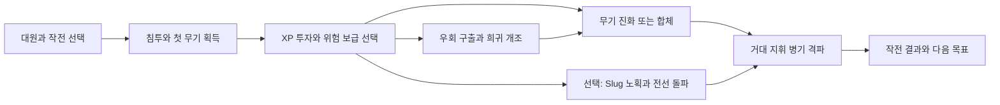

# 메탈슬러그 × 서바이버 · 작전 중심 재기획

2026-11-05 · 방향성 초안 0.2 · 초기 설계 근거

현재 구현은 [0.13 세 전선·전술 보급 계약](VALIDATION-V013.md)을 따른다. 아래 초안의 시간·동선 가설과 확정 구현은 구분한다. 두 대원, 세 전선, 중간 보스 두 기와 최종 지휘전차가 구현됐다.

크레딧·로비·해금·점수·구매/환불의 세부 계약은 [경제와 장기 성장 설계](META-PROGRESSION-ECONOMY.md)를 따른다. 기초 훈련은 상한을 둔 영구 보정으로 구체화했으며, 큰 화력 완성은 판 안의 성장으로 유지한다.

사용자 결정: 기존 동물 원정의 매력을 전제로 고도화하는 흐름에서 벗어나, **메탈슬러그의 시나리오와 캐릭터 특성을 살린 뱀서류**로 다시 기획한다. 이번 문서는 작동 중인 게임의 완료 목록이 아니다. 원작 인물·시나리오는 분석 기준이고, 아래 신규 작전·성장·진화·합체 규칙은 별도로 제안한 팬 콘셉트다.

## 1. 한 문장으로 설명할 게임

**마르코 일행으로 적진에 침투해 포로와 병기를 되찾고, 노획한 무기를 판 안에서 진화·조합하여 모덴군의 거대 병기를 파괴하는 작전형 서바이버.**

전투의 주어가 ‘숲에서 버틴다’에서 ‘특공대가 임무를 수행한다’로 바뀐다. 구출·보급·노획은 이야기와 성장 획득을 동시에 담당한다. 대량 처치는 임무를 돌파할 화력을 만드는 수단이자, 완성한 화력을 즐기는 보상이다.

시점 기본안은 **탑다운 2D·8방향 이동**이다. 전장 폭과 원근으로 전진감을 주고, 거대 병기가 길을 막는다. 횡스크롤·점프·별도 수동 조준까지 도입하는 전환은 미확정이다. 모바일의 이동+전술기 조작과 대군 전투를 먼저 성립시키는 쪽을 추천한다.

## 2. 왜 기존 시제품에 목적이 약했나

대상은 방금 만든 0.11 두 갈래 숲길이다. 기존 긴 원정의 모든 시스템이 없다는 뜻은 아니다.

| 현재 관찰 | 플레이어에게 빠진 기대 | 재설계 원칙 |
|---|---|---|
| 7초에 두 경로, 50초에 두 진화를 고정 지급 | 이번 판 무엇을 발견할까 | 전장 보급·포로·정예가 서로 다른 재료를 제공 |
| XP는 자동 수치 강화 | 지금 얻은 무기에 어떤 투자를 할까 | 레벨업마다 보유 총의 발사 방식/보조 능력을 선택 |
| 같은 공터에서 주위에 적 생성 | 저쪽을 돌파하면 무슨 일이 생길까 | 적 진지·수송대·감옥·차고를 실제 이동 목표로 배치 |
| 일반 적 둘은 추적 속도 위주로 차이 | 어떤 적부터, 어느 방향에서 공격할까 | 방패병·박격포·지휘관·중장비의 역할을 구분 |
| 보스 격파 뒤 처치/시간 최고 기록 | 다음 판에 꼭 이루고 싶은 일이 무엇일까 | 구출 누락·다른 대원·미발견 개조·다음 작전 등 구체적 목표 |

근거: `src/sprint/model.js`의 시간표·성장·적 정의, `src/sprint/main.js`의 결과·재시도, [0.11 실제 검증](VALIDATION-V011.md). 메뉴를 줄이는 과정에서 **성장에 투자하는 판단과 뜻밖의 획득까지 줄였다.** 적 수와 탄 수를 늘리는 것만으로 이 간극을 메우기 어렵다.

원화 취향이 맞지 않으면 첫 흥미도 낮아질 수 있다. 동시에 정지 원화의 매력과 전투 중 작은 스프라이트의 매력은 다르다. 새 외형의 기준은 ‘예쁜 캐릭터’뿐 아니라 총의 작동, 몸의 반동, 적 반응, 파괴 과정을 읽을 수 있는가다.

## 3. 세 게임에서 무엇을 연결하나

| 참조 | 확인한 구조 | 이번 기획에서의 역할 |
|---|---|---|
| 메탈슬러그 | 임무 수행, 포로 구출의 유리한 아이템, 강한 무기와 Slug 탑승. 3편의 분기 경로 | 전장·구출·노획·거대 보스라는 행동의 이유와 시청각 정체성 |
| MegaBonk | 무작위 맵/강화 희귀도, 캐릭터 능력, 발동 아이템 시너지, 퀘스트·해금 | 나온 재료를 해석하고 우회 위험을 선택하는 판 안의 빌드 변화 |
| Pokémon Survivor Burst | 공격·패시브·Burst·진화의 조합, 대원 도전 해금, 빌드와 기록 목표 | 대원마다 다른 성장 효율, 완성 모습의 기대, 다음 판의 구체적 도전 |

이 구조가 재플레이를 도울 수 있다는 것은 **설계상 해석**이다. 공식 소개만으로 실제 이용자 유지율이나 인기의 원인을 입증한 것은 아니다. 참고 대상은 PokéRogue와 구별되는 ClessioTV의 Pokémon Survivor Burst다.

## 4. 플레이하는 이유를 세 거리로 만든다

| 거리 | 플레이어가 가질 생각 | 게임이 제공할 것 |
|---|---|---|
| 지금 10–30초 | 저 포로를 구하면 새 총을 얻는다. 박격포부터 부수자 | 보이는 위험·획득 예고·즉시 다른 발사 방식 |
| 이번 작전 | 로켓과 기관총을 완성해서 저 전차를 부수겠다 | 조건이 보이는 진화/합체, 강해진 빌드를 쓸 대군과 보스 |
| 다음 작전/재도전 | 이번엔 피오로 보급로를 돌아 다른 개조를 완성하겠다 | 다른 대원 가치, 놓친 구조 목표, 새 개조와 다음 임무 |

기록은 이 목적을 보강한다. 작전에서 보급 크레딧을 정산해 로비의 유한한 기초 훈련·개조 연구에 사용하고, 훈장으로 대원/작전을 연다. [세부 순환과 초기 가격·보상](META-PROGRESSION-ECONOMY.md)을 별도 정의한다. 점수는 크레딧으로 환전하지 않는다.

## 5. 한 판과 다음 단계의 경계

- **한 판 = 한 작전.** 통상 5–8분을 초기 관찰 목표로 둔다. 제한 시간이 도달했다고 강제로 끝내지 않는다.
- 한 작전은 침투 구역 → 보급/병기 구역 → 거대 지휘 병기 결전으로 이어진다. 구역 사이에는 그 판의 무기·강화·구출 결과가 유지된다.
- 결전 승리 직후 `MISSION COMPLETE`와 결과. 추가 출구 찾기나 대기 과제를 붙이지 않는다.
- HP 0은 작전 실패. 중도 종료는 포기. 확보한 발견/도전 진척과 작전 완주는 분리해 기록한다.
- 결과에서 다음 작전을 고르면 새로운 판이다. 전투 레벨·장비는 초기화하고 해금된 선택지는 유지한다.
- 첫 구현 검증은 **전장 하나+거대 보스, 약 4–6분의 완결된 짧은 작전**으로 축소한다. 정식 진행의 압축 검증이며 고정 시각의 보상 쇼케이스로 만들지 않는다.

시간은 적 증원과 진지 위험을 높이는 압박으로 사용한다. 보스 도전 자격을 채우기 위한 처치 할당량이나 XP 차단은 두지 않는다. 빨리 완성한 빌드는 빨리 도전할 수 있고, 조금 더 탐색할 수도 있다.

## 6. 첫 작전안: 교두보 탈환

**신규 미션 제안.** 모덴군이 항구로 옮기는 시험 병기와 붙잡힌 정비반을 발견한다. 침투한 대원은 노획 무기로 방어선을 돌파하고, 항구의 지휘전차를 파괴한다. 통신 대사 한두 줄과 전장 연출로 상황을 전달한다.

주목표는 **지휘전차 파괴**다. 포로 전원 구출과 Slug 보존은 선택 목표다. 구출 숫자를 전부 채우지 않았다는 이유로 보스를 잠그지 않는다.

| 조우 | 플레이 행동 | 바로 얻는 보상 | 남는 판단 |
|---|---|---|---|
| 첫 수송대/포로 | 호위병을 처치하고 잠금장치 파괴 | 주총 전용 개조 / 새 지원총 중 선택 | 지금 총을 보강할지 새로운 공격을 얻을지 |
| 전선의 보병 무리 | 사격·회피·XP 회수 | 보유 무기/전술 능력 투자 | 관통, 폭발, 지속화력 중 무엇을 키울지 |
| 측면 감옥 또는 보급차 | 경비와 좁은 길을 감수해 우회 | 희귀 개조 후보 또는 병기 정비 | 지금 위험을 감수할 가치가 있는지 |
| 중장비 호위대장 | 포격 예고를 피하고 공격 거점을 파괴 | 진화용 개조 핵심과 차고 접근 기회 | 즉시 완성 무기로 갈지 다른 재료를 더 찾을지 |
| Slug 차고 | 경비를 격파하고 탑승 병기 노획 | 즉시 전선을 뚫는 큰 화력 변화 | 남은 내구를 길 돌파와 보스 중 어디에 쓸지 |
| 거대 지휘전차 | 포탑/장갑/본체를 공격하며 패턴 회피 | 작전 완주 | 놓친 구출, 다른 대원·개조, 다음 작전 |

초기 목표 순서로 첫 무기 30초 이내, 첫 의미 있는 투자 1분 이내, 무기 완성은 보스 전에 관찰한다. **이 시간들은 자동 지급 시각이 아니다.** 지도상의 실제 조우와 플레이어 행동이 보상을 만든다.

보급 위치·후보·우회 사건은 제한된 패턴 안에서 바뀐다. 첫 필수 성장 기회까지 장거리로 헤매게 하거나, 주력 무기에 쓸 강화가 전혀 나오지 않는 상태는 방지한다.

### 고정 순서 대신 갈림길을 만든다

위 표는 조우 종류다. 포로→수송대→호위대장→차고를 전부 순서대로 완료하는 체크리스트가 아니다. 지휘전차 접근로는 처음부터 열려 있고 성장/병기 보급은 준비 선택이다.

- 첫 가까운 보급은 현재 주총 개조와 새 지원총 하나를 동시에 제시한다. 새 지원총의 종류는 시드마다 다르다.
- 첫 보급 이후에는 **탄약 수송대**와 **포로 수용소**가 서로 다른 방향에 보인다. 수송대는 새 총·탄약·합체 재료 쪽, 수용소는 현재 총의 개조·진화 핵심·정비 쪽에 유리하다. 두 경로 모두 진화 핵심을 얻을 수 있어 한쪽이 필수 재료 관문이 되지 않는다.
- 하나를 완료하면 경보가 올라 다른 쪽의 증원이 강해진다. 곧장 보스로 갈지 추가 위험을 감수할지 고른다. 결과가 나쁘다고 성장/보상 획득을 중단시키지는 않는다.
- 드랍 총·개조 후보와 보급 위치가 제한된 조합 안에서 바뀐다. H+R을 매 판 보장하지 않으며, 같은 총도 도탄/집중처럼 다른 개조를 선택할 수 있다.
- 첫 검증은 두 가지 수제 배치 안에서 이 규칙을 시험한다. 광범위한 절차 생성 맵부터 제작하지 않는다.

Slug 차고는 첫 작전에 **항상 존재하고 처음부터 지도에 보이는 선택 위험**이다. 접근 후 경비를 격파해 노획할 수 있고, 보스 격파 전까지 다시 방문할 수 있다. 우회 시간·경비·제한 내구가 비용이다. 차고를 건너뛴 도보 빌드도 지휘전차를 격파할 수 있어야 한다.

## 7. 캐릭터 특성은 같은 무기 선택의 가치를 바꾼다

설계 참조는 MS6의 네 대원이다. 공식 캐릭터 소개와 시스템은 확인했으나, 특기 세부가 이미지로 제공돼 배율을 1차 자료로 모두 판독하지 못했다. 원작의 ‘2배’ 같은 값을 검증 없이 가져오지 않는다. **아래 전투·성장 규칙은 뱀서류 전환 제안**이다.

| 대원 | 이번 기획의 특성 축 | 시작부터 보이는 차이 | 성장·동선의 가치 | 전술기 제안 |
|---|---|---|---|---|
| 마르코 | 기본 사격·주무기 숙련 | 강한 기본 권총과 집중 사격 | 한 주무기의 연속 적중·관통·약점 공략 투자 가치가 높음 | 정면 집중 사격으로 중장비 빈틈 공략 |
| 피오 | 특수 총기·보급·지속화력 | 기관총 출발, 보급의 강화 사격을 오래 유지 | 다른 총과 보급차를 찾아 두 무기의 강화 사격을 연계 | 보유 총기의 강화 탄창을 즉시 충전 |
| 에리 | 수류탄·투척·연쇄 폭발 | 수류탄 활용 기회가 많고 공격 범위를 직접 만듦 | 폭발·화상·군집 처치 재충전의 가치가 높음 | 이동 방향에 수류탄 집중 투척 |
| 타마 | Slug·병기 운용 | 도보 보조포로 병기 운용 정체성부터 드러냄 | 차고·정비 보급·탑승 병기 유지 가치가 높음 | 도보 보조포 배치 / 탑승 중 긴급 정비 |

주무기·지원무기는 공통 풀에서 얻는다. 모든 대원이 캐릭터 전용 정답 총 두 개만 모으게 하지 않는다. 같은 로켓 보급도 마르코에게는 약점 공략, 피오에게는 다른 총과의 지속화력, 에리에게는 연쇄 폭발, 타마에게는 병기 보조포 투자 기회가 된다.

### 출전과 첫 보급의 슬롯 계약

| 대원 | 출전 주무기 | 출전 지원무기 | 첫 보급의 두 선택 |
|---|---|---|---|
| 마르코 | P | 비어 있음 | P 전용 개조 / H 또는 R 중 이번 판에 나온 지원총 |
| 피오 | H | 비어 있음 | H 전용 개조 / P 또는 R 중 이번 판에 나온 지원총 |

새 지원총을 택하면 빈 지원 칸에 장착한다. 주총 개조를 택하면 지원 칸은 비어 있으며 이후 다른 보급에서 채울 수 있다. 모든 대원이 처음부터 두 칸을 가지며, 피오의 차이는 슬롯 독점이 아니라 H 출발과 보급 운용이다.

후속 보급에서 칸이 차 있다면 교체할 칸과 잃는 해당 총의 전용 투자를 선택 전에 표시한다. 같은 총을 다시 얻으면 중복 총으로 칸을 쓰지 않고 그 총의 개조/강화 탄창 보상으로 바꾼다. 다른 총으로 교체할 때 기존 총의 숙련이 임의로 계승된다고 가정하지 않는다.

첫 검증 대원은 **마르코·피오**로 잡는다. ‘한 총을 깊게 키우는 숙련’과 ‘보급으로 두 총의 화력을 이어가는 운용’이 실제로 다르게 느껴지는지 확인한다. 에리·타마는 이 순환이 성립한 다음 확장한다.

## 8. 무기 획득·성장·진화·합체를 구별한다

| 창구 | 역할 | 선택의 비용 |
|---|---|---|
| 포로·수송 보급 | 새 총 획득. 주무기/지원무기 두 칸 | 가진 총 유지·교체, 그 보급까지의 위험 |
| XP 레벨업 | 보유 총 강화 또는 전술 보조. 후보 셋 중 선택 | 같은 레벨을 어느 공격/약점에 투자하는가 |
| 정예/진지 보상 | 눈에 띄는 탄도·적중 후 효과의 개조 | 희귀도와 현재 빌드의 적합성 판단 |
| 조건 달성 + 개조 핵심 | 해당 무기의 완성 진화 또는 가능한 합체 | 두 무기의 독립 역할을 유지할지 합칠지 |

강화 선택은 자주 쌓일 수 있지만 큰 모달에 설명을 늘어놓지 않는다. `총 아이콘 → 바뀌는 탄도 → 한 줄 효과`로 보여 주고 전투는 멈춘다. 핵심 강화 후보를 항상 하나 포함하고, 나머지는 해당 판의 변화를 만든다. 선택 빈도는 실제 플레이로 조정한다.

### 초기에 검증할 무기와 변화

아래 진화·합체명과 규칙은 원작의 공식 무기 설명이 아닌 제안이다.

- **권총 P → 장갑 관통 권총**: 탄 하나의 관통과 약점 정밀 공략. 기본 총을 끝까지 투자하는 선택도 성립시킨다.
- **기관총 H → 쌍열 기관포**: 촘촘한 탄과 다중 적중으로 길을 연다. 도탄/집중 사격 개조로 다른 완성을 시험한다.
- **로켓 R → 다탄두 발사기**: 느린 중탄이 무리/장갑을 터뜨리고 작은 폭발로 이어진다.
- **H + R → 미사일 호위 기관포**: 연속 사격 적중이 보조 미사일을 유도한다. 단순히 두 총의 탄을 동시에 늘리는 효과와 구별한다.

초기 조건안: 총은 3번의 전용 강화로 숙련 완료. 숙련한 총 하나와 개조 핵심은 진화 선택을 연다. 조합 가능한 두 총을 모두 숙련했다면 같은 핵심 보상에서 합체도 선택할 수 있다. 합체는 두 슬롯을 하나로 합치며 투자한 강화는 계승한다. 진화한 총이 있어도 나중에 합체 기회를 막지 않는다.

획득 총 두 개가 처음부터 정해진 시간에 보장되는 흐름을 피한다. 재료를 못 얻었을 때는 단일 진화 총·독립 두 총으로도 보스를 이길 수 있어야 한다. 희귀한 합체가 나왔을 때는 보스까지 충분한 일반 전투 구간을 남겨 완성 화력을 즐기게 한다.

### 최소한 이 세 판은 다른 결정을 만들어야 한다

1. **마르코·P 집중:** 첫 보급에서 P 개조 → 수용소에서 진화 핵심 → 관통 권총 완성 → 차고를 우회하고 약점 사격으로 보스 격파.
2. **피오·H/R 합체:** R 보급을 얻은 판에서 두 총에 투자 → 수송대 탄약과 핵심을 확보 → 호위 기관포 완성 → Slug에 그 개조를 싣고 전선 돌파.
3. **피오·독립 두 총:** R이 나오지 않아 H/P를 유지 → H 개조와 보급 유지에 투자 → 합체를 기다리지 않고 독립 무기 둘로 결전.

이는 보장된 세 개의 레시피나 검증 결과가 아니라, 후보/배치가 달라졌을 때도 성립시킬 플레이 시나리오다. 합체가 가능한 판과 불가능한 판 모두 승리 경로가 있어야 한다.

### 탄약은 성장 상실 대신 짧은 화력 기회를 만든다

기본 자동 사격은 계속 사용할 수 있다. 탄약 보급은 일정량의 **강화 탄창**을 채워 연사·특수탄·폭발 빈도를 일시적으로 높인다. 소진 뒤에도 획득한 총과 영구한 해당 판 개조가 사라지지 않는다. 피오는 이 보급 효율을 높인다. 탄약 숫자를 계속 확인하거나 수동 장전해야만 전투가 유지되는 조작은 초기안에 넣지 않는다.

## 9. Slug와 보스는 완성 빌드를 살린다

Slug는 제한 내구의 노획 병기다. 현재 총의 발사 방식/핵심 개조가 보조포에 반영되므로, 탑승해도 앞서 투자한 빌드가 계속 보인다. 주포는 큰 무리나 장갑을 뚫는 수동 행동이다. 탑승/하차가 가능하고, 병기를 잃어도 도보로 클리어할 수 있다.

보스는 다음 세 가지로 격파 진행이 보인다.

1. **포탑**: 예고 포격과 보병 증원. 먼저 부수면 특정 위협이 줄어든다.
2. **장갑**: 반복 명중·폭발·주포가 효과적. 깨진 부분이 외형에 남는다.
3. **본체**: 장갑이 열린 부위에 완성 무기의 화력을 쏟아붓는다.

공격/이동 국면마다 다른 안전한 자리와 빈틈을 준다. 장갑을 깨는 데 Slug만 가능한 필수 열쇠를 요구하지 않는다. 장기간 무적·무기 압수·큰 체력만으로 전투를 늘리는 방식 대신 플레이어가 만든 화력을 실제 피해와 파괴 단계로 보여 준다.

## 10. 전투와 화면 표현

**미술 방향 제안:** 과장된 인물 동작, 거친 2D 픽셀 전장, 기계 부품과 연기, 빠르게 읽히는 밝은 탄과 폭발. 원화 한 장의 화려함보다 조작 중 작은 크기의 실루엣과 연속 동작을 우선한다.

| 요소 | 화면에서 읽혀야 할 것 |
|---|---|
| 캐릭터 | 이동 중 사격, 총구와 탄 시작점 일치, 반동, 방향 전환, 피격과 회피 |
| 총 | H의 연사 띠 / R의 무게 있는 중탄 / P의 짧고 강한 탄. 같은 막대 탄의 색 교체로 구별하지 않음 |
| 적 | 추적 보병, 정면 방패병, 예고 박격포, 증원 지휘관의 행동 차이 |
| 피격·파괴 | 짧은 멈춤과 밀림, 공격별 반응, 장갑 파편, 사망 후 빨리 비워지는 실루엣 |
| 성장 | 선택 직후 새 공격을 실제로 보여 주고, 앞서 상대하던 무리를 더 쉽게 정리 |
| 보스 | 화면에 들어오는 덩치, 파괴된 포탑과 장갑, 위험 예고와 공격 후 빈틈 |

큰 폭발은 플레이어/위험 예고보다 뒤에 두고, 적 사망을 오래 남겨 화면을 덮지 않는다. 화면 흔들림의 세기와 소리를 키우는 것만으로 타격감을 대신하지 않는다.

**HUD:** 상단에 현재 임무·HP·화력 상태, 하단에 총 둘과 다음 진화 조건. 지도/가장자리 표식은 포로·보급·차고·보스의 위치와 보상을 짧게 보여 준다. 계속 떠 있는 설명문 대신 그 장소를 향할 이유가 보이게 한다.

**모바일:** 왼손 이동, 오른손 회피/전술기. 기본 사격은 자동이고 이동 방향과 위협도를 고려해 목표를 잡는다. 차량 가까이에서만 상황 버튼 ‘탑승’, 탑승 중에는 ‘하차’를 제공한다. 전술기는 탑승 중 주포로 바뀌며 이름·아이콘도 함께 바뀐다. 수동 조준 스틱은 미확정이다.

## 11. 재도전은 다음 행동을 제안한다

로비에는 보급 크레딧 잔액·작전실·병영·무기고·훈련장을 둔다. 실패도 확보 성과를 정산하고, 바로 재출격하거나 구매/연구 후 돌아간다. 기초 훈련의 총액/상한과 무료 환불, 개조 연구의 다음 판 반영, 훈장/점수의 구분은 [경제 설계](META-PROGRESSION-ECONOMY.md)가 기준이다.

- **작전 완주:** 다음 작전/난도 해금. 새 전장과 적 구성을 만날 목적.
- **구출 기록:** 놓친 포로와 다른 접근로를 확인. 같은 작전의 구조 완주 도전.
- **대원별 임무:** 마르코의 주무기 완성, 피오의 보급 연계처럼 플레이 차이를 배우는 조건. 새로운 개조 후보를 해금한다.
- **발견:** 사용해 본 진화·합체를 기록. 아직 못 써 본 결과와 현재 알고 있는 조건을 보여 준다.
- **숙련 기록:** 작전 시간·구출·피해 등을 분리. 빠른 돌파와 전원 구조의 목적이 섞이지 않게 비교한다.

플레이어에게 다음 작전, 같은 작전의 미완 목표, 다른 대원이라는 서로 다른 재도전 이유를 보여 준다. 모든 것을 해야만 기본 전투력이 따라잡는 누적 능력치 노동을 핵심으로 삼지 않는다.

## 12. 개발의 첫 검증 단위와 중단 기준

전체 기획을 한 번에 구현하지 않는다. **마르코·피오 / 전장 하나 / P·H·R / 선택 위험 한 곳 / 진화 셋과 합체 하나 / Slug 하나 / 거대 보스 하나 / 결과와 재도전**이 첫 완결 단위다.

| 순서 | 실제 확인할 결과 | 다음 단계로 가기 위한 조건 |
|---|---|---|
| A. 전투 장면 | 마르코, H/R, 보병/중화기 적, 구출 보급 | 30초 내 총 획득이 행동과 처치 모습을 바꿈. 발사·적중·사망이 읽힘 |
| B. 성장과 임무 | XP 투자, 선택 위험, 진화, 목적지 | 플레이어가 우회 이유와 이번 판의 완성 목표를 말할 수 있음 |
| C. 완결 | Slug, 보스, 결과 | Slug 사용/차고 건너뛰기 두 경로 모두 보스 격파. 탑승해도 기존 총 투자가 계속 작동 |
| D. 재플레이 | 피오, 무작위 보급, 합체, 도전 보상 | 같은 작전에서 다른 대원/획득에 따라 실제 선택과 움직임이 달라짐 |

다시 ‘재미가 애매하다’는 반응이 나오면 무기 수·대원 수·메타 상점부터 늘리지 않는다. A의 총기 사용감, B의 기대/투자, C의 목적, D의 다음 판 선택 중 무엇이 약한지 구분한다.

검증 질문은 세 개다: **지금 무엇을 하려는가? 이번 판 어떤 화력을 완성하려는가? 끝나고 다음 판에는 무엇을 다르게 하려는가?** 스스로 구체적으로 답할 수 있어야 한다. 자동 주행 성공·검사 개수는 규칙 검증으로 별도 취급한다.

## 근거와 미확정 사항

- [SNK 메탈슬러그 공식 시리즈 소개](https://www.metalslug10th.com/english/history/series1/index.php): 임무·포로 보상·무기·Slug 관계.
- [SNK 시리즈 역사](https://snk-corp.co.jp/anniversary/metalslug30th/history/): 3편의 분기 경로, 시리즈별 추가 요소. 서로 다른 작품의 규칙을 하나로 단정하지 않는다.
- [SNK MS6 시스템](https://www.snk-corp.co.jp/official/ms6/system/index.html), 캐릭터 [마르코](https://www.snk-corp.co.jp/official/ms6/character/marco.html)·[피오](https://www.snk-corp.co.jp/official/ms6/character/fio.html)·[에리](https://www.snk-corp.co.jp/official/ms6/character/eri.html)·[타마](https://www.snk-corp.co.jp/official/ms6/character/tarma.html): 인물·시스템 참조. 수치 이미지 판독 미완이며 새 패시브/전술기의 원작 존재를 주장하지 않는다.
- [MegaBonk 공식 소개](https://store.steampowered.com/app/3405340/Megabonk/): 무작위 맵·성장 제안·희귀도·캐릭터·시너지·퀘스트. [개발자 업데이트](https://steamcommunity.com/app/3405340/allnews/): 해금·진행 조정의 보조 근거.
- [Burst 개발자 소개](https://clessio.itch.io/pokmon-survivor-burst), [개발자 출시 스레드](https://eeveeexpo.com/threads/9705/), [10.5.0 기록](https://clessio.itch.io/pokmon-survivor-burst/devlog/1748263/1050): 조합·진화·고유 Burst·대원 도전·기록. 모든 과거 버전의 세부 규칙이 유지된다고 가정하지 않는다.
- [기존 제공 자료 분석](REFERENCE-ANALYSIS-V09.md): 사용자 캡처 사실과 공식 자료의 버전 차이를 보존.

미확정: 횡스크롤로의 전환 여부, 최종 미술 샘플, 캐릭터별 전투 배율, 강화 후보/희귀도 가중치, 정식 작전 길이. 문서의 시간/수치와 성장 규칙은 첫 검증을 위한 제안이며 플레이 결과가 아니다.
