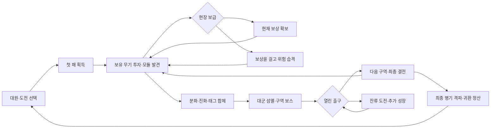

> **이전 설계·검증 이력입니다.** 현재 공개 게임은 [RIFT 0.16 실행 명세](RIFT-GAMEPLAY-V1.md)를 따릅니다. 이 문서의 단일맵/기존 배포·보스·연구 범위를 현재 구현으로 해석하지 마세요.

# 서바이버 작전실 — 빌드 중심 재기획

2026-11-06 · 설계 기준 1.1 · **피오 독립 시제품 일부 구현 · 전체 작전은 확장 명세**

현재 구현 범위·실제 조작 검증·남은 차이는 [첫 시제품 기록](REBOOT-PROTOTYPE.md)을 따른다. 이 문서 전체를 구현 완료로 해석하지 않는다.

세부 구현 계약은 [규칙·상태·경제·저장](REBOOT-RULES.md), [전투·콘텐츠](REBOOT-COMBAT.md), [화면·예외·수용 기준](REBOOT-UX-QA.md)에 정의한다. 핵심 수치 원본은 [설계 데이터](design/reboot-rules.json)다. 본문은 방향 요약이며 명시적 세부 계약을 우선한다.

이 문서는 앞으로 만들 게임의 판단 기준이다. 현재 배포된 0.15.1의 설명이나 새 버전 완료 보고가 아니다. [참고작 조사](REBOOT-REFERENCE-ANALYSIS.md)를 근거로, 기존 작전·경제·진화 기획의 제약을 다시 정한다. 기존 게임·저장·원화 파일은 이번 기획 작업에서 삭제하지 않는다.

**수치는 모두 우리 시제품의 첫 실험값**이다. 참고작의 공식이나 재미가 검증된 밸런스라고 주장하지 않는다. 문서의 규칙·선택 비용·실패 대가를 구현 기준으로 삼고, 숫자는 플레이 관찰로 조정한다.

## 1. 무엇을 만드는가

**적진에서 얻은 뜻밖의 무기와 개조로 매판 다른 화력을 만들고, 더 좋은 보상을 위해 전장 위험을 올리다가 거대 병기를 격파해 귀환하는 작전형 서바이버.**

플레이어의 반복 사고는 **이번 패로 무엇을 키울까 → 이 보상에 위험을 걸 만한가 → 완성한 화력으로 어디까지 갈까 → 다음에는 어떤 조합을 해 볼까**다.

정체성은 군사 작전·구출·노획·거대 병기 파괴, 플레이의 중심은 자동 사격·이동·대군 섬멸과 판 안의 성장이다. 마르코·피오는 이 팬 시제품의 첫 두 대원으로 둔다. 캐릭터 수와 원화량은 성장 규칙을 정하는 제약으로 쓰지 않는다.

| 반드시 느껴야 할 것 | 눈으로 확인할 변화 |
| --- | --- |
| 이번 판은 다른 패다 | 첫 두 보급의 무기·모듈·접근 위험이 달라짐 |
| 내가 선택해서 강해졌다 | 투자 전후 사거리·탄의 경로·폭발·발동 빈도·유효한 표적이 달라짐 |
| 욕심을 내 볼 만하다 | 현재 보상과 걸어야 할 위험, 성공 시 보상 확률을 읽고 선택 |
| 완성한 빌드를 쓸 시간이 있다 | 완성 직후 대군을 쓸고, 그 강점으로 보스·잔류 도전 공략 |
| 다음 판에 할 게 떠오른다 | 다른 공격 조합·미완 도전·개인 기록 중 다음 목표 하나를 고를 수 있음 |

## 2. 기존 규칙의 처분

| 기존 규칙/구조 | 결정 | 이유와 대체 |
| --- | --- | --- |
| 주무기·지원무기 두 칸 | **폐기** | 공격 3칸과 모듈 4칸으로 역할을 분리. 합체 외에도 공격·발동 조합을 만들 공간 확보 |
| 모든 총 3단 강화 → 고정 두 총 합체 | **폐기** | 무기 6레벨·중간 분화·조건부 모듈. 단일 진화/태그 합체/미진화 시너지 모두 완성 후보 |
| 첫 보급에 합체 짝 보장 | **폐기** | 초반 두 기회에 다른 새 총을 보여주되, 현재 총 투자 선택은 보장 |
| 특정 연구를 해야 기본적인 재미가 열림 | **폐기** | 기본 시너지와 각 완성 경로는 초기 계정에서 가능. 연구는 후보·운용 선택 확대 |
| 거점마다 접근→경비 두 무리→같은 카드 | **폐기** | 추격 습격·구역 엄호·장애물 돌파를 다른 교전으로 설계 |
| 큰 공터의 좌표·색·소품만 바뀌는 맵 | **폐기** | 이동·사격에 작용하는 길과 파괴물, 위치에 따라 다른 사건 |
| 완주율·테스트 통과가 재미의 근거 | **폐기** | 규칙 검증과 사람의 빌드 선택·재도전 행동을 따로 평가 |
| 메탈슬러그풍 캐릭터·전장·거대 병기 | **채택** | 이번 게임의 표현 방향. 각 자산은 실제 이동·전투 가독성을 보고 재사용 |
| 자동 공격·회피·전술기·모바일 이동 | **채택** | 성장 판단 중에도 직접 전장을 운영하는 간결한 조작 |
| 보스 뒤 진입/잔류, Slug 별도 내구 | **채택** | 성장·기록의 위험 판단과 병기의 명확한 소유권. 기존 수치·배치는 유지 조건 아님 |
| 저장·정산의 원자성, 중복 지급 방지 | **채택** | 재미와 별개로 지켜야 할 기록 신뢰성 |

기존 코드는 새 규칙의 수용 기준을 통과할 때만 가져온다. 재활용을 위해 무기 수·레벨·보상 경로를 되돌리지 않는다. 과거 동물 원정과 0.15.1은 비교 가능한 보관본으로 둔다.

## 3. 한 판의 목적과 흐름

한 판은 **침투 → 증폭 → 결전의 세 구역을 돌파하고 최종 병기 뒤 자발적으로 귀환하는 작전**이다. 일반 완주의 관찰 목표는 4–6분이다. 시간을 채우기 위한 대기, 시간 도달 즉시 패배, 처치 할당량으로 보스 잠그기를 넣지 않는다.

| 구간 | 관찰 목표 | 플레이어가 정하는 것 |
| --- | --- | --- |
| 0–30초 | 가까운 첫 보급, 첫 새 공격 또는 모듈 | 시작 총을 키울지, 다른 공격을 받을지 |
| 30–90초 | 첫 두 보급·첫 분화·선택 위험 사건 | 나온 패에 투자할지, 초반 개장으로 방향을 바꿀지 |
| 60–180초 | 시작 조율권으로 첫 완성, 구역 보스·새 구역 | 단일 진화/합체/모듈 연계를 무엇부터 완성할지 |
| 180–360초 | 완성 화력·최종 병기·귀환 | 빨리 완주할지, 위험 도전으로 기록을 노릴지 |

위 시각은 지급 조건이 아니다. 빠른 조우 해결과 강한 빌드는 더 빨리 전진한다. 4–6분을 맞추려고 보스 HP를 늘리지 않는다. 잔류하면 XP 성장은 계속되며 공세와 선택 도전 난도가 올라간다. 죽거나 귀환하기 전까지 시간 상한은 없다.

## 4. 빌드의 공간과 투자 예산

| 구성 | 첫 실험 규칙 | 역할·비용 |
| --- | --- | --- |
| 무기 | **3칸**, 시작 총 1개, 첫 구역 새 총 L1·후반 L2/L3, 최대 L6 | 세 가지 공격 문법의 조합. 빈칸 확보에 영구 구매 불필요 |
| 무기 분화 | L3→L4 투자 때 두 작동 방식 중 선택 | 별도 메뉴 없이 그 레벨 카드에서 분화. 공격 방향을 결정 |
| 모듈 | **4종**, 같은 모듈 중복은 최대 3강화 | 도탄·축전·연소 등 조건부 증폭. 새 종류를 넣을 때만 칸 소비 |
| XP 레벨 | 완주 LV.14–18을 첫 관찰 목표 | 보유 총 레벨/모듈 증폭/생존 보정 중 투자. 모든 총의 만렙은 보장하지 않음 |
| 조율권 | 출격 1개 + 두 중간 보스 각1개, 최종 보스0개 | 총3개. 첫 보스 전 완성 가능, 진화/합체/모듈 조율/정비 중 소비 |
| 재추첨/제외 | 판당 재추첨 2회, 후보 제외 1회 | 처음부터 제공. 무작위에 대응하는 통제권 |
| 초반 개장 | 첫 구역 보스 도전 전 1회 | 새 총으로 교체해 min(5,기존L) 유지. 장착 모듈은 공용4칸에 남음 |

무기 3칸은 전부 만렙으로 채우라는 요구가 아니다. 한 총을 집중 완성하거나, 두 공격의 조건부 상호작용에 나누어 투자하거나, 합체 후 빈칸을 다시 활용할 선택 공간이다.

**교체 계약:** 초반 개장은 획득한 새 총에만 사용 가능하며 L6 총이나 합체 완성물을 만들지 않는다. 분화는 새 총 L4의 분화 카드에서 다시 고른다. 초반 개장 없이 교체할 때도 중후반 전환이 함정이 되지 않도록 다음 계약을 적용한다.

- 새 총의 기본 레벨은 구역 1/2/3에서 L1/L2/L3이다. 빈칸에 받을 때 이 레벨로 시작한다.
- 미완성 총을 교체하면 `새 레벨 = min(5, 구역 기본 레벨 + floor(max(0, 기존 레벨 - 구역 기본 레벨) / 2))`로 일부 투자를 이전한다. 남은 투자·분화는 잃고 새 분화를 선택한다. 구역 기본 레벨을 빼고 남은 부분만 이전하므로 반복 교환해 레벨을 계속 올릴 수 없다.
- 진화·합체 완성물은 보통 교체의 대상으로 내지 않는다. 세 칸이 전부 완성물이라면 새 총 카드 대신 모듈/정비 카드를 낸다.
- 교체 전후 무기·레벨·분화 손실을 카드에 표시하고 취소할 수 있다. 시작 총도 교체 가능하다. 대원 고유 능력과 공용 모듈은 남는다.

## 5. 공격·분화·완성의 문법

다음은 최소 콘텐츠의 구체적인 작동 안이다. 기존 총 이름은 식별용으로 활용하되 예전 사격·계수·조립 규칙을 유지하지 않는다.

| 무기 | 기본 공격·기본 태그 | L4 분화 A | L4 분화 B |
| --- | --- | --- | --- |
| 권총 P | 긴 직선, `탄환·정밀` | 관통: 방패 뒤 표적까지 명중, `관통` 추가 | 소이: 적중 표적 점화, `연소` 추가 |
| 기관총 H | 짧은 간격의 연사, `탄환·연사` | 산개 도탄: 무리 사이 탄의 경로 확장, `도탄` 추가 | 유탄 급탄: 주기적으로 유탄, `폭발` 추가 |
| 로켓 R | 느린 광역 중탄, `폭발·중화기` | 추적 다탄두: 분산된 표적 추격, `추적` 추가 | 점화 탄두: 폭발 뒤 연소 구역, `연소` 추가 |
| 산탄총 S | 가까운 부채꼴, `탄환·근접` | 플레셰트: 긴 관통 산탄, `관통` 추가 | 용의 숨결: 근접 점화, `연소` 추가 |
| 화염방사기 F | 짧은 화염 부채, `연소·근접` | 연료 살포: 이동 경로에 남는 지대, `지속` 추가 | 압축 분사: 좁고 긴 화염, `분사` 추가 |

### 세 종류의 완성은 동등한 투자 후보다

1. **단일 진화:** 무기 L6 + 해당 진화에 맞는 모듈 2강화 + 조율권 1개. 그 총의 공격 문법을 크게 확장한다. 다른 두 총과 모듈은 유지한다.
2. **태그 합체:** 서로 다른 두 무기 L4 이상 + 필요한 태그 한 쌍 + 해당 모듈 2강화 + 조율권 1개. 두 총을 한 칸으로 만들고 빈 공격 칸을 돌려준다. 진화한 총은 합체 재료에서 제외해 이미 쓴 조율권 손실을 막는다.
3. **발동 시너지:** 무기·모듈의 조건을 겹쳐 연쇄를 만든다. 진화/합체하지 않아도 완성 빌드로 인정한다. 조율권은 장비 패널에서 언제든 보유 모듈 +1강화 또는 정비로 교환 가능하다.

두 총 모두 L1에서 시작하는 기준으로 단일 진화는 무기 투자 5회, 두 무기 합체는 최소 6회다. 모듈 2강화에 필요한 투자도 있다. 후반 보급의 기본 레벨·일부 이전은 이 비용을 줄이므로 동등 투자 비교에서 함께 계산한다. 진화·합체에서 모듈은 조건으로만 확인하며 소비하지 않는다. 합체가 더 많은 투자·두 공격을 소비하는 만큼 단순 피해 수치로 무조건 우위가 되지 않도록 비교한다. 모든 경로는 일반 희귀도 재료로 성립한다. 희귀품을 못 얻어도 진화·합체를 할 수 있다.

단일 진화의 모듈 조건은 P/S 관통=철갑, P/S 연소·F=촉매, H=도탄기, R 추적=축전 코일, R 점화=축전 코일 또는 촉매로 고정한다. 축전 코일은 피오 충전을 추가하지 않고 화염 적중으로 충전되지 않는다. 공용 열쇠 하나로 모든 경로가 수렴하는 것을 막는다. 합체 결과는 L6 완성물로 처리하고 XP로 추가 무기 레벨을 올리지 않는다. 재료 L4 초과분마다 주공격 간격 −3%(최대 −12%)를 전승한다. 분화별 조건은 설계 데이터의 `moduleByBranch`를 따른다.

| 합체 계열 | 필요 태그·모듈 | 성립 예 | 결과 태그·전투 |
| --- | --- | --- | --- |
| 전도 격발망 | `탄환 + 폭발` · 축전 코일 | H+R, P+R, S+R, 유탄 H+P | `탄환·폭발·전도` — 탄환 적중이 전도 표식을 만들고 폭발이 연쇄 방출 |
| 열압 소각 | `연소 + 폭발` · 촉매 연료 | F+R, 소이 P+R, 용의 숨결 S+R | `연소·폭발·지속` — 점화한 적 무리에 후속 폭발, 길목의 지속 화력 |
| 관통 파쇄 | `관통 + 근접` · 철갑 패키지 | 관통 P+S, 관통 P+F, 플레셰트 S+F | `탄환·관통·근접` — 정면 장갑·밀집 대열을 뚫고 가까운 약점에 집중 |

태그는 서로 다른 두 무기가 각각 하나 이상 제공해야 한다. 한 무기가 두 태그를 모두 가졌어도 단독으로 합체할 수 없다. 여러 계열이 성립하면 선택 가능한 결과를 보여준다. 조립 전 사라질 두 공격, 생길 공격, 빈칸, 모듈 연계를 한 화면에 표시한다. 위 합체는 참고작의 규칙이 아니라 우리의 새 제안이다.

합체 계열이 같아도 주공격 재료의 사격 문법을 유지한다. 전도 H+R의 연사, P+R의 직선탄, S+R의 부채 산탄을 같은 완성 총으로 만들지 않는다. 계승 순서·카운트는 [세부 규칙 4절](REBOOT-RULES.md)에 따른다.

## 6. 판을 바꾸는 모듈

| 모듈 | 작동·잘 맞는 공격 | 다른 판단을 만드는 이유 |
| --- | --- | --- |
| 도탄기 | `탄환`이 다른 적에게 추가로 튕김. 강화마다 도탄 횟수 증가 | 단일 표적 사격을 군집 섬멸로 전환 |
| 축전 코일 | 직접 적중 누적 후 짧은 전기 방출. 도탄은 낮은 가중치로 충전에 기여 | 연사·탄 수·도탄 투자의 가치가 달라짐 |
| 촉매 연료 | 연소 중인 표적에 폭발 적중 시 열압 방출 | 화염을 먼저 걸고 폭발을 맞힐 위치·순서가 중요 |
| 철갑 패키지 | 관통 공격이 장갑을 약화. 뒤쪽 표적/약점에 추가 효과 | 보스 정면·측면·뒤편을 도는 가치가 달라짐 |
| 탄약 회수 벨트 | 이동하며 주운 탄약으로 다음 전술기를 증폭 | 서서 사격하는 위치와 회수 동선 사이의 선택 |
| 자기 회수기 | XP 회수 범위·회수 중 이동 보정 | 우회 수집과 공격 투자 사이의 안정성 선택 |
| 응급 주사기 | 정예 처치 후 회복, 내부 재사용 대기시간 존재 | 공격적인 정예 추적으로 생존을 회수 |
| 불안정 과급기 | 드문 원형품. 전술기 종료 시 현재 무장의 태그 방출, 대신 받는 피해 증가 | 대군 순간 화력과 다음 위험 선택에 큰 변화 |

기본 6종(도탄기~자기 회수기)은 초기 계정에서 제공한다. 응급 주사기는 후속 확장 후보, 불안정 과급기는 초기 계정에서도 낮은 확률로 얻는 원형품 시험 후보로 둔다. 연구 없이도 세 완성 경로가 성립해야 한다.

**강화와 희귀도는 다른 축이다.** 강화는 장착 모듈의 1–3단계다. 희귀도는 보상 묶음의 가치다. 일반 후보는 신규 모듈 1강화/기존 +1, 희귀 후보는 신규 2강화/기존 +2(최대 3), 원형품 후보는 고유 효과인 불안정 과급기 또는 호환 모듈 즉시 3강화다. 이미 최대 강화인 후보를 중복 보상으로 내지 않는다. 빈칸이 없으면 교체 비용이 있으므로 높은 희귀도도 자동 정답이 아니다. 모듈 전체가 최대이고 새 고유 효과도 받을 수 없다면 같은 희귀도의 전술기 보급/회복 묶음을 대안으로 제공한다. 이 경우 도박의 실제 미리보기에도 대체 풀을 명시한다.

**발동 안전 계약:** 직접 공격과 2차 발동을 구분한다. 2차 효과는 원래 효과를 재발동하지 않는다. 산탄·지속 피해에는 정규화한 적중 가중치를 사용한다. 같은 적의 동시 판정과 발동 쿨다운을 명시한다. 발동 수를 줄일 때 피해·계산 결과가 FPS에 따라 바뀌면 안 된다. 화면에서는 주요 연쇄를 읽을 수 있어야 하며 보스 예고가 이펙트 아래 묻히지 않는다.

## 7. 랜덤과 플레이어 통제

### 획득 창구

- **필드 무기 보급:** 현재 총 투자 1개, 새 무기 1개, 모듈 1개 중 선택. 새 총의 종류가 바뀌며 합체 짝을 자동 우선하지 않는다.
- **XP 성장:** 보유 총 투자 또는 장착 모듈 강화 중 유효한 선택 최소 1개 + 다른 투자 후보. 새 총을 얻기 위한 주 창구로 쓰지 않는다.
- **선택 무기고:** 모듈 3후보 중 하나. 희귀도와 현 무장 호환성을 미리 표시. 여기에서만 증폭 습격을 걸 수 있다.
- **중간 보스:** 조율권 1개 + HP15 회복. 추가 무기/모듈 투자 카드는 주지 않는다. 최종 보스·시제품 보스는 조율권/회복을 추가하지 않는다.

### 나쁜 운의 안전장치

1. 첫 두 무기 보급에서 서로 다른 새 총을 최소 2종 제시한다. 동일 새 총의 반복 제시를 막고 현재 총 투자 선택을 유지한다.
2. 첫 두 보급은 초기 위치에서 과도한 우회 없이 접근 가능해야 한다. 도보 실측 첫 20–30초 / 60초 안의 성장 기회를 목표로 배치한다.
3. **안전 확보와 증폭 습격 성공 모두**, 희귀도를 뽑은 뒤 현재 태그에 맞는 모듈 또는 장착 모듈의 유효 강화 1개를 먼저 확정하고 나머지 후보를 채운다. 최대 강화·제외 항목은 빼고, 풀이 부족하면 명시한 강화/보급 대안으로 전환한다. 꽉 찬 칸은 교체 전후를 표시한다.
4. 재추첨 2회·제외 1회·초반 개장 1회를 초기 계정부터 준다. 새 연구의 첫 적합 후보 체험은 유지하되 완성 무기나 짝을 함께 지급하지 않는다.
5. 진화/합체의 핵심 재료를 희귀도에 잠그지 않는다. 일반 모듈 중복과 XP 투자만으로도 완성할 수 있다.
6. 만렙·제외 항목을 무효 후보로 내지 않는다. 보유 장비 투자가 끝나면 회복/충전/기본 화력 +1% 가산의 추가 성장으로 전환한다. XP를 끊지 않고 시간 압박은 계속 높인다.

후보·맵·전투의 난수 흐름을 분리하고 보급 결과를 저장한다. 지도 열기·FPS·재접속으로 희귀도 재추첨을 만들지 않는다. 현재 장비에 따른 호환 후보 선택과 숨겨진 확률 조작을 구분한다. 플레이 중 HP나 연패를 이유로 공개 확률을 몰래 바꾸지 않는다.

## 8. 도박적인 선택: 보급을 걸고 증폭 습격

선택 무기고에서 **현재 받을 모듈을 공개한 뒤** 다음 둘 중 하나를 고른다.

| 선택 | 지금 하는 일 | 성공/실패 결과 |
| --- | --- | --- |
| 안전 확보 | 공개된 후보 중 하나를 즉시 받음 | 기존 보상 확정 |
| 증폭 습격 | 그 상자를 걸고 탈출 중인 지휘 수송차를 격파. 이동 포격·측면 증원 속에서 추격 | 성공: 높은 확률표로 새 모듈 3후보 중 하나 + 도전 점수. 실패/철수: 걸었던 상자만 잃음 |

기존 무기·조율권·확보 크레딧·영구 연구를 걸지 않는다. 습격 중 실제 피해와 죽음의 위험은 존재한다. 실패해도 보스·다음 구역·기본 보급은 잠기지 않는다. 지휘차를 빨리 잡으면 즉시 끝나므로 제한 시간을 채우며 버티게 하지 않는다. 수송차의 탈출 경로와 철수 버튼을 표시한다.

### 공개할 첫 확률표

| 보상 희귀도 | 안전 무기고 생성 | 보급차 습격 성공 | 장갑 수송대 습격 성공 |
| --- | --- | --- | --- |
| 일반 | 75% | 70% | 40% |
| 희귀 | 22% | 27% | 45% |
| 원형품 | 3% | 3% | 15% |

습격은 같은 사건의 두 공개 계약 중 고른다. 보급차는 HP900·경로800, 장갑 수송대는 HP4,200·경로1,050·전면 탄환 피해×0.5와 강한 호위다. 장갑 계약의 15%를 약한 보급차에 적용하지 않는다. 플레이어 DPS에 맞춰 숨겨진 HP를 올리는 대신 고정된 난도·확률을 읽고 선택한다. 수치와 비교 조건은 [전투 명세](REBOOT-COMBAT.md)를 따른다.

희귀도를 상자당 한 번 뽑고 그 희귀도의 3후보를 만든다. ‘3%를 카드마다 3번 뽑는 것’이 아니다. 풀이 부족하면 6절의 같은 희귀도 강화/보급 대안으로 채우며 이름만 다른 같은 보상을 반복하지 않는다. 제외로 희귀도 확률을 조작할 수 없다. 증폭 습격은 구역당 1회, 작전당 최대 3회다. 결과 확률과 성공 조건을 선택 전에 표시한다. 모션·효과를 생략해도 결과가 달라지지 않는다.

**왜 매번 도박이 정답이 아닌가:** 좋은 보상·낮은 체력이면 확보가 유리해야 한다. 일반=1·희귀=2·원형품=4라는 설명용 가정에서 안전 상자 기대값1.31, 보급차 성공 조건부1.36, 장갑 성공 조건부1.90이다. 장갑 습격 성공 가능성을60/70/80%로 가정하면 실패 손실을 포함해1.14/1.33/1.52다. 이미 공개된 희귀 보상을 가진 상황의 비교는 다르다. 이는 실제 DPS·아이템 가치·성공률을 측정한 결과가 아니다.

계산은 [설계용 계산기](design/reboot-risk-study.mjs)와 [출력](design/reboot-risk-study.json)으로 재현한다. 체력 손실·시간·빌드 호환 가치를 넣지 않은 단순 모형이므로 실제 선택의 우열이나 재미를 검증한 결과로 사용하지 않는다.

## 9. 대원은 좋은 선택의 기준을 바꾼다

| | 마르코 | 피오 |
| --- | --- | --- |
| 시작 총 | P. 교체 가능 | H. 교체 가능 |
| 고유 행동 | 같은 중요 표적에 직접 공격을 유지해 집중 표식 | 이동하며 탄약·XP를 회수하고 처치로 전탄 보급 충전 |
| 성장 원천 | 레벨은 표식 유지 여유를, 직접 공략은 표식 단계를 높임 | 레벨은 회수 충전 효율을, 능동 회수는 전술기 가동률을 높임 |
| 유리한 선택 | 관통·약점·표적 유지, 또는 표식 전파로 군집 전환 | 연사·적중·회수, 또는 폭발/연소 연계로 광역 전환 |
| 고유기 | 표식 표적을 겨냥한 집중 포격. 모든 무기 조합에서 작동 | 보유 공격의 작동 주기를 잠시 증폭. H를 버려도 작동 |
| 판 안의 분기 | LV.6: 표식 지속/약점 집중 또는 처치 시 인접 전파 | LV.6: 긴 비축 운용 유지 또는 짧고 잦은 신속 운용 |

LV.6 대원 분기는 무료 이정표로, 일반 무기/모듈 투자 1회를 소비하지 않는다. 그 레벨 화면의 두 운용 토글에서 선택하고 일반 성장 카드를 확정할 때 함께 적용한다. 기본 선택을 표시하고 별도 모달·숙련 자원을 만들지 않는다. 각 대원의 수치 성장은 상한을 두고, 같은 적·같은 조건에서 분화별 효율을 비교한다. 어느 대원도 특정 합체 전용 열쇠가 아니다.

**마르코의 표적 통제:** 이동·시야에 따라 사선이 열리는 유효 표적 중 약점→정예→가까운 적 순서로 전술기 대상 예고 조준점을 표시한다. E를 누르면 그 표적을 지정하고 집중 사격한다. 지정 표적은 사거리·시야 안에서 살아 있는 동안 자동 사격의 우선순위를 유지한다. 다른 적에 탄이 막혔다고 집중을 즉시 초기화하지 않고, 일정 시간 지정 표적을 못 맞히면 감소한다. 플레이어는 이동 위치와 E 사용 시점을 바꿔 지정 대상을 통제한다. 보스 코어가 잠기면 파괴 가능한 부위를 우선한다. 별도 정밀 조준 버튼을 요구하지 않는다.

## 10. 맵이 빌드에 질문하는 방식

세 구역의 이야기 순서는 침투→증폭→결전이다. 각 구역 내부는 **연결된 전투 공간 3–4개와 선택 사건 2개**, 사건 배치·접근 방향·장애물 배치를 시드로 바꾼다. 새로운 배경 90개를 만드는 대신 길의 형태와 전투 행동을 바꾼다.

| 사건 | 실제로 다른 행동 | 빌드·보상 관계 |
| --- | --- | --- |
| 이동 수송대 | 차량 경로를 가로지르며 측면 호위를 끊고 추격 | 사거리·기동·추적 유리. 새 총과 공격 모듈 |
| 구출 엄호 | 구출 대상을 공격하는 적의 진입로를 지킴 | 장판·관통·밀쳐내기 유리. 현재 총 투자·정비 |
| 진지 돌파 | 사격을 막는 파괴 가능한 엄폐물을 열거나 측면으로 우회 | 폭발·근접 파쇄와 원거리 우회의 가치가 다름. 조율용 모듈 |
| 선택 지휘관 | 예고 사격·증원을 피하며 짧은 정예전 | 약점·단일 화력 유리. 선택 무기고·증폭 습격 |

엄호 실패는 구출 보상만 잃고 주목표는 계속된다. 엄폐물은 적·아군 사격과 이동에 일관되게 작동하며, 적탄만 통과하는 장식 벽을 만들지 않는다. 첫 실험에서는 관통탄도 단단한 벽을 통과하지 않는다. 파괴 가능한 엄폐물과 단단한 벽을 시각적으로 구분한다. 포위되어 이동할 경로가 없는 지형은 생성하지 않는다.

보스와 출구는 처음부터 알려 준다. 탐색은 보스를 여는 숙제가 아니라 어떤 빌드로 도전할지 준비하는 선택이다. Slug는 선택 병기이며 차체 피격·파괴·이탈의 소유권을 유지한다. Slug가 모든 경로를 자동 해결하는 필수 획득물이 되면 배치·가동 비용을 다시 조정한다.

## 11. 대군·보스·잔류의 역할

- **대군:** 완성 전에는 이동 경로를 만들고 XP를 회수할 압박, 완성 후에는 공격의 변화가 읽히는 섬멸 보상. 플레이어 강화에 맞춰 잡몹 HP를 즉시 비례 증가시키지 않는다.
- **중간 보스:** 구역마다 하나의 명확한 대응을 요구한다. 돌진 후 측면/후면, 포격의 안전 통로처럼 1–2개 규칙을 읽게 한다. 처치 보상은 선택한 완성 경로를 진전시킨다.
- **최종 병기:** 단일 약점 화력과 증원 정리 사이를 이동하게 한다. 부위 파괴 후 열린 약점은 큰 피해로 빠르게 넘길 수 있다. 모든 공격을 무효화하는 긴 무적 시간이나 강제 페이즈 최소 시간을 넣지 않는다.
- **잔류:** 보스를 잡아도 XP와 남은 사건은 유지된다. 선택 도전을 완료하면 다음 위험 단계가 열린다. 단계별 사격 각도·정예 역할·적 구성으로 압박을 높인다. 단순 HP 증가는 보조 수단이다.

잔류 시간에 따라 증원 빈도·추적 병종도 자동으로 격화한다. 첫 실험은 잔류 30초마다 예고 후 한 단계 격화한다. 보스 전은 구역 60초 주기다. 낮은 압박에 머물며 무한 성장하는 것을 막기 위해 추격 장교의 압박은 장기적으로 계속 커진다. 이 시간 압박은 위험 도전의 완료 단계·점수를 자동 지급하지 않는다. 압박 일정은 구역 단위이며 플레이어의 화력에 비례해 몰래 조절하지 않는다.

정상 완성 빌드의 최종전 관찰 목표는 20–40초, 드문 대박 조합은 더 짧아도 허용한다. 최종전 시간을 맞추려고 화력을 일률적으로 감쇠하지 않는다. 강한 빌드는 위험 단계·빠른 완주 기록에서 시험한다. 완성 직후 20–40초간 대군을 쓸 수 있는 자연스러운 이동/잔류 공간을 제공하며 강제 대기는 하지 않는다.

## 12. 점수·귀환·연구가 만드는 다음 판

### 서로 다른 기록을 구분한다

| 기록 | 인정하는 행동 | 시간만 늘리는 플레이 방지 |
| --- | --- | --- |
| 작전 점수 | 보스 1,000/2,000/3,000점, 고유 사건 400점, 일반 적 10점(구역당 300마리까지), 정예 100점(구역당 8기까지), 완주 3,000점 | 같은 안전 구역 반복 처치에는 점수 상한. XP는 계속 획득 |
| 위험 기록 | 완료한 최고 위험 단계 D, 도전 완료 보너스 500×D | 살아 있는 시간 대신 단계 도전 해결을 기록. 같은 단계 반복 보너스 없음 |
| 완주 시간 | 출격부터 자발적 완주 귀환까지의 전투 시간 | 일시정지·선택 화면 제외. 점수와 합쳐 더하지 않음 |

위험 도전 보너스는 작전 점수에 더하되 **구역×단계**별 완료 순간 한 번만 확정한다. 구역별 위험 단계는 새로 시작하고 최고 단계는 작전 전체에서 기록한다. 최종 병기 후에도 도전을 더 하고 귀환할 수 있다. 0HP는 실패, 최종 병기를 잡고 살아서 귀환하면 완주다. 실패해도 이미 확보한 일반 수당·발견·완료한 도전 기록은 보존하되 완주 수당은 받지 않는다.

기록에는 규칙 버전·대원·난도·시드·최종 무기/분화/모듈·위험 선택·완성 시점·피격·실제 발동 기여를 함께 저장한다. 처음에는 **로컬 개인 기록**만 제공한다. 서버 검증 없이 온라인 순위를 붙이지 않는다.

### 크레딧과 메타 성장

소비 재화는 기존 **보급 크레딧 하나**로 유지한다. 보상은 구역 돌파·고유 임무·완주에 중심을 두고, 일반 처치 수당에는 상한을 둔다. 점수는 돈으로 환전하지 않는다. [반복 수당·초기 연구 가격](REBOOT-RULES.md)의 첫 실험값을 정의했고 실제 획득량으로 조정한다. 시제품은 영구 C를 지급/사용하지 않는다.

- **연구:** 모듈 변형·새 분화·대원 운용 선택을 추가한다. 모든 기본 공격과 최소 세 완성 경로는 연구 전부터 제공한다.
- **보급 통제:** 기본 재추첨·제외는 처음부터 제공한다. 연구 보상은 슬롯 증가나 끝없는 피해 구매보다 다른 후보를 노리는 제한적 선택권에 사용한다.
- **기존 영구 전투력 훈련:** 새 규칙에서 제거하고 실제 지불 기록을 기준으로 전액 환불한다. 초기 계정과 오래 플레이한 계정의 압도적 기본 화력 차이를 만들지 않는다.
- **대원 도전:** 다른 전투 행동을 요구하는 과제로 새 운용을 연다. 단순 누적 처치만으로 모든 해금을 채우지 않는다.

### 결과 화면은 다음 선택까지 이어진다

첫 화면에 **완주/실패 · 점수/위험/시간 중 갱신 기록 · 이번 빌드를 만든 효과 하나 · 새로 열린 후보 · 다음 도전**을 보여준다. 수당 명세는 접어서 확인한다. ‘같은 대원 새 시드’와 ‘다음 목표 준비’를 바로 고를 수 있다. 앞 판과 같은 확정 조립을 로비에서 예약하지 않는다.

기존 재화·기록을 지우는 초기화는 하지 않는다. 0.15 기록은 별도 규칙 기록으로 보존한다. 훈련은 실제 지불 이력을 환불하고, 연구는 별도 지불 원장이 없으므로 확인한 고정 가격표의 이전 보상을 제공한다. [이관 계약](REBOOT-RULES.md)을 검증하기 전에는 새 규칙으로 기본 주소를 바꾸지 않는다. 기획/독립 시제품 단계에서는 기존 저장 키를 건드리지 않는다.

## 13. 같은 피오로 시작한 세 판의 구체적인 차이

아래는 **제안 규칙으로 구성한 예시**이며 실제 플레이 결과가 아니다. 희귀품 없는 A/B와 희귀품을 얻은 C를 비교한다.

| | A: 도탄·축전 | B: 연소·열압 | C: 관통·위험 도전 |
| --- | --- | --- | --- |
| 초반 패 | 도탄기·R | F·촉매 연료 | P·철갑 패키지 |
| 투자 | H의 산개 도탄 분화, 축전 강화 | F 중심으로 투자, R 점화. H는 보조로 유지 | 초반 개장으로 H 투자→P. P 관통 분화, S 확보 |
| 완성 | H 단일 진화 + R 폭발. 합체를 미뤄 모듈 증폭 | F+R 열압 합체 또는 F 단일 진화 + R. 동일 재료에서도 선택 | P+S 관통 파쇄, 여유 칸에 R. 선택 습격에서 과급기 발견 |
| 유리한 행동 | 무리를 연결하며 이동, 처치·회수로 전술기 순환 | 좁은 진입로를 태우고 연소 표적에 폭발 | 정예·장갑·약점 공략. 과급 반동 때문에 피격 관리 |
| 고민 | 조율권을 합체에 쓸지 도탄기에 더 투자할지 | 추격 수송대와 구출 엄호 중 어느 사건을 먼저 할지 | 이미 좋은 보상을 확보할지 더 위험한 습격을 걸지 |
| 다시 할 목표 | 다음에는 전도 격발망 합체의 빈칸 활용 | 희귀품 없이도 더 빠른 열압 완성 | 과급기 없이 최고 위험 재도전 또는 빠른 완주 |

세 판이 이름만 달라서는 통과하지 못한다. 유리한 위치·표적·사격 경로·전술기 가동과 선택한 사건이 실제로 달라져야 한다.

## 14. UI/UX가 보여 줄 것

| 화면 | 반드시 보이는 정보 | 표현 기준 |
| --- | --- | --- |
| 로비 | 대원 고유 행동, 미완 도전 하나, 새 후보, 출격 | 군용 작전판·병기 정비의 표현. 연구 탭 방문을 매번 강제하지 않음 |
| 전투 HUD | 공격 3칸의 레벨·분화, 모듈 4종·강화, HP/차체·전술기·위험 | 아이콘·짧은 이름 중심. 자세한 조건은 일시정지에서 확인 |
| 성장 카드 | 이번 변경, 현재 공격과의 연결, 슬롯·교체 손실 | 피해 숫자만 크게 쓰지 않고 탄의 경로/조건 변화를 한 줄로 표시 |
| 위험 보급 | 현재 확보 가능품, 성공 조건, 실패 손실, 정확한 확률 | 확정 보상과 확률 보상을 구분. 확률은 색 외에 숫자·등급명으로 표시 |
| 조립 | 소비할 두 총/모듈 조건, 새 공격, 빈칸 | 연속 모달 대신 전후 비교 한 화면. 거절 시 재료 보존 |
| 결과 | 실제 핵심 효과·기록·해금·다음 목표 | 10줄 수당 명세가 다음 시도를 밀어내지 않게 구성 |

모바일은 왼손 이동·오른손 회피/전술기·상황 버튼을 유지한다. UI가 터치 영역·보스 예고를 가리지 않아야 한다. 선택·지도·일시정지는 전투 시간을 멈추고 누르던 이동 입력을 초기화한다. 키보드 이동 입력이 선택 화면에 넘어와 카드를 고르지 않게 한다. 카드의 접근성 이름은 효과·비용을 포함하고 희귀도는 색에만 의존하지 않는다.

## 15. 개발 순서와 통과 조건

### 먼저 검증할 한 조각

**한 전장·피오 1명·H/R/F 3총·도탄기/축전 코일/촉매 연료/자기 회수기 4모듈·원형품 1개·합체 계열 1개·보스 1개·증폭 습격 1종**으로 2–3분의 빌드 실험을 만든다. 첫 순환부터 **다른 패 → 투자 → 보급 확보/도박 → 완성 화력**을 모두 넣는다. 단일 진화·전도 격발망 합체·미진화 모듈 연계를 비교한다. 새 규칙은 독립 저장을 쓰고 0.15 모델의 두 슬롯·3단계·고정 합체 전제를 제거한 상태에서 검증한다. 완성 후 적 군집·정예 공략 장면을 반드시 포함한다.

이 실험을 통과하기 전에는 새 로비 원화·세 맵 전체·추가 대원·대규모 연구 트리를 제작하지 않는다. 단일 전장의 재미가 약한 문제를 콘텐츠 양으로 가리지 않는다.

| 순서 | 구현·검증할 것 | 통과해야 다음으로 진행 |
| --- | --- | --- |
| 1 | 피오·3총·4모듈·후보 제어·초반 개장·현재 보상을 거는 습격. 임시 전장/그래픽 사용 | 다른 패의 투자와 확보/습격 양쪽 판단이 가능하고, 실패가 기본 성장을 막지 않음 |
| 2 | 단일 진화·태그 합체 1계열·연쇄 타격 표현·보스 | 같은 투자 예산에서 단일 진화·합체·모듈 조합이 각자 유리한 전투를 가짐 |
| 3 | 사람 3판 연속 비교 | 빌드·선택·교전 행동이 달라지고 다음 시도 이유가 구체적으로 나옴 |
| 4 | 마르코·P/S·기본 모듈 6종·두 번째 합체 계열·다른 지형 사건 | 두 대원에서 각기 3종 방향, 특성이 선택·교전 행동을 실제로 바꿈 |
| 5 | 세 구역·다른 보스·귀환·연구·기록·저장 이관 | 위 재미를 끝까지 유지하며 기존 재화와 기록 신뢰성 보존 |

### 기능 검사와 재미 판단을 분리한다

- **초반 패 검사:** 첫 조각은 피오 20시드, 대원 확장 뒤 20시드×2대원으로 첫 90초 보급·투자 로그를 남긴다. 첫 두 보급에서 새 총 2종/현재 총 투자/호환 모듈 경로가 빠지는 시드 0개. 무조건 특정 합체를 완성시키는 검사는 하지 않는다.
- **분산 검사:** 각 시드에서 동일 우선순위 정책·주력 집중 정책·패 적응 정책을 비교한다. 정책별 최종 공격/분화/모듈과 경로 선택을 함께 기록한다. 시드만 바꿨는데 같은 완성·같은 동선이 70% 이상이면 수렴 경고로 보고 원인을 재검토한다. 이 70%는 첫 실험의 경고선이다.
- **전투 비교:** 같은 투자량으로 군집·이동 정예·장갑 보스 세 장면을 비교한다. 한 경로가 모든 장면을 일관되게 압도하면 조정한다. 진화 전후 처치량·공략 시간·피격과 실제 발동 기여를 측정한다.
- **위험 검사:** 건강한 상태·위급한 상태·좋은 현재 보상·나쁜 현재 보상 네 조건으로 확보/습격을 비교한다. 모두 습격 또는 모두 확보가 정답이면 대가·확률·보상 적합성을 재조정한다. 공개 확률·저장 복원·철수·실패 후 보스 접근을 검사한다.
- **사람 플레이:** 같은 대원으로 최소 3판을 하고 ‘왜 이 총/개조를 골랐는가, 무엇을 포기했는가, 다음 판에 무엇을 바꾸고 싶은가’를 기록한다. 다시 하겠다는 말만으로 통과하지 않고 실제 선택과 자발적 재출격도 관찰한다. 소수 표본의 결과를 전체 이용자 유지율로 일반화하지 않는다.
- **화면·조작:** 실제 데스크톱과 390px 모바일 뷰포트에서 전투·선택·조립·실패/귀환을 확인한다. 모바일 동시 이동/회피·전술기, 중단 복원, 긴 이름/큰 글씨, 경고 가독성을 포함한다.

**중단 기준:** 세 판 모두 같은 완성을 노리거나, 희귀품 없는 판이 재미를 잃거나, 효과는 달라도 이동·표적 선택이 같으면 실패다. 이 경우 적 수·배경·보스 HP·무기 목록을 늘리지 말고 해당 선택의 비용과 작동 방식을 다시 설계한다.

## 16. 범위 밖과 출시 전 미해결 항목

이번 기획은 실제 게임 밸런스 검증 완료를 뜻하지 않는다. 보류한 것은 온라인 랭킹·시즌/가챠·여러 모드 동시 제작·새 대원 대량 추가·무한 영구 공격력·전체 기존 경제의 즉시 이관이다. 초기 프로토타입에는 Slug도 포함하지 않고 빌드 선택을 먼저 검증한다.

총별 피해/주기·모듈 발동·XP·공세·수당·가격·이관은 1.1 세부 명세에 기준값/계약을 정의했다. 수치 조정은 실제 플레이에서 검증해야 한다. 확장 무기·보스는 명세의 확장 단계로 분리하고 처음부터 모두 제작하지 않는다. 재미 검증 실패 시 핵심 계약 자체를 고친다면 이유·실험 결과를 이 문서에 먼저 반영하고 개발한다.
