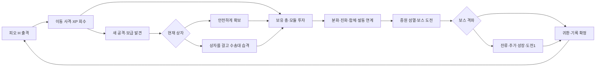

> **이전 설계·검증 이력입니다.** 현재 공개 게임은 [RIFT 0.16 실행 명세](RIFT-GAMEPLAY-V1.md)를 따릅니다. 이 문서의 단일맵/기존 배포·보스·연구 범위를 현재 구현으로 해석하지 마세요.

# RIFT — 뱀서류 방향 재점검과 첫 구현

2026-11-06 · 독립 피오 시제품 0.1 · 밸런스 실험 b03

최신 결과: [두 빌드의 실제 브라우저 완주·화력 보정](VALIDATION-REBOOT-V002.md).

**장르는 자동 공격과 이동 생존을 중심에 둔 빌드 서바이버다.** 메탈슬러그에서 가져오는 것은 대원·적진 침투·병기 노획·거대 병기 파괴라는 표현과 사건의 맥락이다. 임무 목록을 순서대로 소화하는 슈팅 캠페인을 핵심 진행으로 삼지 않는다.

실행: `npm run dev` → **http://127.0.0.1:5200/reboot.html**. 기존 기본 주소와 저장은 그대로다. 이 페이지는 첫 전투 실험이며 세 구역 작전 전체의 완료본이 아니다.

## 장르에 맞게 다시 고정한 기준

[공식 자료 조사](REBOOT-REFERENCE-ANALYSIS.md)의 사실과 설계 해석을 재사용했다. 아래는 그 조사에서 **우리 게임에 내린 결정**이며 원작의 수치를 복제했다는 뜻이 아니다.

| 참고한 관계 | 이번 구현 | 피할 실패 |
| --- | --- | --- |
| Megabonk의 공격·증폭 분리, 조건부 캐릭터 성장 | 공격 3칸 / 공용 모듈 4칸. 피오는 처치·회수로 전탄 보급을 충전 | 이름만 다른 피해 증가, 같은 합체로 수렴 |
| Megabonk의 Refresh·Skip·Banish | 재추첨 2, 제외 1, 초반 개장 1. 제외한 슬롯만 다른 유효 후보로 교체 | 안 나온 재료 때문에 재시작하는 판 |
| Burst의 공격 습득과 보유 공격 투자 구분 | 필드 보급에서 새 총, XP에서 현재 총·모듈 투자 | 레벨업마다 새 총까지 섞여 핵심 투자가 밀리는 판 |
| Burst의 캐릭터 능력·복수 공격·진화 관계 | 시작 H를 바꿔도 피오 능력 유지. 단일 진화 / 전도 합체 / 연소·폭발 연계 | 합체 하나가 모든 판의 정답 |
| 두 작품에서 해석한 완성 빌드의 활용 | 첫 완성 뒤 60명 증원, 준비되면 보스, 클리어 뒤 선택 잔류 | 강해지는 연출 직후 게임 종료 |
| 군사 작전이라는 표현 | 보급 확보·수송대 습격·부위 파괴·귀환 | 대기 시간·처치 할당량·거점 방문으로 보스 잠금 |

참고작의 모든 모드가 무제한이라는 전제는 쓰지 않는다. **우리 규칙에는 강제 종료 타이머가 없고**, 경계가 올라가 위험이 커진다. 빠른 보스 공략과 추가 성장·잔류는 플레이어의 선택이다.

## 실제 플레이 순환



처음부터 북쪽 보스에 도전할 수 있다. 보급·무기고는 성장을 위한 선택지다. 선택·조립·일시정지는 전투 시간을 멈추고, 첫 두 보급은 서로 다른 새 총을 제시한다. R을 반드시 얻도록 강제하지 않는다.

### 같은 피오의 세 투자 경로

| 경로 | 투자·소비 | 전장에서 달라지는 것 |
| --- | --- | --- |
| H 집중 | H L6 + 도탄기2 + 조율권1 | 사중 기관포. 한 번의 실제 탄 수와 무리 사이 도탄 확대 |
| 전도 합체 | H/R 각 L4 + 축전2 + 조율권1 | H L6 연사 문법 + R 추적/점화 페이로드. 한 무기 칸 확보 |
| 연소·폭발 연계 | H 유탄 + F 분화 + 촉매 투자·조율 | 연료 지대·연소 전파, 연소한 적에 유탄 폭발과 열압 |

단일 진화와 합체를 동시에 공짜로 주지 않는다. 초기 조율권 1개를 어디에 쓸지 판단한다. 조립 화면에는 생존 정비도 있으므로 화력 완성과 당장 생존 사이 비용도 남는다.

### 위험 보급

걸리는 것은 **아직 받지 않은 현재 무기고 상자**다. 기존 총·모듈·기록을 빼앗지 않는다. 안전 확보, 낮은 전력의 보급차, 완성 전력의 장갑 계약을 구분한다.

| 계약 | 목표 | 성공 뒤 품질 확률 |
| --- | --- | --- |
| 보급차 | HP900 / 약16.7초 안에 격파 | 일반70 / 희귀27 / 원형3% |
| 장갑 수송대 | HP4,200 / 21초 / 전면 탄환×0.5, 강한 호위 | 일반40 / 희귀45 / 원형15% |

위 숫자는 **성공률이 아니다**. 성공·철수·탈출·같은 틱 사망, 보상 씨앗과 저장 복원은 모델 검사 대상이다. 12회 기본 파일럿에서는 습격이 발생하지 않았으므로 그 파일럿을 습격 체감 검증으로 세지 않는다.

## 구현과 표현의 경계

`src/reboot/`에 전투·후보·렌더·저장을 새로 작성했다. 기존 `src/mission`의 전투 모델을 가져오지 않았다. 기존 캐릭터/병기 원화, 터치 제어, 오디오만 재사용했다.

- H/R/F 각 L1–6, L4 분화, 단일 진화, H+R 전도 합체, 모듈4종·희귀 고유품1종.
- 엄폐물 충돌·파괴·사선 차단, 이동 보급, 수송대 경로, 보스 부위와 돌진·회복·후면 공략.
- 실제 다탄·도탄·전기 선·화염 지대·폭발·처치 효과. 일반 적 적중 밀림과 짧은 감속, 대원 피격 밀림.
- HP·충전·투자 상태 중심 HUD, 활성 보급의 남은 경비와 이동 사격 안내. 모바일 세로 카드와 왼손 스틱·오른손 버튼.
- 최고 점수·최단 생존 귀환·도전1 기록, 최근10판, 같은 시드 재도전. 정상 귀환의 시제품 점수3,000을 한 번 지급하고 **C는 지급하지 않는다**.
- 독립 키 `operation-reboot-prototype-v1`. 저장 실패 재시도, 오래된 탭 충돌 안내. 기존 재화·연구·활성 작전의 키는 건드리지 않는다.

**전체 명세를 구현했다는 뜻은 아니다.** 마르코·P/S·추가 지역/보스·Slug·연구 경제·기존 저장 이관은 확장 단계다. 타깃 유지·F 군집 조준·전장 지도·지난 보고서는 b03에서 구현했다. 새 원화와 버전/난도별 기록 보관 UI는 남아 있다. 현재 로컬 시제품 최고 기록은 정식 경쟁 기록으로 사용하지 않는다.

### 이번 실제 조작에서 고친 것

1. 자동 저장/전술기 확정이 누르던 이동을 끊지 않게 했다. 새 이동 입력도 저장 커밋 중 보존하되 모달에서 누른 입력은 전투로 흘리지 않는다.
2. 남쪽 경계에 눌린 초기 적이 시작 위치 약100 단위까지 가까워지던 배치를 폐기했다. 초기 적은 거리300 초과·엄폐물 밖·서로52 이상 간격으로 생성한다.
3. 방패 방향이 즉시 플레이어를 따라가던 것을 초당1.8라디안으로 제한했다. 측면 이동이라는 공략이 실제로 성립하도록 한다.
4. 모바일 정지·조립 버튼을 최소48px로 늘렸다. 스틱과 장비, 오른손 조작 영역을 분리했다.

## 검증 결과와 남은 판단

| 검증 | 결과 | 의미·한계 |
| --- | --- | --- |
| 전체 자동 검사 | 281/281 | 기존242 + 독립 전투39. 규칙·회귀 검사 |
| 빌드 / Pages 하위 경로 | 성공 / 4/4 | 새 엔트리·모듈·폰트 포함 |
| 4시드 × 3투자 정책 | 12/12 귀환, 막힘0 | 정상 입력·재추첨/제외 예산 사용 |
| 각 경로의 최종 장비 | 단일 진화4/4, 합체4/4, 촉매3 연계4/4 | 자유 선택 분포나 재미 지표가 아님 |
| 모델 파일럿 길이 | 51.8–95.7초 | 대기·보스 HP로 길이를 강제하지 않음 |
| 인앱 데스크톱 | 단일 진화1:20 / 합체2:13 생존 귀환 | 결과 저장·로비·보고서 재열람 확인 |
| 인앱390×844 | 결과·보고서·로비, 가로 넘침 없음 | 실기기 두 손 장기 조작은 미확인 |

최신 원본은 [모델12판](design/reboot-pilot-v002.json)과 [브라우저 두 완주](design/reboot-browser-v002.json)다. [이전 b02 파일럿](design/reboot-pilot-v001.json)은 과거 실험으로 보관한다.

초기 UI의 짧은 사망에서 생성·입력·방패·탄도 문제를 찾아 순차 수정했다. b03은 실제 브라우저 완주까지 확인했지만, 사람이 자연스럽게 다른 패를 고르고 자발적으로 재출격한다는 결론은 아직 없다. [입력 방법·실패 시도·수정 근거](VALIDATION-REBOOT-V002.md)를 함께 남겼다.

다음 판단은 콘텐츠 추가보다 먼저 한다. 자유 선택 세 판에서 첫 보급을 이해하는지, 다른 무기에 투자하는지, 완성 뒤 이동·처치 체감이 달라지는지, 실제로 다시 출격하는지 본다. 세 경로의 군집/장갑/이동 표적 비교와 두 습격 계약의 손익 비교도 남아 있다. 이 결과가 [확장 기준](REBOOT-UX-QA.md)을 통과하기 전에는 기본 공개 주소를 새 게임으로 교체하지 않는다.

## 다시 검증하는 명령

```sh
npm run test:reboot
node scripts/reboot-pilot.mjs --all
npm test
npm run build
npm run test:pages
```

밸런스 원본은 `docs/design/reboot-rules.json`, 런타임 복사본은 `src/reboot/rules.js`다. 테스트가 둘의 동등성을 확인한다. 월드·총·기록의 구조 변경과 단순 계수 조정을 구분해 다음 실험을 남긴다.
