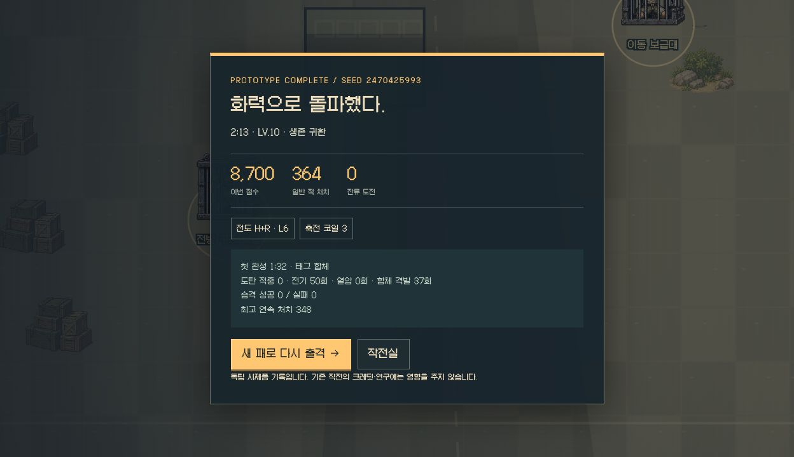
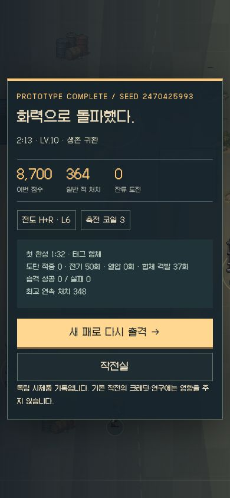

# RIFT 0.1 b03 — 실제 브라우저 완주와 화력 전달 보정

2026-11-06 · [구현 범위](REBOOT-PROTOTYPE.md) · [전체 설계](REBOOT-DESIGN.md)

**인앱 브라우저에서 두 빌드로 보스 격파 → 생존 귀환 → 결과 저장 → 로비 기록 반영까지 확인했다.** 자동 사격의 실제 적중과 다중 표적 전달을 고쳤고, 보급의 후보 통제와 다음 투자 안내를 보강했다. 마르코·전체 작전·연구 경제로 범위를 확장하지 않았다.

## 브라우저에서 확인한 두 판

| 경로 | 실제 선택과 최종 무장 | 첫 완성 | 귀환 | 결과 |
| --- | --- | --- | --- | --- |
| 단일 진화 / seed2073330339 | H 산개 도탄 → 사중 기관포 + 도탄기3 | 0:57 | 1:20 / LV7 | 171처치 · 6,910점 · 도탄266적중 |
| 태그 합체 / seed2470425993 | H 유탄 급탄 + R 추적 다탄두 → 전도 H+R + 축전3 | 1:32 | 2:13 / LV10 | 364처치 · 8,700점 · 전기50회 · 합체 격발37회 |

합체 판의 화면 관찰은 `1:32 / 229 K.O.` → `1:41 / 287 K.O.`였다. 합체 뒤 9초에 일반 적 58명을 처치했다. 주변 일반 공세와 완성 증원이 함께 있으므로, 이를 합체만의 추가 피해나 다른 빌드 대비 배율로 해석하지 않는다.

두 판은 다른 시드·투자·이동을 사용했다. 시간을 맞춘 통제 실험이나 효율 순위표가 아니다. 합체 판은 중간 도구 연결 복구와 저장 복귀도 포함했다. 시험 중 HP·XP·장비·보스 HP·RNG를 브라우저에 주입하거나 결과를 직접 저장하지 않았다.

전장에 실제 표시된 SVG 지도와 카드/HUD를 읽어 일반 키·카드 클릭으로 진행한 자동 입력과 수동 이동을 섞었다. 합체 보스전 후반은 직접 돌진 옆 회피·후면 사격으로 마무리했다. 첫 단일 진화 시도는 입력 경로가 차체를 가로질러 사망했고, 이후 경로에서 차체를 우회해 완주했다. 자유 플레이 사용자의 재미나 재출격 의사를 측정한 실험으로 세지 않는다.

원본: [브라우저 결과·관찰 기록](design/reboot-browser-v002.json). 일부 입력 로그는 연결 복구 이후 구간부터 남아 있으므로 전체 입력 재현 파일은 아니다. 최종 결과 텍스트와 화면은 두 판 모두 저장했다.

## 왜 화력이 답답했는지와 수정

| 확인한 문제 | b03 동작 | 검증 |
| --- | --- | --- |
| 조준은 발 좌표인데 탄 시작점만18px 위여서 수평 탄이 가장자리를 스침 | 투사체·충돌은 지상면 좌표, 렌더만 총구 높이로 표시. 적탄도 같은 좌표 계약 적용 | 작은 횡이동 표적 명중 회귀검사, 실제 전투 |
| H4발이 한 표적에 몰리고 R도 중복 표적을 배분 | 사선·사거리 유효 표적을 유지하고 살아 있는 다른 표적에 다중탄 분배. 표적이 부족할 때만 중복 | H4발/R3발의 실제 서로 다른 target 검증 |
| 가장 가까운 외톨이만 향하는 F | 제한된 후보 각도에서 부채 안 유효 군집을 비교 | 가까운1명 대신 뒤쪽10명 타격 검사 |
| 합체 탄두가 플레이어 위치에서 임의 적에게 다시 출발 | 적중 지점에서 가까운 생존 표적으로 격발. 없으면 그 지점에서 폭발. 계승 분화 유지 | 발사 원점·표적·재귀 발동 금지 검사, UI 격발37회 |
| 이동 중 적이 한 점에 겹침 | 공간 버킷으로 이웃 분리. 틱당 보정 상한과 벽 충돌 유지 | 겹친 분대의 간격 회복·순간이동 제한 검사 |
| 비전투 모듈3만으로도 연계 완성 처리 | 서로 다른 연소/폭발 총 각L4 + 촉매3을 공통 판정으로 사용 | 자기 회수기3·단일 R 점화의 오완성 방지 검사 |

일반 적은 쓰러질 때 기울며 사라지고 합체 격발은 청록색 파동·탄으로 구분한다. 피해 숫자나 적 HP를 몰래 조정해 시연을 통과시키지 않았다. 보스 HP6000, 돌진·회복·부위 공략, 보스 진입의 무문턱 규칙은 유지했다.

## 다른 빌드를 고를 정보와 통제권

- 새 총 카드에서 즉시 공격 문법과 L4 갈림길을 읽는다. 모듈 카드는 어떤 진화·합체·연계와 연결되는지 안내한다.
- 조립 화면은 단일 진화·전도 합체·열압 연계의 현재 조건을 함께 보여준다. 무장 두 개를 소비하는 합체와 생존 정비의 조율권 비용도 함께 보인다.
- 완성 증원은 HUD에 별도 화력 전개와 투입 수로 표시한다. 증원 전멸을 보스 진입 조건으로 만들지 않는다.
- 재추첨2·제외1은 **XP/무기 보급/선택 무기고/습격 보상 사이에서 공유**한다. 모듈 상자는 같은 품질과 강화량을 유지하며 내용만 바꾼다. 보스·조립에는 쓸 수 없다.
- 로비에서 지난 빌드·전투 보고를 다시 열 수 있다. 기록 열람은 활성 판을 덮어쓰지 않는다. 최고 점수8,700과 최단 귀환1:20이 서로 독립적으로 유지되는 것도 확인했다.

초기 파일럿의 fire/seed109는 재추첨을 XP에 소모하고 촉매를 얻지 못한 채 기본 무장으로 완주했다. 이 실패를 숨기거나 촉매를 강제 지급하지 않았다. 모듈 상자에서도 후보를 제외하는 선택권을 열고, 파일럿이 공개된 같은 예산에서 해당 제어를 사용하도록 했다. 이후 같은 seed109는 제외1·재추첨2를 사용해 촉매3 연계를 만들었다. 원하는 빌드를 모든 임의 시드에서 보장했다는 뜻은 아니다.

## 검사와 실제 조작 범위

| 항목 | 결과 |
| --- | --- |
| 전체 검사 | 281/281 — 기존242 + 독립 전투39 |
| 정적 빌드·Pages 하위 경로 | 성공 / 4/4 |
| 모델 파일럿 | 4시드×3정책, 12생존 귀환 / 막힘0 |
| 실제 경로 | 단일 진화4/4 · 합체4/4 · 촉매3 연계4/4 |
| 모델 파일럿 길이 | 51.8–95.7초. 브라우저 시간과 별도 측정 |
| 데스크톱 | 두 빌드 완주·귀환·재출격·기록 재열람·새로고침 유지 |
| 저장/입력 | 출격 저장 중 Esc도 예약 처리, 0:00/HP100에서 정지 확인. 모달 입력은 해제 |
| 390×844 | 귀환 결과·보고서·로비, 가로 넘침0. 결과 버튼332×48 세로 배치 |
| 브라우저 오류 | 최종 console error/warn 없음 |

최종 모델 원본: [12판과 제어 사용량](design/reboot-pilot-v002.json). 모델 파일럿은 전장 상태를 읽는 강한 회피 정책이다. 브라우저 입력 파일럿과 구분하며, 둘 다 초보자 생존율이나 자연스러운 빌드 분포를 나타내지 않는다. 테스트 시드에 맞춰 보상 결과를 조작하지 않았다.

사람의 자유 선택 세 판, 군집·이동 정예·장갑의 동일 투자 비교, 낮은/높은 HP의 습격 손익 비교, 실제 휴대폰 두 손 장시간 조작은 남아 있다. 현재 결과로 세 구역·추가 대원·연구를 대량 제작하거나 공개 기본 주소를 교체하는 기준을 통과 처리하지 않는다.
