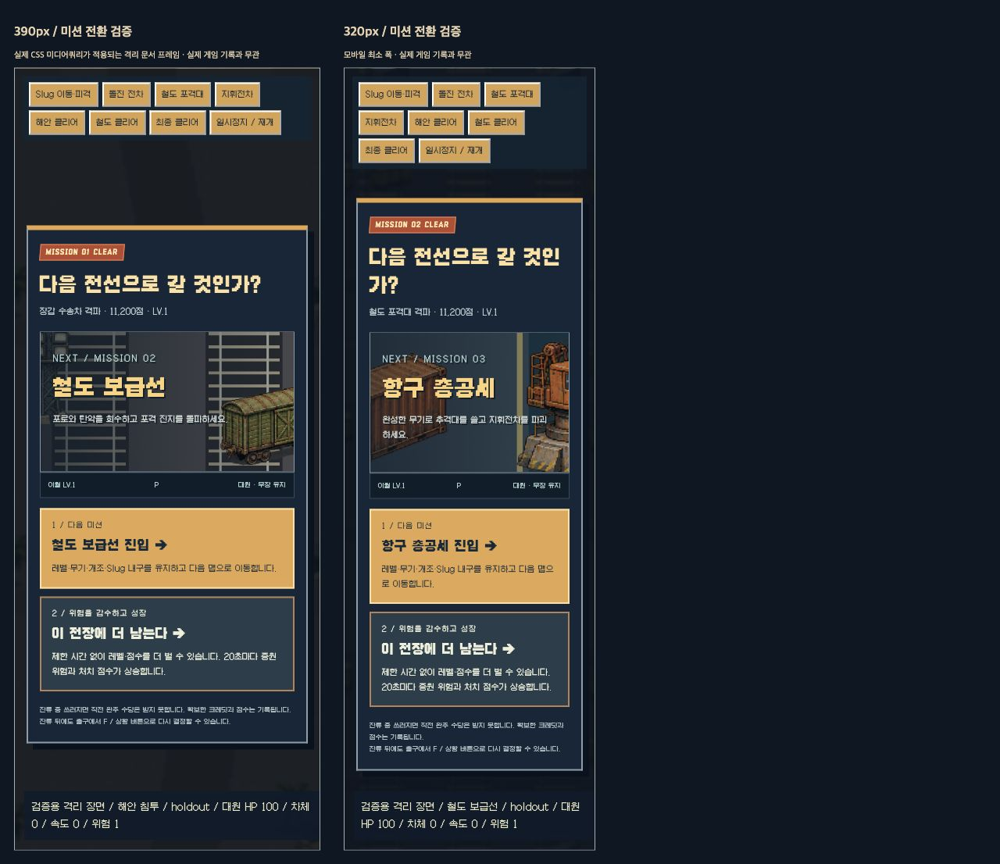

# 0.15 구현·검증 기록

기준: [진입·잔류 기획](MISSION-LOOP-V015.md). 이전 0.14 구현은 [별도 기록](VALIDATION-V014.md)으로 보존한다.

## 구현

- 보스 격파와 맵 이동을 분리했다. 중간 보스 보급 뒤 진입/잔류를 선택한다. 최종 보스 뒤에도 잔류/완주 귀환을 고른다.
- 잔류는 XP·레벨·점수를 계속 제공한다. 20초마다 위험이 증가하며 위험 3부터 맵별 포격·탄막과 장교 증원이 생긴다. 출구는 계속 사용할 수 있다.
- 잔류 중 남은 보급도 회수한다. 이미 보스를 잡은 뒤 회수한 포격 진지의 교란은 현재 맵의 잔류 공격을 줄인다.
- 해안·철도·항구의 지면·시설 구성, 다음 장소 미리보기와 진입 배너를 구분했다. 새 맵 진입 시 현장 적·탄·거점은 교체하고 성장과 차체 내구는 이월한다.
- 대원 HP / Slug 내구를 동시에 표시한다. 차체 피격과 대원 피격을 구분하고 차체 파괴 시 초과 피해 없이 긴급 이탈한다.
- 회전 가능한 [차체·포탑 분리 원화](MISSION-ART-V015.md), 가속·제동·선회·궤도·발사 반동을 넣었다. 보스도 돌진의 가감속과 포탑의 추적/반동을 표현한다. 후면 약점·차체 부품 위치가 렌더 방향과 일치한다.
- 보스와 대원을 함께 담도록 전투 카메라를 조정했다. 보이는 목표 위에는 불필요한 방향 화살표를 겹치지 않는다.
- 전투 점수, 잔류 실적, 신기록, 로비 최고 점수/최고 시간을 연결했다.

## 자동 검사

- `npm test`: **240/240** 통과.
- `npm run test:mission`: **74/74** 통과.
- `npm run build`: 통과.
- `npm run test:pages`: **4/4** 통과. 새 차량 PNG 및 `motion.js`/`route.js`의 전이 import 버전도 포함한다.
- `git diff --check`: 통과.

주요 회귀 시나리오: 클리어 뒤 잔류/재진입, 최종 귀환, XP 지속·위험 증가, 상한 밖 추가 점수, 저장 복원, 일반 사망 및 보스와 동시 사망, 출구 무적 반복 방지, 결과 저장 중단·정산 중복 방지, 장갑의 적탄/접촉/폭격 흡수와 파괴 후 대원 HP 보존, 이동 관성·제동·경계·정지, 돌진 총 거리·부위 위치.

Pages 테스트의 첫 실행은 샌드박스의 로컬 서버 바인딩 제한으로 실패했다. 허용된 로컬 테스트 실행으로 다시 확인하여 통과했다. 게임 코드 오류로 처리하지 않았다.

## 정상 입력만 쓰는 전체 주행

체력·총·돈·시계를 주입하지 않는다. 모델의 일반 이동·회피·스킬·상호작용·선택 API를 사용한다. 초기 계정, 마르코/피오, 시드 17/71.

| 주행 | 결과 | 관찰 |
| --- | --- | --- |
| 기본 8판 | **8완주**, 222.7~306.8초 | 도보/Slug 모두 세 맵 진입과 최종 귀환. LV.19~21 |
| 합체 목표 12판 | **12완주**, 목표 합체 **11/12** | 마르코·시드17의 H+R 목표는 필요한 H 보급이 나오지 않아 P+R로 완주. 나머지는 목표 합체 완료 |
| 맵별 90초 이상 잔류 8판 | **8완주**, 490.4~607.9초 | 누적 잔류 271~342초, LV.29~31, 최고 위험 5~8. 잔류 뒤 출구를 찾아 다음 맵과 최종 귀환까지 진행 |

- [기본 주행 데이터](design/mission-pilot-v015.json)
- [합체 목표 데이터](design/mission-builds-v015.json)
- [장기 잔류 데이터](design/mission-holdout-v015.json)

장기 주행은 처음 600초의 **검증 도구 상한**에서 2판이 미완료였다. 제품에 제한 시간이 있는 것이 아니며, 도구 상한을 900초로 늘려 두 판도 603.6/607.9초에 출구와 귀환을 확인했다. 적을 피하려는 자동 조종기가 밀집 증원 속에서 출구까지 돌아가는 데 더 걸렸다.

## 화면·조작 확인

Codex 인앱 브라우저에서 실제 게임의 출격·전술기·이동·일시정지를 확인했다. 기존 기지 재화와 연구를 유지했다.

동작/전환 장면은 정상 플레이와 분리한 `work/mission-lab.html`에서 동일한 렌더러·경로 화면을 사용해 확인했다. 이 장면에는 명시적인 fixture 상태가 있으며 실제 플레이/기록 검증으로 세지 않는다. Slug 차체 120→113 피격 시 대원 HP 73 유지, 차체/포탑 방향, 돌진 보스와 대원 프레이밍, 미션 분기와 진입 배경을 확인했다.

390·320px 문서 프레임에서 실제 CSS 미디어쿼리로 분기 화면을 렌더했다. 잔류 → 출구 F → 경로 재선택도 확인했다. 브라우저 viewport override가 실제 너비에 적용되지 않아, 그 결과를 모바일 검증으로 세지 않고 폭이 고정된 문서 프레임을 사용했다.

## 저장과 검토

- 규칙 버전 `operation-0.15.0`. 기지 재화·훈련·연구·교범과 과거 기록을 유지한다. 이전 0.13/0.14 진행 중 판의 확보 수당을 이전 계약에 맞춰 복구 정산한다.
- 독립 검토에서 동시 사망 후 부활, 잔류 무적 갱신, 귀환 결과 체크포인트의 패배 복구를 발견해 수정하고 재현 검사를 추가했다. 후속 검토에서 잔류 포격 진지의 무효 선택도 찾아 실제 잔류 공격 억제로 바꿨다.
- 최종 귀환은 결과 상태를 중간 체크포인트로 저장하지 않고 정산을 원자적으로 저장한다. 저장이 중단되면 마지막 경로 선택부터 다시 결정할 수 있다.

## 남은 판단

규칙이 돌아간다는 결과만으로 “한 판 더 하고 싶다”를 입증하지 않는다. 이번 버전의 사람 플레이에서는 **완성 빌드로 자발적으로 잔류하는가 / 압박이 생기면 출구를 노리는가 / 다음 판에 바꿀 빌드를 떠올리는가**를 본다. 모든 시드에서 원하는 합체가 보장되지는 않는다. 실제 모바일 두 손 동시 조작, 저사양 장시간 성능, 장기 고득점의 체감 난도는 추가 확인 대상이다. 세 미션 이후의 새 캠페인은 아직 없다.

## 0.15.1 공개 사이트 — 최종 귀환부터 다음 빌드까지

2026-11-06, 이전 계정의 `5078f4f` 배포에서 확인했다. 현재 서비스 주소는 [유승원 GitHub Pages](https://seung-won-yu.github.io/woodland-survivors/)로 이관했다. 앞서 해안 잔류와 철도→항구 전환까지 진행한 **동일한 저장 판**을 이어 했다. 인앱 브라우저에서 이동·전술기·선택·귀환·연구·재출격을 직접 조작했으며, 재화·무장·체력·시계·시드를 주입하지 않았다.

| 단계 | 실제 화면 결과 |
| --- | --- |
| 항구 저장 판 복원 | 피오, LV.14, H+R 합체, 대원 100/100, Slug 19/120, 2:19 |
| 최종 보스 격파 | 포탑·장갑 파괴 뒤 코어 공략. 2:48에 MISSION 03 CLEAR. 대원 100/100, Slug 12/120 |
| 자발적 완주 귀환 | A등급, **63,060점**, 일반 적 1,523처치, 중간 보스 2/2, 진화·합체 처치 1,246 |
| 잔류 결과 이월 | 0:21, 최고 위험 2, 추가 점수 9,640 |
| 정산 | 작전 목표 440C + 반복 수당 871C + 최초 보너스 300C = **1,611C** |
| 보상으로 연구 | H 도탄 240C → H 축전 탄창 360C. 잔액 **1,011C** |
| 페이지 새로고침 | 연구 완료·잔액·최고 점수·최고 시간 유지. 중복 지급 없음 |
| 다음 판 | 피오로 새 출격. LV.2 H 1단계, 전방 보급에서 H 2단계, LV.3 H 도탄, LV.4 H 축전 탄창 장착 |
| 빌드 적용 | HUD에 **도탄 전력망 · 도탄 적중도 축전 충전** 표시. 새 판 0:18, 60처치 후 정상 저장·기지 복귀 |

연구는 영구 해금이고 전장에서 다시 장착하는 구조다. 이번 판은 앞 판의 H+R 합체와 달리 H 도탄·축전 연계를 먼저 선택했다. 공개 UI에서 두 개조의 제시·장착·조합 표시와 플레이를 확인했다. 축전의 정확한 18적중 충전·범위 피해 수치는 기존 모델 회귀 검사로 검증하며, 화면의 충전 수치만으로 다른 충전 원인과 분리해 측정했다고 주장하지 않는다.

0.15.1 기존 전체 검사 **242/242**, 미션 **76/76**, Pages **4/4** 및 빌드가 통과한 배포다. 이번 확인에서는 게임 소스를 바꾸지 않았으므로 같은 검사를 반복 실행하지 않았다.

수동 증거는 `outputs/full-loop-v0151/`의 `final-boss-cleared.png`, `victory-settlement.png`, `research-purchased.png`, `ricochet-offered.png`, `capacitor-offered.png`, `new-run-researched-build.png`, `second-run-saved.png`에 보관했다. `outputs/`는 저장소의 기존 제외 정책을 따른다.

### 실제 플레이로 확인한 부족한 점

**순환은 동작하지만, 맵을 공략할 이유는 아직 약하다.** 첫 보급 뒤 중앙으로 바로 달려도 보스에 도전할 수 있다. 통신소와 수송대는 위치·그림이 달라도 접근→경비 제압→보급 선택이라는 행동이 같다. 지형 소품 대부분이 이동·사격에 영향을 주지 않아 경로 판단이 생기지 않는다. 완성 H+R 빌드는 최종 보스를 약 7초에 격파해 화력은 드러나지만, 마지막 전투의 대응 구간은 짧았다.

결과 화면도 수당 내역이 길어 새로 열린 개조와 재출격 목표가 아래로 밀린다. 연구 후 첫 성장에는 먼저 해당 무기 1단계를 골라야 하므로, “다음 작전 첫 전용 후보” 안내만으로는 개조가 언제 나올지 충분히 알기 어렵다.

### 다음 맵 개선의 좁은 검증안 — 아직 미구현

새 맵·재화·무기 수를 늘리기 전에 해안 한 곳의 두 경로를 실제로 다르게 만든다.

- **수송대 습격:** 움직이는 차량과 호위를 따라 교전한다. 지원 무기·합체 재료를 노리는 공격 경로다. 보상 위치가 차량을 따라가므로 한 점에서 대기하는 거점과 구분한다.
- **통신소 구출:** 구출 대상을 엄호하며 고정 구역을 확보한다. 보유 총의 연구 개조 또는 회복을 확정적으로 노리는 정비 경로다.
- 어느 경로도 보스 도전·기본 성장을 잠그지 않는다. 두 번째 경로는 선택적 추가 투자다. 지도에서 전투 방식과 보상 계열을 미리 읽을 수 있어야 한다.

성공 기준은 배경이 달라졌는지가 아니다. 같은 캐릭터로 두 판을 했을 때 **경로에 따라 이동·교전 행동과 보스에 가져가는 빌드가 달라지는지**, 그리고 보상 때문에 스스로 우회하는지를 본다. 이 검증 전까지 맵 게임성이나 반복 의욕이 개선됐다고 결론 내리지 않는다.
