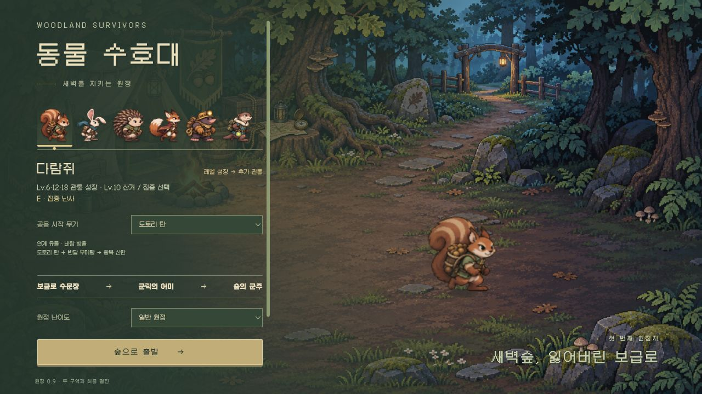

# 0.9 구현·검증 기록

2026-11-05. [게임 기획](GAME-DESIGN.md), [대원 성장](CHARACTER-DESIGN.md), [표현 기준](PRESENTATION-V09.md)의 초기 구현입니다. 아래 자동 조작은 실제 입력 정책의 모델 주행이며, 사람이 느끼는 재미·타격감의 입증과 구분합니다.

## 구현된 한 판

- 보급로 수문장 → 군락 심부의 어미 → 별도 수호목 공터의 군주. 세 보스가 다른 패턴·실루엣을 사용하며 마지막 군주만 승리로 판을 끝냅니다.
- 보스 도전은 처음부터 가능하고 레벨 권장은 안내입니다. 사냥 할당량·추가 XP 제한·정찰 강제 종료를 제거했습니다.
- 보스 보상 후 필드로 돌아와 출구에서 F로 이동합니다. 남은 XP는 자동 장비 선택 없이 성장 선택을 모두 마친 뒤 다음 구역에 반영합니다.
- 새 무기는 구역당 두 보급에서 얻습니다. 레벨업은 보유 무기·보조에 투자합니다. 보류·재방문·가득 찬 슬롯·합체 후 빈 슬롯을 처리합니다.
- 8단계+촉매+인장 진화, 두 재료 8단계+한쪽 진화 합체. 합체는 재료 두 개를 하나로 소비하고 선택한 핵심의 궤적을 사용합니다.
- 다람쥐·고슴도치의 Lv.6/12/18 자동 특성과 Lv.10 스타일 선택. 추가 숙련 자원이나 무기 4단계 분기 메뉴를 사용하지 않습니다.
- 최종전 치유 꽃은 독립 HP를 가진 공격 대상입니다. 꽃이 살아 있어도 군주에게 피해를 줄 수 있습니다.
- 버전·대원·스타일·난이도별 최고 기록, 보스 체크포인트, 첫 완주 과밀 도전. 최근 24회가 밀려도 최고 기록과 해금은 유지합니다.

## 규칙·호스팅 검사

`npm test`는 기존 130개와 새 원정 14개를 검사합니다. 새 검사 범위는 다음과 같습니다.

| 영역 | 확인 내용 |
| --- | --- |
| 진행 | 세 조우·중복 보상 방지·수동 출구·최종 종료·메뉴 시간 정지 |
| 성장 | 필드 새 무기·보류 후 같은 후보·XP 정산 대기열·Lv.10 한 선택 소비·모든 장비 완성 뒤 명시적 보너스 |
| 변환 | 인장·촉매·8단계 조건, Returning과 Hive 양 핵심의 소비·보유 상태·저장 복원·수량 상한 |
| 대원 | 실제 cast/서로 다른 표적 충전·초당 7 상한·Bram 차단 충전의 적별 상한·특성 용량 |
| 전투 | 진화 꿀벌의 동일 적 재공격을 한 번으로 제한, 무한 재타격 방지 |
| 기록·저장 | 보스 체크포인트·완주 구분·최근 목록 순환 후 최고 기록 유지·비정상 인장/기간/보급 거부 |

`npm run build`와 `npm run test:pages`로 정적 자산과 `/woodland-survivors/` 하위 경로를 확인합니다. 로컬 HTTP bind 제한으로 생긴 EPERM은 서버 수신 권한으로 재실행해 확인했습니다.

## 장비·HP 주입 없는 모델 주행

재현: `node scripts/journey-pilot.mjs --hero pip --seed 1437`. 보급 탐색, XP 회수, 카드·스타일·보스 보상 선택, 공방, 위험 회피, 출구 상호작용을 정상 API와 입력으로 수행합니다. 둥지는 건너뛰고 기본 비교에서는 제단·유물도 사용하지 않습니다. 아래 시간은 메뉴 정지가 제외된 **게임 시뮬레이션 시간**입니다.

기본 합체 경로의 시드 비교:

| 시드 | 다람쥐 집중·도토리 핵심 | 고슴도치 방벽·가시 핵심 |
| --- | --- | --- |
| 71 | 완주 280.7초 · HP 55 | 완주 282.9초 · HP 89.8 |
| 1437 | 완주 289.6초 · HP 85 | 완주 262.7초 · HP 99 |
| 2048 | 완주 317.8초 · HP 32 | 완주 288.6초 · HP 117 |

다른 스타일·핵심·비합체 비교(시드 1437):

| 경로 | 결과 | 최종 보스전 |
| --- | --- | --- |
| 다람쥐 산개·반달 핵심 합체 | 완주 259.8초 · HP 82 | 69.9초 |
| 다람쥐 집중·도토리/반달 양쪽 진화 | 완주 281.7초 · HP 84 | 53.0초 |
| 고슴도치 방벽·가시/꿀벌 양쪽 진화 | 완주 307.3초 · HP 86.6 | 82.4초 |
| 고슴도치 반격·가시/꿀벌 양쪽 진화 | 완주 304.7초 · HP 96.5 | 77.0초 |
| 고슴도치 반격·꿀벌 핵심 합체 | 완주 264.3초 · HP 1.1 | 43.5초 |

11개 경로에서 세 보스 격파와 목표 빌드 완성을 관찰했고 실행 오류는 없었습니다. 꿀벌 핵심의 마지막 비교는 거의 사망한 사례로, 모든 조합이 쉬운 상태는 아닙니다. 고슴도치의 첫 보스전은 시드 2048에서 101.4초로 길었습니다. 단일 시드의 최적화로 균형을 단정하지 않습니다.

초기 비교에서는 고슴도치 비합체 경로가 두 번째 보스에서 패배했습니다. 진화 꿀벌이 이미 적중한 같은 보스만 맴돌던 시간을 줄이기 위해, 수명·관통 예산을 유지한 채 재공격을 한 번 허용하고 일반 진화 화력을 조정했습니다. 합체만 정답이 되는 병목을 줄인 이유입니다.

## 실제 브라우저 확인

Codex 인앱 브라우저에서 데스크톱과 390×844 세로 화면을 확인했습니다.

스타일 선택의 [모바일 캡처](images/v09-style-mobile.png)는 고정 검수실 화면입니다.

- 일반 원정 시작·이동·자동 전투·첫 레벨 강화·일시정지와 공방 진입.
- 실제 공용 UI를 쓰는 고정 검수실에서 두 대원 스타일, 진화→합체 소비, 전장 복귀, 군락과 최종전·치유 꽃 표시.
- 본문 줄바꿈·카드·버튼·스크롤과 기존 원화 유지, 무기·적·방향 표식의 가독성.
- 공개 Pages에서도 출전·이동·자동 전투와 0.9 버전을 확인했습니다. 기존 대원에는 없는 자동 성장 예고를 표시하지 않도록 고쳤습니다.
- 관찰한 화면에서 콘솔 오류 없음. 고정 검수실은 무적·장비 사전 배치를 명시하며 일반 원정 완주 증거로 사용하지 않습니다.

## 남은 품질 범위

- 8–12분은 사람의 탐색·카드 판단을 포함한 관찰 목표입니다. 최적 입력 모델은 약 4.3–5.3분에 완주했습니다. 목표 시간을 맞추려고 강제 대기를 추가하지 않습니다.
- 여덟 시작 무기 전체, 여섯 대원 전체, 과밀 난이도 전체의 균형을 동등하게 검증한 상태는 아닙니다. 이번 비교는 두 대원·두 합체와 비합체 대체 경로에 집중합니다.
- 첫 보스 장기전, 벌떼 귀환의 방어 공백, 실제 터치 조작 중 시야·피격 체감은 사람의 플레이로 추가 조정할 항목입니다.
- 수첩·설정은 브라우저에 저장하지만 진행 중 원정 복구 UI와 서버 순위표는 포함하지 않습니다.
